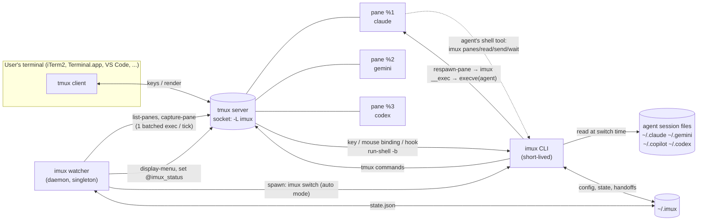
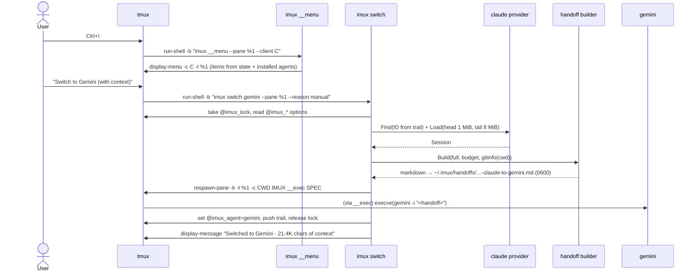
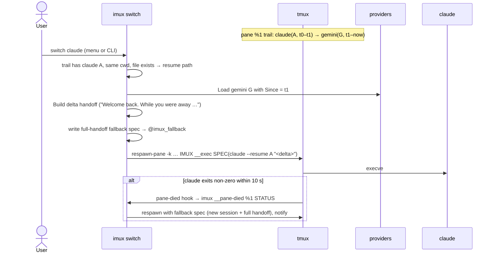
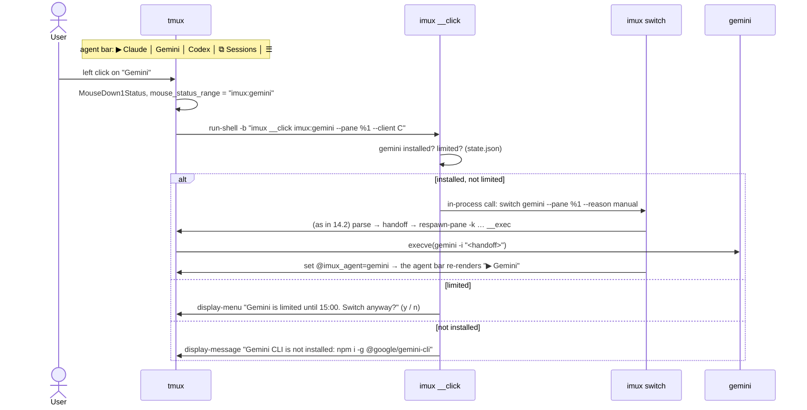

# i-mux: Architecture

> Status: implemented (M0–M8); the open questions in §20 are being closed by manual checks. Last updated 2026-11-06.
> Companion document: [TASKS.md](TASKS.md) (milestones and task plan).
> Naming: the product is i-mux; its command, config directory and environment prefix are `imux`, `~/.imux` and `IMUX_`.

---

## 1. Overview

i-mux is a very lightweight, tmux-based terminal workspace for AI coding CLIs:
**Claude Code**, **Gemini CLI**, **GitHub Copilot CLI** and, as a bonus, **OpenAI Codex CLI**.

Core user story:

> "I'm working in Claude Code, I hit my usage limit, and I want to continue the SAME
> conversation in Gemini CLI or Copilot CLI in the same terminal pane, with one keystroke
> and without re-explaining anything."

**Hard requirement: switching happens directly in the UI.**

- The user switches a pane's conversation to another agent with **one click** on the agent bar,
  or with one keystroke. The menu works with both mouse and keyboard (§9.3).
- The user can also browse earlier conversations of any agent and continue one of them from a
  picker. No command typing is needed for any of this.
- The CLI commands exist too, but the UI is the primary interface.

i-mux is a single static Go binary. All terminal work (PTYs, rendering, scrollback, keys) is
done by tmux on a dedicated socket. i-mux only:

1. starts and arranges agent CLIs in tmux panes,
2. reads the agents' on-disk session files when a switch happens and condenses them into a
   markdown **handoff document**,
3. relaunches the pane with another agent, passing the handoff as its initial prompt,
4. runs a tiny watcher that looks at the bottom of agent panes for usage-limit messages,
5. offers a small command set that lets agents talk to each other through tmux.

### Features

| ID | Feature | Summary |
|----|---------|---------|
| F1 | Context handoff | **From the UI:** click an agent in the agent bar, or pick it in the menu (`Ctrl+\`, `prefix a`, right-click on a pane border). **Automatic:** when a limit is detected (modes `ask` / `auto` / `off`, default `ask`). |
| F2 | Limits visibility | Per-agent OK / limited (with reset time) shown in the agent bar, plus an `imux limits` panel. |
| F3 | Multi-pane workspace | Several agents side by side, each pane labeled with its agent. |
| F4 | Agent-to-agent bus | Agents can list panes, read another pane, send it a message, and wait until it is idle. |
| F5 | Standalone handoff | `imux handoff --from claude --to gemini` in a plain terminal, or `--print` to output the document only. |
| F6 | Session picker | A menu listing recent conversations of all agents for this project. Pick one, then continue it natively or in another agent with context. |

## 2. Goals and non-goals

### Goals

- **One click or one keystroke in the UI** to continue a conversation in another agent, in the
  same pane. No commands need to be typed.
- **Lightness is a hard requirement.**
  - Our code is never in the keystroke or render path; tmux (C) is.
  - The only long-running i-mux process is the watcher: under 15 MB RSS and about 0% CPU when idle.
  - i-mux adds no per-pane resident processes.
- **Zero runtime dependencies besides tmux.** Users never need Go, Node or Python for i-mux itself.
- **Never touch the user's own tmux setup** (separate socket, generated config).
- **Robust against format changes.** Parsers degrade to partial output with warnings and never crash.
- **Privacy by default.** Everything stays local. Handoff files are 0600. Nothing is logged from screens or transcripts.

### Non-goals

- **Re-implementing a terminal multiplexer.** tmux does all PTY and rendering work.
- **Calling model APIs directly**, or reusing CLI subscription OAuth tokens to call models.
  That is against provider terms; we only orchestrate the official CLIs.
- **Converting a session into another CLI's native session format.**
  - Tool schemas differ between CLIs.
  - Claude's thinking blocks are signed and cannot be given to other models.
  - We inject a condensed markdown handoff instead: lossy, but robust.
- **Reading provider usage endpoints** in v1 (no undocumented APIs). This may become an opt-in module later.
- **Windows.** WSL works if tmux works there; it is not a target.

## 3. Key decisions

| # | Decision | Rationale |
|---|----------|-----------|
| D1 | **Go + tmux, one static binary** (`CGO_ENABLED=0`) | Small idle footprint, trivial cross-compilation, same proven architecture as claude-squad and agent-deck. Writing our own multiplexer is avoided. |
| D2 | **Dedicated socket `tmux -L imux`** with a generated `~/.imux/tmux.conf` | Isolation from the user's tmux. The user's own overrides go in `~/.imux/tmux.local.conf`, which is sourced last. |
| D3 | **Handoff = condensed markdown passed as the target CLI's initial prompt** | Works with every CLI that accepts an initial prompt. No dependency on internal session formats of the *target*. |
| D4 | **Returning to an agent that already has a native session in this pane resumes it natively** (`claude --resume <id> "<delta>"`), plus a *delta* handoff | Full fidelity on the way back; only what happened elsewhere is summarized. |
| D5 | **Limit detection by polling the screen** (every ~2.5 s, the last 25 non-blank lines of the visible screen, agent panes only) | Agents redraw spinners constantly, so streaming output (`pipe-pane`) would cost CPU around the clock. |
| D6 | **One `tmux` exec per tick, batched** (`cmd1 \; cmd2 \; …`), and **skip unchanged screens by hash** | Keeps the watcher's CPU near zero regardless of pane count. A control-mode client (`tmux -C`) is a later optimization, used only if measurements require it (§17). |
| D7 | **The watcher sleeps when no client is attached and exits when the i-mux tmux server is gone** | No work when nobody can see a prompt anyway. A `client-attached` hook wakes it. |
| D8 | **Session files are parsed only at switch time**, reading a bounded head and tail window | Long Claude sessions are tens of MB (the largest local file is about 64 MB). |
| D9 | **Agents are launched through `imux __exec <spec-file>`**, which replaces itself (`execve`) with the agent | No shell quoting at all (tmux runs multi-argument commands without `sh -c`, verified in the tmux 3.8 man page). No tmux command-size limit, because the prompt lives in a 0600 file. Correct `PATH` for nvm-installed CLIs. Zero resident cost. This replaces the brief's `exec <bin> "$(cat file)"` idea. |
| D10 | **Pane lifecycle via `remain-on-exit on` + a `pane-died` hook** instead of a wrapper shell or supervisor | Fallback when a resume fails fast, and a drop back to a shell when an agent exits. No process stays resident per pane. |
| D11 | **Pre-assign Claude session IDs** with `claude --session-id <uuid>` (verified in 1.0.110 `--help`) | Deterministic mapping from pane to session file for Claude, the most common source. Other agents use time + cwd discovery. |
| D12 | **Config in TOML** (`~/.imux/config.toml`); machine state in JSON (`state.json`) | Regex patterns are hand-edited: TOML literal strings (`'…'`) need no backslash escaping, while JSON would need `"\\d"`. TOML also allows comments (self-documenting defaults) and is familiar from Codex's `config.toml`. Cost: one small pure-Go dependency, `github.com/BurntSushi/toml`. |
| D13 | **Dependencies: stdlib + BurntSushi/toml only.** No CLI framework, no YAML library, no SQLite driver | Small binary and less supply-chain surface. `workspace.yaml` (Copilot) needs only top-level scalars, so a 30-line reader suffices. SQLite is avoided (see Q5). |
| D14 | **All UI strings in one catalog** (`internal/i18n`), English first | The primary user is Turkish; a `tr` catalog can be added without touching call sites. The handoff preamble is model-facing and always English. |
| D15 | **Distribution:** GoReleaser (darwin/linux × arm64/amd64), `install.sh` (installs tmux if missing), Homebrew tap with `depends_on "tmux"` | Users never need Go. |
| D16 | **The UI is built only from tmux-native elements:** a clickable second status line (`status-format[1]` with `#[range=user\|…]` regions), `display-menu` (mouse and keyboard), `display-popup` and pane border labels. No TUI framework. | tmux draws everything and handles mouse and keys, so nothing of ours stays resident and the lightness budget holds. tmux 3.8 supports `range=user\|X` (verified in its man page): a click fires the `MouseDown1Status` binding with `X` in `#{mouse_status_range}`. |
| D17 | **The primary UI is a sidebar pane on the left of each window** (added 2026-11-07, at the user's request, after the bottom agent bar): a small `imux __sidebar` process drawing with ANSI escapes and reading keys and SGR mouse events, no TUI library. The agent bar stays as an option (`tmux.agent_bar`). | A sidebar can show what a status line cannot: every pane's agent and state, the switch targets, split buttons and help, all clickable. A familiar agent-workspace layout, built on tmux. Cost: one resident process per window (~6 MB, no CPU while idle: it sleeps until a tmux hook or the watcher signals it). |
| D18 | **The handoff stays in its file; the agent gets a two-line message pointing to it** (added 2026-11-07, v0.6): `[i-mux handoff · A → B · time]`, one sentence in the user's language and the file's path. The agent reads the file with its own tools; `--add-dir` lets Claude, Copilot and Antigravity read `~/.imux/handoffs` without asking. `handoff.deliver = "inline"` keeps the old behavior. | The user saw the whole 30 000-character document as their own first message: a wall of text in the pane. The file is 0600, so the document also leaves argv (no process-list exposure, no argv size limit). Cost: one file read by the agent. Chained handoffs follow the path back to the file. |
| D19 | **The sidebar is a full agent workspace UI** (added 2026-11-07, v0.7, at the user's request; our extra is moving a chat to another CLI): Projects (letter avatar, branch, roll-up status) above Agents grouped by project (icon, name, time since the state changed, status), and a "Continue this chat in" block for the switch. States: **Needs you** (the agent asks something), **Done** (finished while you looked elsewhere), working (spinner), idle (ring). | The sidebar answers "what needs me?" at a glance, and adds what other agent workspaces lack: moving the chat. imux keeps reading the screen it already captures: a question on a still screen is "Needs you", a working → idle change the user has not looked at is "Done". |
| D20 | **Tabs: a project holds tabs, a tab holds panes** (added 2026-11-07, v0.8, at the user's request). A tab is a tmux window; a tab bar at the top (the status line, `status-position top`) shows each tab's number, name and most urgent state, and a **+** that asks which agent the new tab starts with. | One project, several tasks: each task gets its own tab with its own agents and sidebar, instead of one crowded window. tmux windows already are tabs; only the bar and the naming are new. |
| D21 | **Long-running imux processes restart themselves after an upgrade** (v0.8): the watcher and each sidebar compare the imux binary's size and mtime with the ones they started from and `exec` the new binary when it changed; the restarted watcher rewrites the tmux config. | The user saw an old version keep running after the one-line install ("0.5.0 shows up out of nowhere"): the daemon and the sidebars of sessions started earlier never restarted. |

## 4. Components



| Component | Lifetime | Responsibility |
|-----------|----------|----------------|
| tmux server (`-L imux`) | while sessions exist | PTYs, rendering, scrollback, key bindings, menus, popups, pane options. |
| `imux` CLI | per command | Start/attach, switch, split, handoff, limits, bus, doctor. Also invoked by tmux key bindings and hooks via `run-shell -b`. |
| `imux __exec` | milliseconds | Reads a launch spec, sets env/cwd, `execve`s the agent. Gone afterwards. |
| `imux __watch run` | while the i-mux server lives | Limit detection, status bar, `ask` / `auto` actions. |
| Session providers | in-process | Find and parse the four agents' session stores into a common model. |
| Handoff builder | in-process | Budgeted markdown rendering from the common model plus repository state. |

## 5. Go package layout

```
imux/
├── cmd/imux/main.go              # tiny: calls internal/cli.Main(os.Args)
├── internal/
│   ├── cli/                      # subcommand dispatch (stdlib flag), help text, exit codes
│   ├── config/                   # TOML load, defaults, merge, validation (regex compile)
│   ├── paths/                    # IMUX_HOME, dir creation with perms, umask
│   ├── state/                    # state.json: flock + atomic write; limits, bin cache, notices
│   ├── i18n/                     # message catalog (en; tr later), T(key, args...)
│   ├── agent/                    # agent registry: IDs, display names, default launch templates,
│   │                             #   binary resolution + PATH capture, install hints
│   ├── session/                  # common model (§6), Provider interface, Ref, helpers
│   │   ├── jsonl/                # bounded head/tail reader, reverse line scanner, safe decode
│   │   ├── claude/
│   │   ├── gemini/
│   │   ├── copilot/
│   │   └── codex/
│   ├── handoff/                  # builder, budget allocator, renderer, marker/chain parsing,
│   │   ├── toolsum/              #   generic tool-call summarizer
│   │   ├── clean/                #   wrapper-tag stripping, middle truncation (UTF-8 safe)
│   │   └── redact/               #   best-effort secret redaction
│   ├── gitinfo/                  # branch, status --short (capped), diff --stat; timeouts
│   ├── tmux/                     # exec wrapper (-L socket), batching, format parsing, errors,
│   │                             #   tmux.conf generator, version check
│   ├── workspace/                # start/attach/split/switch, pane options, trail, menus,
│   │                             #   pane-died handling, launch specs
│   ├── launch/                   # __exec implementation (spec read, env, argv limits, execve)
│   ├── watch/                    # daemon: pidfile lock, loop, detector, actions, status bar
│   ├── limits/                   # pattern sets, reset-time parsing, usage stats, panel render
│   └── bus/                      # panes/read/send/wait, target resolution, idle detection
├── testdata/                     # SYNTHETIC fixtures only (see TASKS.md, testing strategy)
├── e2e/                          # end-to-end tests: separate tmux socket, fake agents
│   └── fakeagents/               # shell scripts that record argv/env and print screens
├── scripts/                      # measure-watch.sh, gen-large-fixture, etc.
├── .goreleaser.yaml
├── install.sh
├── ARCHITECTURE.md
└── TASKS.md
```

Dependency rules:

- `session/*` must not import `tmux`, `workspace` or `watch`. Parsers are pure.
  `imux handoff --print` therefore works without tmux.
- `handoff` depends only on `session`, `gitinfo` and `i18n`.
- Only `workspace`, `watch` and `bus` talk to tmux.

## 6. Common data model

```go
package session

type AgentID string

const (
	Claude  AgentID = "claude"
	Gemini  AgentID = "gemini"
	Copilot AgentID = "copilot"
	Codex   AgentID = "codex"
)

// Ref identifies a session on disk without parsing it.
type Ref struct {
	Agent     AgentID
	ID        string    // native session id (a UUID for all four agents)
	Path      string    // file (Claude, Gemini, Codex) or directory (Copilot)
	CWD       string    // may be "" until parsed
	StartedAt time.Time
	UpdatedAt time.Time // file mtime
	Size      int64
}

// Session is the agent-neutral result of parsing.
type Session struct {
	Ref
	Model      string          // last real model seen (Claude "<synthetic>" ignored)
	GitBranch  string
	Entries    []Entry         // chronological; superseded and excluded lines removed
	Omitted    int             // entries known to exist but not included (outside window, compacted)
	Compaction *Compaction     // latest compaction, if any
	Todos      []Todo          // latest task-list snapshot
	Files      FileActivity
	Usage      Usage
	Errors     []APIError      // never in Entries; used for the switch reason and limits
	Chained    *ChainedHandoff // set when the first user message is an imux handoff
	Warnings   []string        // non-fatal parse problems ("312 unknown lines skipped", ...)
}

type Role uint8

const (
	RoleUser Role = iota
	RoleAssistant
	RoleNotice // CLI info/warning lines, compaction summaries
)

type EntryKind uint8

const (
	KindMessage EntryKind = iota
	KindSlashCommand   // "/name args"
	KindCompactSummary // text of a compaction summary
	KindHandoff        // an imux handoff document (excluded from Conversation, parsed into Chained)
)

type Entry struct {
	Role  Role
	Kind  EntryKind
	At    time.Time
	Text  string     // cleaned text, may be empty for tool-only turns
	Tools []ToolCall // tool calls issued in this assistant turn, in order
}

type ToolCall struct {
	Name   string
	Args   map[string]any // decoded; JSON-string arguments (Codex) are decoded too
	Failed bool           // when the result says so (Copilot success=false, Gemini status=error, ...)
}

type TodoStatus uint8 // Pending, InProgress, Done, Blocked

type Todo struct {
	Text   string
	Status TodoStatus
}

type FileActivity struct {
	Edited    []string // deduped, ordered by last touch
	Created   []string
	Read      []string // capped sample
	ReadCount int
}

type Usage struct {
	InputTokens, OutputTokens        int64
	CacheReadTokens, CacheWriteTokens int64
	Replies                           int     // assistant API messages (Claude: deduped by message.id)
	PremiumRequests                   float64 // Copilot
	RateLimits                        *RateLimitSnapshot // Codex, when present
}

type RateLimitSnapshot struct {
	At                   time.Time
	PrimaryUsedPercent   float64
	PrimaryResetsAt      time.Time
	SecondaryUsedPercent float64
	SecondaryResetsAt    time.Time
}

type APIError struct {
	At   time.Time
	Code string // e.g. "rate_limit", "authentication_failed"
	Text string
}

type Compaction struct {
	At      time.Time
	Trigger string // "auto" | "manual"
	Summary string
}

type ChainedHandoff struct {
	From, To        AgentID
	At              time.Time
	OriginalRequest string
	History         string // the earlier doc's "Earlier history" + "Conversation", as text
}
```

Provider interface (one implementation per agent):

```go
type Provider interface {
	Agent() AgentID
	// Find lists candidate sessions, newest first. Never reads whole files.
	Find(ctx context.Context, q Query) ([]Ref, error)
	// Load parses one session. Malformed input never panics; problems go to Session.Warnings.
	// An error is returned only when nothing usable could be read.
	Load(ctx context.Context, ref Ref, opt LoadOptions) (*Session, error)
}

type Query struct {
	CWD   string
	ID    string    // exact id when known (trail, --session)
	Since time.Time // ignore sessions not updated since (pane start time)
	Limit int
}

type LoadOptions struct {
	HeadBytes int64     // default 1 MiB: original request, metadata
	TailBytes int64     // default 8 MiB: recent history, latest todos
	Since     time.Time // delta mode: only entries after this time
}
```

Workspace state attached to each pane as tmux user options (§9.4):

```go
type TrailEntry struct {
	Agent     session.AgentID `json:"a"`
	Start     int64           `json:"s"`           // unix ms
	End       int64           `json:"e,omitempty"` // unix ms; 0 = current
	SessionID string          `json:"id,omitempty"`
	File      string          `json:"f,omitempty"`
	Handoff   string          `json:"h,omitempty"` // handoff file that seeded this run
	Resumed   bool            `json:"r,omitempty"`
}

// LaunchSpec is written to ~/.imux/launch/<rand>.json (0600) and consumed by `imux __exec`.
type LaunchSpec struct {
	Agent    session.AgentID
	Bin      string            // absolute path
	Args     []string          // fully expanded; includes the prompt in argv mode
	Dir      string
	Env      map[string]string // at least PATH
	Pane     string            // "%3"
	Fallback *LaunchSpec       // used by the pane-died hook when a resume fails fast
}
```

## 7. Agent adapters

All formats below are internal to their CLIs and may change in any release. Every parser:

- decodes one line (or document) at a time, ignores unknown fields and line types, and never panics;
- counts skipped and bad lines into `Warnings`;
- reads large files through `session/jsonl`: a head window (≤ 1 MiB, for the original request and
  metadata) plus a tail window (≤ 8 MiB). The tail starts at the first full line in the window.
  Single lines over 16 MiB are skipped with a warning.

Notes marked **[verified]** were checked on the dev machine on 2026-11-05 (§21). **[expected]**
means taken from the research brief or public knowledge but not seen locally. **[unverified]**
means a known unknown, tracked in §20.

### 7.1 Claude Code

- **Store:** `~/.claude/projects/<encoded-cwd>/<sessionId>.jsonl`; respect `$CLAUDE_CONFIG_DIR`.
- **Encoding** [verified for local paths]:
  - `<encoded-cwd>` is the absolute cwd with every non-alphanumeric character replaced by `-`.
  - All local project directory names match `^[A-Za-z0-9-]+$`; the longest is 166 characters.
  - Long-path behavior is [unverified] (Q7). Fallback: scan project folders for recent files
    whose first lines contain a matching `"cwd"`.
  - Project folders may also contain `memory/` and `<uuid>/` subdirectories. Ignore them.
- **Locating a pane's session:** i-mux launches Claude with `--session-id <uuid>`, so the path is
  known exactly. For sessions not started by i-mux (standalone handoff), take the newest
  `*.jsonl` in the encoded folder.
- **Lines** [verified on files written by Claude Code 2.1.x]:
  - `type ∈ {user, assistant, system, attachment, last-prompt, mode, queue-operation,
    file-history-snapshot, file-history-delta, api-request, api-request-blob, custom-title,
    ai-title, agent-name, cost-state, …}`.
  - Only `user`, `assistant` and `system` matter; ignore everything else.
- **Common fields** [verified]: `uuid`, `parentUuid`, `sessionId`, `timestamp`, `cwd`, `gitBranch`,
  `version`, `isSidechain`, `message`. Optional: `isMeta`, `isApiErrorMessage`, `error`, `isCompactSummary`.
- **Messages:**
  - `message.content` is a string or a list of blocks `text | tool_use{name,input} | tool_result | thinking`.
  - **Each assistant line holds exactly one block.** Lines of the same API message share
    `message.id` and carry identical `message.usage` [verified].
    - The parser merges consecutive lines with the same `message.id` into one `Entry`.
    - Usage is counted **once per `message.id`**.
  - Skip `isSidechain: true` and `isMeta: true` lines.
  - `message.model == "<synthetic>"` marks client-generated messages; never use it as the model name.
- **Errors** [verified]. Two shapes exist; neither enters the transcript.
  1. An assistant line with `isApiErrorMessage: true`, model `<synthetic>`, and a top-level
     `error` string code (seen: `authentication_failed`; `rate_limit` is [expected]).
     Used for the switch reason.
  2. `{type:"system", subtype:"api_error", error:{message, formatted, rateLimits, connection,
     isNetworkDown, noResponse}, retryAttempt, maxRetries, retryInMs}`: retry notices.
     `error.rateLimits` was `null` in every local sample (Q11).
  - Other `system` subtypes seen (`stop_hook_summary`, `model_consent_fallback`) are ignored.
- **Compaction** [verified on one local occurrence]:
  - `{type:"system", subtype:"compact_boundary", compactMetadata:{trigger, preTokens, postTokens,
    preservedSegment{headUuid, anchorUuid, tailUuid}, preservedMessages{uuids, allUuids, anchorUuid}, …}}`.
  - The summary is a later `user` line with `isCompactSummary: true` (and `isVisibleInTranscriptOnly: true`).
    It is **not** the line right after the boundary; attachment lines come in between.
  - Rule: entries before the latest boundary are superseded by the summary, **except** entries
    whose `uuid` appears in `compactMetadata.preservedMessages.uuids`. Newer versions keep a
    preserved segment (exact semantics: Q8).
- **Text cleaning (user text):**
  - Strip `<system-reminder>…`, `<ide_selection>…`, `<ide_opened_file>…`, `<system-note>…`.
  - `<command-name>/x</command-name><command-args>y</command-args>` becomes the slash command `/x y`.
  - Drop `<local-command-stdout>…`.
  - Replace `<task-notification>…` (background task results, [verified] present) with a one-line notice.
  - The tag list is data (`handoff/clean`), not code.
- **Task list:** latest `TodoWrite` input `todos[{content, status, activeForm}]` [expected].
  Newer task tools are [unverified] (Q9).
- **Launch** [verified in `claude --help`, 1.0.110]:
  - new: `claude --session-id {uuid} {prompt}`
  - resume: `claude --resume {id} {prompt}`
  - The installed CLI (1.0.110) is outdated, while the local session files come from 2.1.x apps.
    `imux doctor` recommends updating it.

### 7.2 Gemini CLI (removed 2026-11-07)

> **Removed.** Google stopped serving personal Google accounts in Gemini CLI on 2026-06-18, and
> i-mux replaced it with Antigravity CLI (§7.6). Configs that still name `gemini` load with a
> warning (`config.RemovedAgents`). The notes below are kept as history.

- **Store:** `~/.gemini/tmp/<project-id>/chats/session-<YYYY-MM-DDTHH-MM>-<shortid>.json[l]`.
- **Project id** [verified in the installed 0.30.0 source, `config/storage.js`]:
  - Newer versions: a short id from the registry `~/.gemini/projects.json`
    (`{"projects": {"<abs cwd>": "<short-id>"}}`).
  - 0.30.0 migrates legacy `tmp/<sha256(cwd)>` directories to `tmp/<short-id>`.
  - Each project dir contains `.project_root` with the absolute root [verified].
  - Lookup order: (1) `projects.json[cwd]`, (2) `tmp/<sha256hex(cwd)>`, (3) scan `tmp/*/.project_root`.
  - Cross-check: `projectHash` in chat files equals `sha256(cwd)` [verified in all local dirs with chats].
- **`.json` format** (written by 0.30.0) [verified in the type definitions and local files]:
  - `{sessionId, projectHash, startTime, lastUpdated, messages[], summary?, directories?}`.
  - `messages[].type ∈ {user, gemini, info, error, warning}`; `content` is a string or
    `PartListUnion` (`[{text}]`, other parts become `[attachment]`); optional `displayContent`.
  - Gemini messages: `model`, `thoughts[{subject, description, timestamp}]` (skipped),
    `tokens{input, output, cached, thoughts, tool, total}`,
    `toolCalls[{id, name, args, result, status, timestamp, displayName, description, resultDisplay}]`.
  - The file is rewritten in full on each update. Read it whole, capped at 64 MiB with a warning.
- **`.jsonl` format** [verified shape, written by a newer producer, short id `a2a-serv`]:
  - The first line is `{kind:"main", sessionId, projectHash, startTime, lastUpdated}`.
  - Then patch lines `{"$set": {lastUpdated, messages}}`.
  - Parser: apply `$set` patches in order. Also accept bare message lines `{id, type, …}`.
    Messages are keyed by `id` (last write wins, first-seen order kept), which is correct whether
    `$set.messages` is a full replacement or incremental (Q16).
- **Tool names** [expected]: read_file, write_file, replace, run_shell_command, glob,
  search_file_content, list_directory, web_fetch, google_web_search, write_todos.
- **Task list:** latest `write_todos` args [unverified shape] (Q17).
- **Launch** [verified in `gemini --help` and source, 0.30.0]:
  - new: `gemini -i {prompt}` (`--prompt-interactive`). A positional query also starts interactive mode in 0.30.0.
  - resume: `gemini --resume {id} -i {prompt}`. `--resume` accepts `latest`, an index **or a UUID**
    (the UUID form is in the source, not the help text). Combining it with `-i` is [unverified] (Q2).

### 7.3 GitHub Copilot CLI

- **Store:** `~/.copilot/session-state/<sessionId>/` [verified, but the local sessions were written
  by VS Code's Copilot agent (`producer: "copilot-agent"`); the CLI is not installed (Q3, Q4)].
  - `workspace.yaml`: keys `id, cwd, git_root, repository, branch, created_at, updated_at, name,
    user_named, summary_count, client_name, host_type, fork_count`. Only top-level scalars are read.
  - `events.jsonl`: one event per line, `{type, data, id, timestamp, parentId}`.
    May be missing [verified: one local session dir has none]; then the session is skipped.
  - `session.db` (SQLite): tables `todos(id, title, description, status ∈ pending|in_progress|done|blocked)`,
    `todo_deps`, `inbox_entries`.
  - Lock files `inuse.<pid>.lock` mark live sessions.
  - Also present: `checkpoints/index.md`, `files/`, `research/`. A global
    `~/.copilot/session-store.db` (SQLite: sessions, turns, …) exists; its role is Q4.
- **Events** [verified]:
  - `session.start`: `data.context.cwd` (plus branch, gitRoot, …), `data.selectedModel`, `data.copilotVersion`.
  - `session.resume`: `data.context`, `data.sessionLimits` (null locally).
  - `user.message`: `data.content` (string). Use it, not `transformedContent`.
  - `assistant.message`: `data.content` (string), `data.model`,
    `data.toolRequests[{name, arguments (object), toolCallId, intentionSummary, type}]`.
  - `tool.execution_start` / `tool.execution_complete` (`data.success`, `data.toolCallId`).
  - `session.usage_checkpoint` and `session.shutdown`: `data.totalPremiumRequests`,
    `data.codeChanges{filesModified, linesAdded, linesRemoved}`.
  - Also `abort`, `permission.*`, `hook.*`, `assistant.turn_*`, `subagent.*`, `skill.*`,
    `system.message`. Ignore them.
- **Tool names** [verified]: `view, rg, bash, create, edit, skill, report_intent`.
  Skip `report_intent`.
- **Task list:** from `session.db` → Q5. Decision for v1: if a `sqlite3` binary is on `PATH`, run
  `sqlite3 -readonly -json session.db "select title,status from todos"`; otherwise omit the section
  with a warning. No SQLite driver in the binary.
- **Launch** [unverified, CLI not installed]: new `copilot -i {prompt}`? resume `copilot --resume {id}`? (Q3).

### 7.4 OpenAI Codex CLI

- **Store:** `~/.codex/sessions/YYYY/MM/DD/rollout-<YYYY-MM-DDTHH-MM-SS>-<uuid>.jsonl`; respect `$CODEX_HOME`.
- **Lines** [verified, cli 0.38.0]: `{timestamp, type, payload}`.
  - `session_meta`: `payload{id, cwd, cli_version, originator, instructions, timestamp}`.
  - `turn_context`: `payload{cwd, model, approval_policy, sandbox_policy, summary}`.
  - `response_item`: `payload.type` is one of:
    - `message` (role `user`/`assistant`, parts `input_text` / `output_text`)
    - `function_call` (`name`, `arguments` as a **JSON string**, `call_id`)
    - `function_call_output`, `reasoning` (skip)
    - `custom_tool_call` (apply_patch) and `local_shell_call` [expected]
  - `event_msg`: `token_count` (`info.total_token_usage`, `info.last_token_usage`,
    `info.model_context_window`), `user_message`, `agent_message`, `agent_reasoning`,
    `turn_aborted`. `error` is [expected].
- **Duplicates:** `event_msg/user_message` and `agent_message` duplicate `response_item` messages
  [verified both present]. Build the transcript **only from `response_item`**.
- **Skip** user messages starting with `<environment_context>` [verified] or `<user_instructions>` [expected].
- **Tool names:** `shell` [verified]. Its `command` argument is an argv array such as
  `["bash","-lc","…"]` [expected]; the summarizer prints the last element when the array looks like
  `[sh, -c|-lc, X]`. Newer versions add `exec_command` and `write_stdin` [seen as strings in the binary].
- **Rate limits:** `token_count.rate_limits{primary, secondary}{used_percent, window_minutes, resets_at…}`
  is [unverified]; it is absent in 0.38.0 files (Q13).
- **Task list:** latest `update_plan` args `plan[{step, status}]` [unverified shape] (Q17).
- **Launch** [verified in `codex --help` / `codex resume --help`, 0.38.0]:
  - new: `codex {prompt}`
  - resume: `codex resume {id} {prompt}`
  - **Note:** `codex -i` means `--image`, not prompt.

### 7.5 Default launch templates

Placeholders: `{prompt}`, `{id}`, `{uuid}` (a new v4 UUID). `args` from config are inserted
after the binary, before the template.

| Agent | New session | Resume | Status |
|---|---|---|---|
| claude | `--session-id {uuid} {prompt}` | `--resume {id} {prompt}` | verified (help, 1.0.110) |
| copilot | `-i {prompt}` | `--resume {id}` + paste delta | unverified |
| codex | `{prompt}` | `resume {id} {prompt}` | verified (help, 0.38.0) |
| antigravity | `-i {prompt}` | `--conversation {id} -i {prompt}` | both flags verified in `agy --help` (1.5.2); their combination is unverified (Q30) |

### 7.6 Antigravity CLI (`agy`)

Added 2026-11-06. Google stopped serving personal Google accounts (free, Google AI Pro and Ultra)
in Gemini CLI on 2026-06-18. Sign-in then fails with "This client is no longer supported for Gemini
Code Assist for individuals. … migrate to the Antigravity suite of products". Antigravity CLI is
the `antigravity` agent and follows Claude in the default order. Gemini CLI support was removed on
2026-11-07 (§7.2).

- **Binary and install** [verified by reading Google's installer, not running it]:
  `curl -fsSL https://antigravity.google/cli/install.sh | bash` installs the native binary `agy`
  to `~/.local/bin` (macOS and Linux, so WSL too). No Node.js needed.
- **Launch** [verified in `agy --help`, 1.5.2]: `-i, --prompt-interactive` runs an initial prompt
  and stays interactive; `--conversation <id>` resumes by id; `-c, --continue` the newest. The id is
  the `brain/<id>` directory name of the conversation.
- **Store** [verified on Antigravity CLI 1.5.2, 2026-11-06; not documented by Google]: every
  conversation has a directory `~/.gemini/antigravity-cli/brain/<conversation-id>/` (the desktop app
  uses `~/.gemini/antigravity/brain/`) holding
  - `.system_generated/logs/transcript_full.jsonl` (and `transcript.jsonl`): one step per line,
    `{step_index, source, type, status, created_at, content, …}`:
    - `USER_EXPLICIT`/`USER_INPUT`: `content` wraps the request in `<USER_REQUEST>`, followed by
      context such as `<ADDITIONAL_METADATA>` and `<USER_SETTINGS_CHANGE>` (stripped);
    - `MODEL`/`PLANNER_RESPONSE`: `content` (text), `thinking` (skipped),
      `tool_calls[{name, args}]`, `input_tokens`, `cache_read_tokens`, `output_tokens`;
    - `MODEL`/`GENERIC`, `LIST_DIRECTORY`, …: a tool's result, in tool-call order; `status: ERROR`
      with an `error` string;
    - `SYSTEM`/`SYSTEM_MESSAGE`, `CONVERSATION_HISTORY`: skipped.
    Tool names seen: `run_command` (`CommandLine`), `read_file` (`Path`), `list_dir`
    (`DirectoryPath`), `manage_task`. Argument names are mapped to the summarizer's (`command`,
    `file_path`, `path`, `query`, `url`).
  - `task.md`: the plan as a markdown checklist (`[x]` done, `[/]` in progress).
  - The transcript has no working directory. `~/.gemini/antigravity-cli/history.jsonl` has one
    `{display, timestamp (ms), workspace}` line per typed prompt; a conversation's directory is the
    entry with the same text within 10 minutes, else the closest entry within a minute.
  - Also present and not read: `conversations/<id>.pb` (protobuf), `conversation_summaries.db`.
- **As a handoff source:** `internal/session/antigravity` reads the transcript like the other
  providers read theirs: user and assistant turns, tool lines, failed tools, token usage, the task
  list, and a chained handoff when the first request is one (imux starts agy with the handoff as its
  first prompt). Discovery for a pane uses the run's start time; a conversation without a known
  directory matches only a time-bounded query. The scrollback (§18) remains the fallback.
- **Return with resume:** the trail records the conversation id found at switch time, so switching
  back to Antigravity runs `agy --conversation <id> -i "<delta>"` (verified with a fake agy; the real
  combination is Q30).
- **Limits:** quota messages are not documented. The defaults keep Gemini CLI's verified wording
  (Antigravity runs Gemini models: "usage limit reached for", "exhausted your daily quota") plus the
  usual phrasings (Q31). `imux limits` shows today's requests and tokens from the transcripts.
- **Agent bar:** its range is `imux:agy`, because `imux:antigravity` is 16 bytes and tmux drops
  ranges over 15 bytes (the entry could not be clicked in v0.2.0). `workspace.AgentRange` picks the
  binary name whenever the id would not fit.

## 8. Handoff document

### 8.1 Storage

- Path: `~/.imux/handoffs/<YYYYMMDD-HHMMSS>-<from>-to-<to>.md`, mode **0600**, directory 0700.
- Pruned after `handoff.keep_days` (default 30) by any i-mux command, at most once a day.

### 8.2 Layout

```markdown
[i-mux handoff · Claude Code → Gemini CLI · 2026-11-05 14:32]

You are continuing a coding session that the user was running in Claude Code (model: <model>).
They switched to you because Claude Code hit its usage limit (resets 15:00).
- Treat the record below as your own memory of this session.
- Do not redo finished work. Files may have changed since; re-read a file before editing it.
- Tool names in the record (Bash, Edit, ...) belong to the previous agent. Use your own tools.
- Reply in the language the user writes in.

## Original request
...

## Earlier history (carried over from a previous handoff)
...

## Current task list
- [x] ...
- [~] ... (in progress)
- [ ] ...

## Files touched
Edited: src/a.ts, src/b.ts · Created: src/c.ts · Read: 23 files (README.md, go.mod, ...)

## Repository state
cwd: /path/to/project · branch: feature/x
git status --short (12 lines):
 M src/a.ts
...
git diff --stat:
 ...

## Conversation (condensed, oldest first; 37 earlier entries omitted)
**User:** ...
**Assistant:** ...
  · $ npm test
  · edited src/a.ts
  · (+4 more tool calls)
...

## Where it stopped
Last user request: ...
Last assistant message: ...

## What to do now
If the last request is not finished, continue it. Otherwise give a 2–3 sentence status
and wait for the user.

Full transcript of the previous session (read only if needed): <path>
```

Details:

- **Marker** (first line): `[i-mux handoff · <From CLI> → <To CLI> · <YYYY-MM-DD HH:MM>]`.
- **Chained handoff:** if the source session's first user message starts with `[i-mux handoff ·`:
  - parse it by `## ` headings;
  - its "Original request" becomes this document's "Original request";
  - its "Earlier history" + "Conversation" become this document's "Earlier history"
    (truncated from the *oldest* end, within its budget);
  - the handoff message itself is not shown as a user message.
- **Reason line:** "hit its usage limit (resets HH:MM)" | "the user switched manually".
  The reason comes from `--reason`, the watcher's detected text, or the source session's last `APIError`.
- **Excluded:** API error messages, the limit message itself, sidechains, meta lines, thinking blocks.
- **Delta mode** (target resumed natively, §8.6) replaces the preamble with "Welcome back. While you
  were away the user continued in X; here is what happened there." It keeps only Conversation,
  Files touched, Repository state, Where it stopped and What to do now.

### 8.2a Arrival: wait for the user (v0.5)

`handoff.on_arrival` decides what the new agent does with the handoff:

- `wait` (default): "Read the record, reply with one short sentence that you have the context, then
  wait for the user's next message; do not start working." Reading the handoff costs its input
  tokens once (they would be spent on the next message anyway); no work is started unasked.
- `continue`: the v0.1 behavior: continue the unfinished request, or give a short status.

### 8.2b Delivery: a short message, the record in a file (v0.6)

The user should not see the record. With `handoff.deliver = "file"` (default) the agent's first
message is:

```
[i-mux handoff · Claude Code → Codex CLI · 2026-11-07 09:47]
Claude Code hit its usage limit, so we continue here. First read this file in full: it is the record of this session and ends with what to do now.
/Users/me/.imux/handoffs/20261107-094700-claude-to-codex.md
```

- The sentence is in the UI language (`i18n`): it is what the user sees, and it sets the reply
  language. Variants: limit, manual switch, delta ("Welcome back…").
- The path is the saved handoff (§8.1), alone on the last line (paths may contain spaces).
- Claude, Copilot and Antigravity get `--add-dir=<handoffs dir>` so that reading it asks nothing
  (the `=` form: Claude's `--add-dir` is variadic). Codex reads any path in every sandbox mode.
- **Chained handoffs:** when a session's first user message is such a message, `ParseChained`
  reads the file named on its last line (only a `YYYYMMDD-HHMMSS-a-to-b[-n].md` file inside a
  `handoffs` directory, at most 4 MiB) and parses that. A pruned file leaves From/To/At only.
- `deliver = "inline"` passes the whole document as before (argv or paste). Doctor's argv-exposure
  warning applies only to inline.

### 8.3 Budget allocation

Default `handoff.budget_chars = 30000` (characters, i.e. runes). Algorithm:

1. Render header + preamble + "What to do now" + source path (~1K, not truncated).
2. Fixed sections with caps, sized to their real content: task list ≤ 2K, files ≤ 1.5K,
   repository state ≤ 2.5K (git status ≤ 40 lines, diff --stat ≤ 25 lines). About 6K in total.
3. Original request ≤ 12% of the budget (middle truncation).
4. Earlier history ≤ 25% (chained only; keep the newest part).
5. Where it stopped: last user ≤ 3K, last assistant ≤ 4K (middle truncation).
6. **Everything left goes to the Conversation**, filled **newest-first**:
   - per-entry caps: user 1.5K, assistant 1.2K (middle truncation);
   - at most 12 tool lines between two messages (`(+N more tool calls)`), each ≤ 160 chars;
   - stop at the first entry that does not fit; render in chronological order with "N earlier entries omitted".
7. Unused budget from capped sections flows to the Conversation.
8. **Byte guard for argv:** the encoded prompt must stay under `handoff.max_arg_bytes`
   (default 100 KiB; Linux's single-argument limit `MAX_ARG_STRLEN` is 128 KiB, and macOS
   `ARG_MAX` is 1 MiB [verified]). If it is larger, shrink the Conversation and re-render.

Middle truncation keeps 60% head and 40% tail, cuts on rune boundaries (Turkish text is
multi-byte), and inserts `[… 1,234 chars omitted …]`.

### 8.4 Tool-call summarizer (`handoff/toolsum`)

A generic, ordered rule list keyed on the tool name (case-insensitive regex) and argument names.
The first rule that matches wins. Paths are shown relative to cwd when inside it.

| # | Match | Output | Counts as |
|---|-------|--------|-----------|
| 1 | name `report_intent` | (skipped) | |
| 2 | name ~ `todo\|plan\|task` with a list argument (`todos`, `plan`) | (captured as task list) | Todos |
| 3 | name ~ `apply_patch` or input with `*** Begin Patch` | `edited x`, `created y`, `deleted z` (from `*** Update/Add/Delete File:` headers) | Edited/Created |
| 4 | args `command` / `cmd` (string or argv array; `[sh, -c, X]` → X) or name ~ `bash\|shell\|exec_command\|run_shell` | `$ <first line, ≤ 120 chars>` | |
| 5 | name ~ `edit\|replace\|str_replace\|multi_?edit` + path arg | `edited <path>` | Edited |
| 6 | name ~ `write\|create` + path arg | `wrote <path>` | Created |
| 7 | name ~ `read\|view\|cat\|open` + path arg | `read <path>` | Read |
| 8 | name ~ `grep\|rg\|search\|glob\|find` + `pattern` / `query` | `searched "<pattern>"` | |
| 9 | name ~ `list\|ls` + path | `listed <path>` | |
| 10 | arg `url` | `fetched <url>` | |
| 11 | name ~ `web_?search\|google_web_search` + `query` | `web search "<q>"` | |
| 12 | name `mcp__<server>__<tool>` | `mcp <server>.<tool>(<first short scalar arg>)` | |
| 13 | fallback | `<name>(<first short scalar arg ≤ 60>)` | |

Path argument names: `file_path`, `absolute_path`, `path`, `filename`, `notebook_path`.
Failed calls get a ` (failed)` suffix.

### 8.5 Secret redaction (`handoff/redact`)

- Best effort, on by default (`handoff.redact_secrets = true`).
- High-confidence patterns only, to avoid mangling code:
  - private key PEM blocks
  - AWS access key ids (`AKIA…`)
  - GitHub tokens (`ghp_`, `gho_`, `ghs_`, `github_pat_`)
  - OpenAI (`sk-…`) and Anthropic (`sk-ant-…`) keys
  - Google API keys (`AIza…`)
  - Slack tokens (`xox[abpr]-…`)
  - `Authorization: Bearer …` headers
- Matches are replaced by `[REDACTED:<kind>]`.
- Applied to the final document, so it also covers git output.

### 8.6 Delta handoff (return with resume)

- The pane's trail lists runs, for example `claude(A, t0–t1) → gemini(G, t1–t2) → codex(X, t2–now)`.
- When switching back to an agent that has an earlier entry in the trail with a session id,
  the same cwd, and an existing session file, i-mux resumes that session natively.
- The delta covers every run *after* the agent's last run, concatenated in order
  (here G and X, each loaded with `Since = t1`).
- If the delta is empty, the resume runs without a prompt.

## 9. tmux integration

### 9.1 Socket, config, environment

- All tmux calls use `tmux -L imux -f ~/.imux/tmux.conf …`. The socket name can be overridden
  with `IMUX_TMUX_SOCKET` (used by tests).
- The **minimum tmux version is 3.2** (popups, extended keys); 3.4+ is recommended. `imux doctor`
  checks it. The dev machine has 3.8.
- **Environment:** the tmux server inherits the environment of the client that starts it. Agent
  CLIs installed under nvm need `node` on `PATH` (their bins are `#!/usr/bin/env node` scripts).
  i-mux therefore:
  1. resolves each agent's absolute path with `exec.LookPath` in the *invoking* process (an
     interactive shell, which has nvm's PATH);
  2. caches `{path, PATH, version}` per agent in `state.json → bins` whenever the CLI runs
     interactively;
  3. launches every agent through a `LaunchSpec` whose `Env.PATH` is the cached PATH with the
     binary's *unresolved* directory prepended (nvm's `bin/` holds both `claude` and `node`).
  Menus and the watcher (which run with the server's env) use the cache.

### 9.2 Generated `tmux.conf` (sketch)

```tmux
# Generated by imux. Do not edit; put overrides in ~/.imux/tmux.local.conf
set -g  default-terminal "tmux-256color"          # present on the dev machine; doctor checks
set -as terminal-features ",*:RGB"                # truecolor
set -g  extended-keys on                          # Shift+Enter etc. in agents (verify, Q20)
set -as terminal-features ",*:extkeys"
set -s  escape-time 10
set -g  history-limit 50000
set -g  mouse on
set -g  focus-events on
set -g  pane-border-status top
set -g  pane-border-format " #{?@imux_label,#{@imux_label},#{pane_current_command}} #{?@imux_flag,#{@imux_flag},} "
set -g  status 2                                  # line 0: window list, line 1: imux agent bar
set -g  status-format[1] "…generated agent bar, see §9.3…"
set -g  status-right "#{@imux_status} "
set -g  @imux_status ""
bind -n 'C-\' run-shell -b "/abs/imux __menu --pane '#{pane_id}' --client '#{client_name}'"
bind    a     run-shell -b "/abs/imux __menu --pane '#{pane_id}' --client '#{client_name}'"
bind    S     run-shell -b "/abs/imux __menu --sessions --pane '#{pane_id}' --client '#{client_name}'"
# Clicks on agent-bar regions (range=user|imux:<x>) go to imux; other status clicks keep tmux's default.
bind -n MouseDown1Status if -F '#{m:imux:*,#{mouse_status_range}}' \
  "run-shell -b \"/abs/imux __click '#{mouse_status_range}' --pane '#{pane_id}' --client '#{client_name}'\"" \
  "switch-client -t ="
# Right-click on a pane border opens that pane's menu ("-t =" targets the pane under the mouse).
bind -n MouseDown3Border run-shell -t = -b "/abs/imux __menu --pane '#{pane_id}' --client '#{client_name}'"
set-hook -g pane-died       "run-shell -b \"/abs/imux __pane-died '#{pane_id}' '#{pane_dead_status}'\""
set-hook -g client-attached "run-shell -b '/abs/imux __watch ensure'"
source-file -q ~/.imux/tmux.local.conf
```

- The config is regenerated when the binary path or config changes, compared by content hash.
  The running server reloads it with `source-file`.
- The i-mux binary's absolute path comes from `os.Executable()` (symlinks resolved).

### 9.3 UI: agent bar, menus, session picker, keys

**Switching from the UI is the primary interface.** tmux draws everything below; i-mux only
generates format strings and menu items, then exits (D16).

#### Screen layout

```
┌─ Claude · opus ───────────────────────┬─ Gemini · 2.5-pro ────────────────────┐
│ > fix the login redirect bug           │ > review src/auth.ts                   │
│ ● Reading src/auth.ts …                │ ✦ Looking at the handler …             │
│                                        │                                        │
└────────────────────────────────────────┴────────────────────────────────────────┘
 0:proj*                                                               14:32 · imux
 i-mux │ ▶ Claude │ Gemini │ Codex ⛔15:00 │ Copilot (not installed) │ ⧉ Sessions │ ☰
```

- **Status line 0:** tmux's normal window list, plus `@imux_status` on the right.
- **Status line 1, the agent bar:** always refers to the **active pane**. Focusing another pane
  (click or keys) updates it immediately, with no i-mux process involved.
- **Pane border labels** (`pane-border-status top`): ` Claude · opus `, plus `⛔15:00` when limited.
  - Right-click on a border (`MouseDown3Border`) opens that pane's menu.
  - Left click keeps tmux's default behavior (focus and resize).

#### Sidebar (default since v0.4)

Each imux window has a sidebar pane on its left (`tmux.sidebar = true`, width `tmux.sidebar_width`,
default 30 columns), running `imux __sidebar`:

```
 i-mux · acme-api
 ⎇ main · 3 changed
 ──────────────────────────
 PANES
 ▌● Claude      working
   ○ Codex      idle
 ──────────────────────────
 CONTINUE HERE IN
   Claude       current
   Antigravity
   Codex        ⛔15:00
   Copilot      not installed
 ──────────────────────────
 [→] Split right
 [↓] Split down
 [⧉] Sessions
 [◔] Limits
 [?] Keys
 ──────────────────────────
 ^b b hide · Ctrl+\ menu
```

- **Target pane:** the agent pane the user last focused in the window (window option `@imux_last`,
  written by the sidebar). Every action applies to it; the sidebar never becomes a target.
- **PANES:** one row per pane of the window with its agent and state: `●` working (screen changed in
  the last 3 s), `○` idle, `⛔` limited, `✕` exited, `·` plain shell. The target is marked `▌`.
  Click: focus that pane.
- **CONTINUE HERE IN:** the switch targets, as on the agent bar: click switches the target pane
  with context (limited agents ask first; missing ones show the install hint).
- **Buttons:** Split right / Split down open a menu "New pane with: Claude / Antigravity / …" and
  split the target pane; Sessions opens the session picker; Limits the limits popup; Keys a help
  popup listing every key.
- **Keyboard** (when the sidebar is focused): ↑/↓ select, Enter activates, `c a x p` continue in
  an agent, `v` / `-` split right / down, `s` sessions, `l` limits, `?` keys, Esc back to the
  target pane. After any action focus returns to the target pane.
- **Global keys:** `prefix b` shows/hides the sidebars, `prefix v` / `prefix -` split the active
  pane after asking for the agent, on top of `Ctrl+\` and `prefix a`/`S`.
- **Lifecycle:** created with every imux window (`split-window -hbf -l <width> -d`), marked
  `@imux_role=sidebar` and `remain-on-exit off`; it exits when it is the window's last pane, so
  closing the last agent closes the window. It keeps its width on resize (SIGWINCH →
  `resize-pane -x`). Menus and commands given the sidebar pane act on the target pane.
- **Refresh:** event-driven, no polling loop: it redraws on `SIGUSR1`, sent by
  `imux __sidebar-refresh` from tmux hooks (`pane-focus-in`, `after-split-window`, `pane-exited`,
  `pane-died`), by imux after a switch or split, and by the watcher when a pane's state changes;
  plus a 15 s safety refresh. One redraw = one batched tmux exec plus `state.json`.
- **Pane state:** the watcher already hashes each agent pane's bottom lines every tick; it now also
  writes `@imux_state` (`working` / `idle`) on change. Only while a client is attached.

#### Sidebar v2: projects, changes, names (v0.5)

Feedback on v0.4 (2026-11-07): the user wanted to see the project and its git changes, to tell the
agents apart ("Claude, Copilot… I can't name them"), to see the agents of every open project and
jump between projects, and asked why the new agent starts working (spending tokens) right away.

```
 PROJECTS
 ▾ acme-api             current
  ▌● backend fix   Claude
   ○ tests         Codex
 ▸ blog                ●○ 2
 + Open a project…
 ──────────────────────────────
 CHANGES · main
  M src/auth.ts
  A test/auth.test.ts
  ? notes.md
 ──────────────────────────────
 SWITCH TO · keeps the chat
 c Claude          current
 a Antigravity      Google
 x Codex            OpenAI
   Copilot   not installed
 ──────────────────────────────
 ✎ Name this pane
 → Split right   ↓ Split down
 ⧉ Sessions  ◔ Limits  ? Keys
```

- **PROJECTS** replaces PANES: every imux session (one per project directory) with its agents. The
  current project is expanded; others show their state dots and count. Click: another project →
  `switch-client` to it; an agent → focus it (in another project: switch to it). **+ Open a
  project…** asks for a folder (`command-prompt`) and runs `imux open <dir>` (start the project's
  session and switch the client to it).
- **CHANGES** (git only): branch and `git status --short` files, at most 8 rows plus "+N more".
  Click a file: a popup with its diff (`git diff --color=always -- <file> | less -R`; the file
  itself when untracked). Hidden outside a git repository.
- **Names:** `@imux_name` on a pane; **✎ Name this pane** (or `n`) asks for it with `command-prompt`
  (`%%%` escapes quotes) and `imux rename`. The name leads the sidebar row and the pane border
  (`backend fix · Claude`).
- **Who is who:** each agent row shows its maker (Anthropic, Google, GitHub, OpenAI) when no status
  is shown; headings use plain words.
- Rows that do not fit the height are cut from the bottom of PROJECTS and CHANGES first; the
  action buttons always stay.

#### Sidebar v3: agents first (v0.6)

Feedback on v0.5 (2026-11-07, screenshot): the panel looked like a list of text buttons; "agents"
should be a section of their own, and "here", key letters in front of rows and six
buttons made it hard to read.

```
 PROJECTS
 ▌acme-api                 ●○
   blog                     ●
   + Open a folder…

 AGENTS
 ▌● backend fix       working
      Claude · opus
  ○ Codex                idle
   + New agent…

 CHANGES · main             3
   M src/auth.ts
   A test/auth.test.ts
   ? notes.md

 MOVE THIS CHAT TO
   Antigravity         Google
   Codex               OpenAI
   Copilot      not installed

 ────────────────────────────
  ✎ Rename      ⧉ History
  ◔ Limits      ? Help
  ^b b hide · Ctrl+\ menu
```

- Sections separated by blank lines, not rules; the toolbar is anchored to the bottom.
- **PROJECTS:** one row per project with its agents' state dots (up to 4, then `+N`); the current
  one is marked `▌`. Click another: switch to it.
- **AGENTS:** the current project's agent panes as cards: the name (the pane's name, else the
  agent), the state on the right, and a second dim line with the agent (and model) when the pane is
  named or the label has a model. **+ New agent…** splits the target pane with an agent chooser,
  side by side when it is at least twice as wide as tall (in cells), else one above the other.
- **MOVE THIS CHAT TO:** the other agents (the current one is left out), maker on the right.
  No key letters in rows; keys are in Help.
- **Toolbar:** two buttons per row; a click hits the button under the pointer, the keyboard
  selection moves over buttons. Rename, History (the session picker), Limits, Help.
- Rows that do not fit: CHANGES shrinks to 2 + "+N more", then cards lose their second line,
  then other projects shrink, then blank lines go.

#### Sidebar v4: agent workspace (v0.7)

Feedback on v0.6 (2026-11-07, with a reference screenshot): a full agent-workspace layout, with
moving a session to another CLI as our extra. Drawn in the terminal with our own code.

```
 Projects                       +
  W  website    main ● Needs you        ← current project: highlighted row
  C  core       master ●    ●
  P  plugins        main ⠹
 ────────────────────────────────
 Agents                         +
 website
  ✻ pricing page          <1m ⠹         ← target pane: highlighted row
  ◎ og tags                4m ⠹
  ▲ blog pass              9m ○
  ✻ docs nav       <1m Needs you
 core
  ✻ doc comments          <1m ●

 ────────────────────────────────
 Continue this chat in
  ▲ Antigravity     ◎ Codex
  ◉ Copilot
 ────────────────────────────────
  ✎ Rename   ± 3 files
  ⧉ History  ◔ Limits  ? Help
```

- **Projects:** a coloured letter avatar (colour from the name), the name, the branch, a yellow
  dot when it has uncommitted changes, and the most urgent state of its agents
  (Needs you > Done > working > idle). Click: switch to it. **+** (header): open a project.
- **Agents:** every project's agent panes, grouped under the project's name. A row: the agent's
  icon in its colour (Claude ✻, Antigravity ▲, Codex ◎, Copilot ◉, shell ›), the name, the time
  since its state changed (`<1m`, `9m`, `2h`, `3d`) and the state. Click: go to it (switching
  project if needed). **+** (header): new agent (split by the pane's shape).
- **Names:** the pane's name (`@imux_name`), else the terminal title the agent sets (Claude Code
  titles it after the task; spinner glyphs stripped; ignored when it is the host name or the
  program name), else the agent's name.
- **States:**
  - working: a braille spinner, animated every 120 ms from the cached model (no tmux exec) while
    a visible agent works;
  - **Needs you:** a pill; the watcher sets `@imux_state = blocked` when an idle screen's last lines
    ask a question (Claude's "Do you want to …", a numbered "1. Yes" choice, Codex's "Would you
    like to run …", `(y/n)`, `[Y/n]`);
  - **Done:** a green dot: the state went working → idle (`@imux_state_at`) after the user last
    looked at the pane (`@imux_seen`, written by the sidebar for the active pane of the current
    window of an attached session); looking at it makes it idle;
  - idle: a dim ring; limited: a red pill with the reset time; exited: ✕.
- **Continue this chat in:** the other agents as buttons (two per row): click switches the target
  pane with the conversation. Not installed: dim (click shows the install hint); limited: red.
- **Toolbar:** Rename, "± N files" (a menu of the changed files; each opens its diff), History,
  Limits, Help.
- Default width 32. When rows do not fit: blank lines go, then the other projects' agent groups
  shrink to one row each, then rows are cut above the bottom blocks.

#### Tabs (v0.8)

```
  1 backend fix ●   2 tests !   3 Claude    +                    Codex ⛔15:00 · 12:30
```

- The status line moves to the top (`tmux.tabs = true`, default) and shows the session's windows as
  tabs: ` <n> <name> <state> `; the current tab on a dark background. A click selects it (tmux's
  window ranges); the **+** (`range=user|imux:tab`) opens "New tab with: Claude / Antigravity / …"
  and `imux tab <agent>` opens a window with that agent (and its sidebar) after the current one.
- **Name:** the user's (`@imux_tab`, set with `prefix ,`), else the name of the tab's target agent
  (`@imux_tab_auto`, kept by the tab's sidebar), else the window name. `#` is escaped.
- **State:** the most urgent of the tab's panes as a coloured glyph (`@imux_tab_state`, kept by
  the sidebar): `!` needs you, `●` green done, `●` blue working, `◆` limited; nothing when idle.
- Keys: `prefix c` new tab (asks for the agent), `prefix ,` rename the tab, `prefix 1..9` /
  `prefix n` / `prefix p` select (tmux's).
- The agent bar (`tmux.agent_bar`) stays an option on a second status line.

#### Agent bar

Each region is marked with `#[range=user|imux:<x>]`. A left click fires `MouseDown1Status`, and
the binding (§9.2) passes `#{mouse_status_range}` to `imux __click`.

| Region | Range | Click does |
|---|---|---|
| `▶ Claude` (current agent of the active pane, reverse video) | `imux:cur` | opens the pane menu |
| `Gemini`, `Codex`, … (installed agents) | `imux:<agent>` | **switches the active pane to that agent with context**, same as the menu item |
| a limited agent, e.g. `Codex ⛔15:00` | `imux:<agent>` | asks first in a one-line menu: "Codex is limited until 15:00. Switch anyway?" |
| `Copilot (not installed)`, dimmed | `imux:<agent>` | shows the install hint (`display-message`) |
| `⧉ Sessions` | `imux:sessions` | opens the session picker |
| `☰` | `imux:menu` | opens the pane menu |

- Range arguments must be ≤ 15 bytes (tmux limit, verified). The longest, `imux:sessions`, is 13.
- `status-format[1]` is generated from the config `order` and the bin cache.
  - Highlighting uses conditional formats (`#{?#{==:#{@imux_agent},gemini},#[reverse],}`) on the
    active pane's options.
  - Limit markers read global options `@imux_lim_<agent>`, which the watcher sets.
  - i-mux regenerates the format only when the installed agents or the config change.
- In a plain-shell pane (no agent running), clicking an agent starts it there. It carries context
  from the pane's last trail entry if one exists, and starts fresh otherwise.
- With `tmux.mouse = false` the bar is just an indicator; everything stays reachable by keyboard.
- Two status lines need `status 2` (tmux ≥ 2.9). Setting `tmux.agent_bar = false` hides the bar.

#### Pane menu (`display-menu`, mouse or keyboard)

Opened by `Ctrl+\` (root table), `prefix a`, a click on `☰` or on the current agent, or a
right-click on a pane border. `imux __menu` builds the items from state and runs
`display-menu -c <client> -t <pane> -T "i-mux · <Agent>" -x C -y C …`:

1. If the current agent is limited: a disabled title line "Claude: limited until 15:00".
2. `Switch to <Agent> (with context)` for each other agent.
   - Disabled (`-` prefix) when the agent is not installed.
   - Suffix `(limited until HH:MM)` when it is limited.
   - Mnemonic keys `c` / `g` / `p` / `x`: **`Ctrl+\` `g` = switch to Gemini**.
3. `Sessions…` (key `s`) opens the session picker.
4. `New pane → <Agent>`, one per installed agent.
5. `Preview handoff` (`display-popup -E -w 90% -h 90% "imux handoff --pane %N --print | less -R"`).
6. `Limits` (`display-popup -E "imux limits --pager"`).
7. `Close pane`.

Each item runs `run-shell -b "<imux> <subcommand> --pane %N …"`. Inside menus you can use the
arrow keys and Enter, the mnemonic keys, Esc to close, or click an item.

#### Session picker

Opened by `⧉ Sessions`, menu → `Sessions…`, `prefix S` or `imux pick`. It is a `display-menu`:

```
 Sessions · ~/proj
 ─────────────────────────────────────────────
 Claude   12 min ago   fix the login redirect…   (1)
 Gemini   2 h ago      review src/auth.ts        (2)
 Codex    yesterday    add rate limiter          (3)
 Claude   3 days ago   set up CI                 (4)
 ─────────────────────────────────────────────
 More…                                           (m)
```

- Rows show conversations of all installed agents for the pane's project dir (`@imux_cwd`),
  newest first, up to 9 per page.
- The preview is the conversation's first user request: cleaned, one line, 40 characters.
  It is shown only on the user's own screen and never logged.
- Selecting a row opens a second menu for that conversation:
  - `Continue in <its agent> (resume)`: only when the agent supports native resume (§7.5).
  - `Continue in <other agent> (with context)`: a handoff built from *that* conversation.
  - `Preview handoff`.
  - The target is the pane the picker was opened from. `… in new pane` variants open a split.
- Cost: only metadata and the first user message are read, from the head window of each file,
  capped at 50 candidate files. Target < 150 ms to show the menu.

#### Keys (defaults, configurable)

| Key | Action |
|---|---|
| `Ctrl+\` | pane menu (root table, no prefix) |
| `prefix a` | pane menu |
| `prefix S` | session picker (`prefix s` stays tmux's own session tree) |
| left click on an agent-bar entry | switch the active pane to that agent with context |
| right click on a pane border | that pane's menu |

- `Ctrl+\` is SIGQUIT in cooked mode. Binding it means shells inside imux panes lose that key; acceptable.
- Pass-through in VS Code's terminal is Q1.
- Menu latency target: < 100 ms from key press or click (one i-mux exec plus one tmux exec).

### 9.4 Pane options

| Option | Example | Written by | Meaning |
|---|---|---|---|
| `@imux_agent` | `claude` | start/switch, cleared by pane-died | agent currently running in the pane |
| `@imux_start` | `1762352000123` | start/switch | unix ms when the current agent was launched |
| `@imux_cwd` | `/Users/x/proj` | start | project directory (stable even if the agent cd's) |
| `@imux_label` | `Claude · opus` | start/switch | border label |
| `@imux_flag` | `⛔ 15:00` | watcher | per-pane limit marker in the border |
| `@imux_trail` | JSON `[TrailEntry…]` | start/switch | history of runs in this pane (max 10) |
| `@imux_fallback` | path to spec | switch (resume) | fallback LaunchSpec if a resume dies within 10 s |
| `@imux_lock` | pid | switch | guards against concurrent switches on one pane |

### 9.5 Launch, switch and exit mechanics

- **Launch:** `respawn-pane -k -t %N -c <cwd> <imux> __exec <spec>` (or `new-session` / `split-window`
  with the same command). `__exec`:
  1. reads the spec and deletes it;
  2. checks the argv size;
  3. sets `PATH`, `IMUX_PANE=%N` and `IMUX_AGENT=<id>`, plus any extra env;
  4. `chdir`s, then `syscall.Exec`s the agent.
- **Prompt injection:** `handoff.inject`:
  - `argv` (default): the prompt is in argv.
  - `paste`: launch without a prompt, wait until the screen is stable for 1.5 s (max 20 s), then
    `load-buffer` + `paste-buffer -p -d` + `Enter`. This avoids exposing the prompt in `ps`
    (§19). It is also the fallback for agents with no initial-prompt flag.
- **Kill semantics:** `respawn-pane -k` sends SIGHUP to the old agent. All four CLIs write their
  transcripts incrementally [observed: files grow during sessions], so only an in-flight streaming
  turn is lost, which is usually the limit message itself.
  - **The source session is parsed and the handoff file written *before* the kill.** Any error
    aborts the switch with the old agent still running.
- **Exit:**
  - imux panes set `remain-on-exit on` (pane option).
  - The `pane-died` hook runs `imux __pane-died %N <status>`, which:
    - if `@imux_fallback` is set and the agent died < 10 s after `@imux_start` with a non-zero
      status: respawns with the fallback spec (full handoff, new session) and notifies;
    - otherwise: closes the trail entry, clears `@imux_agent`, and respawns the pane with the
      user's login shell in `@imux_cwd`, so the user keeps a usable pane. The `on_exit = "close"`
      config value kills the pane instead.

## 10. Watcher daemon (limit detection)

- **Singleton:** `~/.imux/watch.pid` held with `flock(LOCK_EX|LOCK_NB)` for the process lifetime.
  A stale file is harmless because the lock dies with the process.
- **Start:** `imux __watch ensure` (called by every interactive `imux` command and by the
  `client-attached` hook) takes the lock or, if it is held, sends `SIGUSR1` (wake).
  The daemon is the same binary started with `Setsid`, stdio to `/dev/null`, stderr to
  `~/.imux/watch.log`.
- **Runtime knobs:** `GOMAXPROCS=1`, `debug.SetGCPercent(50)`, `debug.SetMemoryLimit(12 MiB)`,
  regexes compiled once, buffers reused.
- **Loop:**
  1. `tmux list-clients -F … \; list-panes -a -F '#{pane_id}\t#{@imux_agent}\t#{@imux_start}\t#{pane_dead}\t#{pane_height}\t#{session_name}'`
     (one exec).
  2. Server gone (`no server running`) → exit 0.
  3. No non-control clients → sleep `limits.idle_interval` (15 s) or until `SIGUSR1`.
  4. For live panes with `@imux_agent`, one batched exec of
     `display -p '\t\timux:%N' \; capture-pane -p -J -t %N \; …` (the visible screen; its last
     `limits.scan_lines` non-blank lines are scanned, because inline CLIs write from the top and a
     short session's message is not on the bottom rows). The delimiter line splits the output.
  5. Per pane, skip if the FNV-64 hash of the capture equals last tick's.
     Otherwise strip ANSI and normalize whitespace, then match each line against the agent's patterns.
  6. Sleep `limits.poll_interval` (2.5 s).
- **Patterns have a severity:**
  - `limit`: switch-worthy;
  - `warn`: "approaching", shown in the status bar only;
  - `ignore`: e.g. Claude's "Opus limit reached, now using Sonnet" model fallback.
- **False-positive guards:**
  - **Grace:** matches within 20 s of `@imux_start` go into the seen-set and never prompt.
    This covers resumed sessions that re-render an old limit message.
  - **Seen-set:** normalized matched lines per pane instance (pane id + `@imux_start`).
  - **Cooldown:** 10 minutes per pane after a prompt or action.
  - **Confirmation** in `ask` mode.
- **On a `limit` hit:**
  1. `state.json → limits[agent] = {at, text, reset_at, expires_at, source:"screen", pane}`.
     - `reset_at` is parsed from the text (§10.1).
     - `expires_at` is `reset_at`, or `at + limits.default_expiry` (5 h).
  2. Update `@imux_status` (global) and `@imux_flag` (pane), only when they change.
  3. Act by mode:
     - `ask`: `display-menu` on the client showing that pane's session (else the most recently
       active client), titled "<Agent> hit its limit (resets 15:00): continue in …", with one item
       per installed, non-limited agent in config order, plus "Dismiss".
     - `auto`: spawn `imux switch <first installed, non-limited agent in order> --pane %N
       --reason limit`, then `display-message`.
     - `off`: record and `display-message` only.
  - If every other agent is limited too: notify only.
- **Status bar:** `@imux_status` is rendered from state, e.g.
  `Claude ⛔15:00 · Gemini ● · Codex ●` (installed agents only; `◐` for `warn`).
  The watcher also sets the global options `@imux_lim_<agent>` (e.g. `⛔15:00`, or empty).
  The agent bar (§9.3) shows these next to each agent's name.
  Expired limits are dropped on the next tick.
- **Logging:** pane id, agent, pattern id and timestamps only. **Never screen text**, except the
  matched limit line, which goes to `state.json` only.

### 10.1 Default patterns and reset parsing

Patterns are RE2 (Go `regexp`), case-insensitive, matched per line. Users can extend them per agent.

| Agent | Severity | Pattern (simplified) | Source |
|---|---|---|---|
| claude | limit | `(5-hour\|weekly\|opus weekly\|usage) limit reached` | verified strings in the 1.0.110 bundle |
| claude | limit | `claude (ai )?usage limit reached` (incl. legacy `…\|<epoch>`) | verified (bundle) |
| claude | limit | `limit reached – contact an admin` | verified (bundle) |
| claude | limit | `you've hit your .* limit` | brief |
| claude | warn | `approaching (5-hour\|weekly\|opus weekly\|opus usage) limit` | verified (bundle) |
| claude | ignore | `opus limit reached, now using` | verified (bundle) |
| gemini | limit | `usage limit reached for`, `exhausted your daily quota` | verified (0.30.0 bundle) |
| gemini | limit | `quota exceeded`, `exceeded your current quota`, `RESOURCE_EXHAUSTED` | brief, unverified |
| copilot | limit | `exceeded your premium request allowance`, `(session\|weekly) limit reached` | brief, unverified |
| codex | limit | `you've hit your usage limit` | verified (0.38.0 binary) |

Claude's real messages use ` ∙ ` as the separator ("5-hour limit reached ∙ resets 3pm"), not
" - ", so patterns must not depend on the separator.

Reset-time parser (`limits.ParseReset(text, now, loc)`), first match wins:

- `\|(\d{10})\b`: Claude's legacy epoch form. Exact.
- `resets? (?:at )?(\d{1,2})(?::(\d{2}))?\s*(am|pm)?(?:\s*\(([A-Za-z_]+/[A-Za-z_]+)\))?`:
  "resets 3pm", "resets 3:45pm (Europe/Istanbul)", "reset at 15:00".
  If the time is earlier than now, it is the next day. IANA zones load via embedded `time/tzdata`.
- `(?:resets?|reset at|until)\s+(\w{3,9}\s+\d{1,2}),?\s+(\d{1,2}(?::\d{2})?\s*(?:am|pm)?)`:
  dated weekly resets ("resets Nov 8, 9am").
- `try again in (\d+)\s*(seconds?|minutes?|hours?|days?)` (+ combos like `2 days 3 hours`).
- Otherwise there is no reset time and the limit expires after `limits.default_expiry`.

## 11. Limits panel (`imux limits`)

v1 uses local data only. Output is a table (or `--json`); in tmux it opens as a popup.

| Agent | Shown | Source |
|---|---|---|
| all | detected state, reset/expiry time, detected text | `state.json` |
| Claude | replies and tokens (in/out/cache) in the last 5 h | `message.usage` of recent `.jsonl` files, deduped by `message.id`. Files are read **backwards** until timestamps leave the window. |
| Gemini | requests (gemini messages) and tokens today | `tokens` of chat files modified today |
| Copilot | premium requests this month | `session.shutdown` / latest `session.usage_checkpoint` per session (`totalPremiumRequests`) |
| Codex | latest `rate_limits` percentages and reset times | newest `token_count` with `rate_limits` (if the CLI writes it, Q13) |

The panel footer suggests CodexBar (`brew install --cask codexbar`) for exact plan percentages.
Provider-API reading is a possible later, opt-in milestone.

## 12. Agent-to-agent bus

Agents use their own shell tool to call i-mux. Inside a pane, `TMUX`, `TMUX_PANE` and `IMUX_PANE` are set.

| Command | Behavior |
|---|---|
| `imux panes [--json]` | id, agent, label, cwd, idle/busy, seconds since the screen last changed |
| `imux read <target> [-n 60]` | `capture-pane -p -J`, last *n* lines, ANSI stripped |
| `imux send <target> "<msg>" [--wait-idle] [--no-enter]` | prefix `[from <agent> <pane>] `, write a 0600 temp file, `load-buffer -b imux-<rand>`, `paste-buffer -p -d -t <target>` (bracketed paste only if the app enabled it, [verified] in the man page), wait 150 ms, `send-keys Enter` |
| `imux wait <target> [--timeout 600] [--idle 5s] [--print]` | poll the capture hash every 1 s; idle once unchanged for `bus.idle_after`. Exit 0 = idle, 124 = timeout. Spinners and elapsed timers change the screen, so a stable screen means idle. |
| `imux snippet [claude\|gemini\|agents]` | prints a block the user may paste into CLAUDE.md / GEMINI.md / AGENTS.md. **i-mux never edits these files.** |

- **Target syntax:** `%N`, or an agent name. An agent name resolves to the unique pane with
  that `@imux_agent` in the caller's session, then server-wide. If ambiguous, the command fails
  and lists the candidates.
- **Guards:**
  - `bus.enabled`;
  - `bus.max_message_bytes` (16 KB);
  - `bus.rate_per_minute` per sender pane (20), which stops agent ping-pong loops;
  - the target must be on the i-mux socket and must not be the sender;
  - `bus.confirm = true` makes every send show a confirm menu to the user first.

## 13. CLI surface

| Command | Description |
|---|---|
| `imux [agent]` | Outside tmux: attach to this directory's i-mux session, or create it with `agent` (default: first in `order`). Inside i-mux: open a new window with `agent`. |
| `imux attach [session]` | Attach to an existing i-mux session (most recent by default). |
| `imux ls` | Sessions and panes with agent, cwd, state. |
| `imux switch <agent> [--pane %N] [--reason manual\|limit] [--no-resume] [--from-session <agent>:<id>]` | Switch the pane (default: the caller's `TMUX_PANE`) with context. `--from-session` takes the context from a conversation picked in the session picker instead of the pane's current one. |
| `imux split <agent> [-h\|-v]` | New pane with `agent` in the same cwd. |
| `imux handoff [--from A] [--to B] [--cwd DIR] [--session ID\|PATH] [--pane %N] [--print] [--budget N] [--delta-since T]` | Build a handoff. Without `--print`, exec `B` in the current terminal (F5). `--from` defaults to the newest session of any agent for the cwd. |
| `imux sessions [--agent A] [--cwd DIR] [--all]` | List sessions found for the cwd (agent, id, updated, size, first request). |
| `imux pick [--pane %N]` | Open the session picker (§9.3) on the attached client. This is the same menu as `⧉ Sessions` / `prefix S`. |
| `imux limits [--json] [--pager]` | Limits panel. |
| `imux panes`, `read`, `send`, `wait`, `snippet` | Agent bus (§12). |
| `imux doctor` | tmux presence/version and terminfo, agents installed (paths, versions, nvm PATH), `~/.imux` perms, socket, watcher status, key hints (VS Code), CLI flag sanity checks via `--help` parsing (never with a prompt). |
| `imux config [init\|path\|show]` | Write a commented default config / print the path / print the effective config. |
| `imux version` | Version, commit, build date. |
| internal | `__exec <spec>`, `__menu [--sessions\|--session <agent>:<id>]`, `__click <range-arg>`, `__pane-died`, `__watch run\|ensure\|stop\|status`, `__status` |

Session naming: `<sanitized basename(cwd)>-<first 4 hex of sha256(cwd)>`. tmux forbids `.` and `:`
in session names.

## 14. Sequence flows

### 14.1 Start

```mermaid
sequenceDiagram
  actor U as User
  participant A as imux (CLI)
  participant T as tmux server (-L imux)
  participant X as imux __exec
  participant C as claude
  participant W as watcher
  U->>A: imux claude (in project dir, interactive shell)
  A->>A: load config, resolve abs bin + PATH, update bin cache, (re)write tmux.conf
  A->>A: uuid := new v4; write launch spec (0600)
  A->>T: new-session -d -s proj-1a2b -c CWD -P -F '#{pane_id}' IMUX __exec SPEC
  T->>X: spawn in pane %1
  X->>C: execve(claude --session-id uuid)
  A->>T: set -p -t %1 @imux_agent/@imux_start/@imux_cwd/@imux_label/@imux_trail, remain-on-exit on
  A->>W: __watch ensure (start, or SIGUSR1 if running)
  A->>T: execve(tmux -L imux attach -t proj-1a2b)
```

### 14.2 Manual switch

The flow below starts from the keyboard. A click on the agent bar (§14.7) or on a session in the
picker (§14.8) enters the same `imux switch` path.



### 14.3 Limit-triggered switch

```mermaid
sequenceDiagram
  participant W as watcher
  participant T as tmux
  participant C as claude (pane %1)
  actor U as User
  participant S as imux switch
  loop every 2.5 s while a client is attached
    W->>T: list-clients ; list-panes -a  (1 exec)
    W->>T: capture-pane ×N, bottom 25 lines  (1 exec)
  end
  C-->>T: renders "5-hour limit reached ∙ resets 3pm"
  W->>W: match (severity=limit), past grace, not seen, no cooldown
  W->>W: state.json limits.claude = {at, text, reset_at 15:00}
  W->>T: set -g @imux_status "Claude ⛔15:00 · Gemini ● · Codex ●"
  alt on_limit = ask (default)
    W->>T: display-menu -c C -t %1 "Claude hit its limit (resets 15:00): continue in …"
    U->>T: picks Gemini
    T->>S: run-shell -b "imux switch gemini --pane %1 --reason limit"
  else on_limit = auto
    W->>S: spawn "imux switch <first available> --pane %1 --reason limit"
  else on_limit = off
    W->>T: display-message only
  end
  Note over S: continues as in 14.2 (parse → handoff → respawn)
```

### 14.4 Return with native resume



### 14.5 Standalone handoff (no tmux)

```mermaid
sequenceDiagram
  actor U as User
  participant A as imux handoff
  participant P as claude provider
  participant G as gemini
  U->>A: imux handoff --from claude --to gemini
  A->>P: Find(cwd) → newest session; Load
  A->>A: Build handoff (+ gitinfo), write file (0600)
  alt --print
    A-->>U: markdown on stdout
  else
    A->>G: execve(gemini -i "<handoff>") in the same terminal
  end
```

### 14.6 Agent message

```mermaid
sequenceDiagram
  participant C as claude (pane %1)
  participant A as imux send / wait / read
  participant T as tmux
  participant G as gemini (pane %2)
  C->>A: (shell tool) imux send gemini "please review src/a.ts"
  A->>T: list-panes → @imux_agent=gemini → %2 ; rate-limit + size checks
  A->>T: load-buffer -b imux-r1 TMPFILE ; paste-buffer -p -d -b imux-r1 -t %2
  A->>T: (150 ms) send-keys -t %2 Enter
  T->>G: "[from claude %1] please review src/a.ts"
  C->>A: imux wait %2 --timeout 600
  A->>T: capture-pane every 1 s until unchanged for 5 s
  C->>A: imux read %2 -n 80
  A-->>C: last 80 lines of gemini's screen
```

### 14.7 Click on the agent bar



### 14.8 Session picker

```mermaid
sequenceDiagram
  actor U as User
  participant T as tmux
  participant M as imux __menu
  participant P as providers
  participant S as imux switch
  U->>T: click "⧉ Sessions" (or prefix S)
  T->>M: run-shell -b "imux __menu --sessions --pane %1 --client C"
  M->>P: Find(cwd) for each installed agent; head-read first user message (≤ 50 files)
  M->>T: display-menu: "Claude 12 min ago fix the login…" (1) …
  U->>T: picks row 2 (a Gemini conversation)
  T->>M: run-shell -b "imux __menu --session gemini:<id> --pane %1 --client C"
  M->>T: display-menu: Continue in Gemini (resume) / Continue in Claude (with context) / …
  U->>T: "Continue in Claude (with context)"
  T->>S: run-shell -b "imux switch claude --pane %1 --from-session gemini:<id>"
  S->>S: handoff built from the PICKED conversation (not the pane's current one)
  S->>T: respawn-pane -k … __exec (claude --session-id <uuid> "<handoff>")
```

## 15. Files on disk

| Path | Mode | Writer | Content |
|---|---|---|---|
| `~/.imux/` (or `$IMUX_HOME`) | 0700 | i-mux | root; process umask is set to 077 at startup |
| `config.toml` | 0600 | user / `imux config init` | configuration (§16) |
| `tmux.conf` | 0600 | i-mux (generated) | tmux config for the `imux` socket |
| `tmux.local.conf` | user's choice | user | optional overrides, sourced last |
| `state.json` (+ `state.lock`) | 0600 | CLI and watcher (flock + atomic rename) | limits, bin cache, one-time notices, schema version |
| `watch.pid` | 0600 | watcher | pid; the flock is the real singleton |
| `watch.log` | 0600 | watcher | lifecycle and errors only; rotated at 1 MB (one `.1` kept) |
| `handoffs/` | 0700 | i-mux | `*.md` handoffs, 0600, pruned after `keep_days` |
| `launch/` | 0700 | i-mux | launch specs, 0600, deleted by `__exec` on read; leftovers older than 1 h are swept |
| tmux socket | tmux-managed | tmux | `$TMUX_TMPDIR/tmux-<uid>/imux` (dir 0700) |

Read-only access (never written): `~/.claude/projects`, `~/.gemini/{projects.json,tmp}`,
`~/.copilot/session-state`, `~/.codex/sessions`.
**Never read:** credential files (`~/.gemini/oauth_creds.json`, `~/.codex/auth.json`, Claude
credentials, `~/.copilot/config.json`). Each provider has an explicit path allowlist.

`state.json` sketch:

```json
{
  "version": 1,
  "limits": {
    "claude": {"at": "2026-11-05T12:01:07Z", "text": "5-hour limit reached ∙ resets 3pm",
               "reset_at": "2026-11-05T12:00:00Z", "expires_at": "2026-11-05T12:00:00Z",
               "source": "screen", "pane": "%1", "severity": "limit"}
  },
  "bins": {
    "claude": {"path": "/…/bin/claude", "path_env": "/…/bin:/opt/homebrew/bin:…",
               "version": "1.0.110", "checked_at": "2026-11-05T11:00:00Z"}
  },
  "notices": {"cross_provider_ack": true}
}
```

## 16. Configuration

`~/.imux/config.toml`. Every key is optional; defaults are built in. `imux config init` writes
this file with comments.

```toml
order         = ["claude", "gemini", "copilot", "codex"]  # menu order and auto-switch priority
default_agent = ""          # "" = first installed in order
on_limit      = "ask"       # ask | auto | off
on_exit       = "shell"     # shell | close   (what a pane does when its agent exits)
locale        = ""          # "" = from IMUX_LANG/LANG; "en" (tr later)

[handoff]
budget_chars   = 30000
max_arg_bytes  = 102400
inject         = "argv"     # argv | paste
redact_secrets = true
include_git    = true
include_source_path = true
keep_days      = 30
head_bytes     = 1048576
tail_bytes     = 8388608

[limits]
poll_interval  = "2.5s"
idle_interval  = "15s"      # when no client is attached
grace          = "20s"
cooldown       = "10m"
scan_lines     = 25
default_expiry = "5h"

[bus]
enabled           = true
confirm           = false
idle_after        = "5s"
max_message_bytes = 16384
rate_per_minute   = 20

[tmux]
menu_key_root   = 'C-\'     # "" disables the root binding
menu_key_prefix = "a"
picker_key_prefix = "S"     # session picker
agent_bar       = true      # clickable second status line (§9.3)
mouse           = true
history_limit   = 50000

[agents.claude]
bin         = ""            # "" = auto-resolve on PATH
args        = []            # inserted before template args, e.g. ["--model", "opus"]
new_args    = ["--session-id", "{uuid}", "{prompt}"]
resume_args = ["--resume", "{id}", "{prompt}"]
home        = ""            # "" = $CLAUDE_CONFIG_DIR or ~/.claude
patterns    = []            # extra patterns: [{ re = '(?i)my limit', severity = "limit" }]
replace_default_patterns = false

[agents.gemini]
new_args    = ["-i", "{prompt}"]
resume_args = ["--resume", "{id}", "-i", "{prompt}"]

[agents.copilot]
new_args    = ["-i", "{prompt}"]
resume_args = ["--resume", "{id}"]

[agents.codex]
new_args    = ["{prompt}"]
resume_args = ["resume", "{id}", "{prompt}"]
home        = ""            # "" = $CODEX_HOME or ~/.codex
```

Validation at load:
- unknown keys produce a warning;
- regexes compile (RE2) or the config is rejected with a line reference;
- `order` entries must be known agent ids;
- `{prompt}` must appear at most once per template.

## 17. Performance budget

| Metric | Budget | How it is measured |
|---|---|---|
| Watcher RSS | < 15 MB (target < 10 MB) | `scripts/measure-watch.sh`: `ps -o rss=,%cpu= -p $(cat ~/.imux/watch.pid)` every 5 s for 10 min with 4 fake-agent panes and one attached client; report max RSS and mean CPU. On macOS also `footprint <pid>`. |
| Watcher CPU, attached, 4 agent panes | < 0.5% mean of one core | same script |
| Watcher CPU, detached | ~0% (≤ 1 tmux exec / 15 s) | same script with no client attached |
| tmux execs per tick | ≤ 2 | unit test on the tmux wrapper (counts invocations) |
| Per-pane resident i-mux processes | 0 | e2e: `pgrep -f "imux __exec"` is empty after launch |
| Menu open latency (key or click) | < 100 ms p95 | e2e: timestamp `__menu` / `__click` start → `display-menu` exec, 50 runs |
| Session picker open latency | < 150 ms p95 with 50 candidate files | e2e with synthetic sessions for all four agents |
| Agent bar re-render on focus change | 0 i-mux execs | e2e: change the active pane; the recorder shows no i-mux invocation |
| Sidebar process | ≤ 8 MB RSS, 0% CPU idle (blocked on signals and stdin) | `ps -o rss=,%cpu=` of `imux __sidebar` over 10 min |
| Sidebar redraw after an event | < 50 ms, one tmux exec | e2e: focus another pane, measure until the sidebar shows it |
| Switch latency (key → new agent exec), 64 MB Claude session | < 1.5 s | e2e with a generated synthetic 64 MB fixture |
| `imux handoff --print`, 64 MB session | < 1 s, peak RSS < 80 MB | `go test -bench` + `/usr/bin/time -l` |
| Parser throughput | ≥ 100 MB/s on JSONL tail scan | `go test -bench ./internal/session/...` |
| Binary size | < 15 MB (stripped, `-trimpath -s -w`) | CI artifact size check |

Numbers are recorded in `docs/PERF.md` at the end of M3 and re-checked before each release.
Reference points on the dev machine: idle Node process 37 MB RSS; one Claude Code process 303 MB.
If the watcher misses its CPU budget, the planned fix is a single control-mode client
(`tmux -C` with `refresh-client -f no-output`) instead of exec per tick.

## 18. Failure modes and fallbacks

| Failure | Detection | Behavior |
|---|---|---|
| Source session not found | provider `Find` returns nothing | Fallback transcript from the pane's own scrollback (`capture-pane -S -3000 -J`, ANSI stripped, marked "reconstructed from terminal scrollback"). If that is empty too, the handoff carries only the repo state + "no transcript found". Notify. Never block the switch. |
| Format changed / partial parse | warnings count, zero entries, unknown `version` | Use what parsed. If < 2 entries, add the scrollback fallback. Warnings go in the `display-message` and `imux handoff --print` stderr, never in the handoff body. |
| Target agent not installed | bin cache / LookPath | Menu item disabled. CLI error with an install hint (`npm i -g @google/gemini-cli`, `npm i -g @github/copilot`, …). |
| Target agent also limited | `state.json` | Menu shows "(limited until HH:MM)" but stays selectable. `auto` skips it. If all are limited: notify only. |
| Handoff too large for argv | byte guard | Shrink the Conversation until it fits; `inject=paste` has no limit. |
| Target exits immediately (bad flag, auth, trust dialog) | `pane-died` with status ≠ 0 within 10 s | Resume attempt: run the fallback spec (new session + full handoff). Otherwise: drop to a shell with a message pointing to `~/.imux/handoffs/<file>` and `imux doctor`. |
| Double key press / concurrent switch | `@imux_lock` (pid, checked for liveness) | Second invocation exits with "switch already in progress". |
| Two panes, same agent, same cwd | discovery ambiguity | Claude: pre-assigned ids. Others: exclude files claimed by other panes' trails and pick the newest. If still ambiguous, show a warning in the menu. |
| Git missing, not a repo, or slow | exec error / 2 s timeout | Section says "not a git repository" / "git status timed out". |
| Unparseable reset time | parser returns zero | `expires_at = at + 5h`. |
| Handoff write fails (disk full) | error | Abort before killing the source agent. |
| tmux server killed | exec error | Watcher exits. The next `imux` invocation starts a new server and watcher. |
| Watcher crashed | flock free | Restarted by the next `imux` command or `client-attached` hook. |
| nvm PATH missing in the server env | bin cache empty / exec fails | Use the cache. `imux doctor` explains how to run `imux` once from an interactive shell. |
| `Ctrl+\` swallowed by the host terminal (VS Code) | user report / doctor hint | `prefix a` always works. Key configurable. |
| tmux < 3.2 | `tmux -V` | doctor fails. Popups degrade to `new-window`. |
| Gemini / Copilot use the alternate screen | empty scrollback | The scrollback fallback only gets the visible screen. Documented limitation. |

## 19. Security and privacy

- **Local only.** i-mux makes no network calls and has no telemetry. (install.sh and Homebrew download
  the binary; that is all.)
- **No credential access.** Providers read session stores via an explicit path allowlist; credential
  files are never opened. i-mux never calls model APIs or reuses OAuth tokens.
- **File permissions.** umask 077; `~/.imux` 0700; handoffs, specs, state and logs 0600. Handoffs
  can contain code and secrets.
- **Cross-provider disclosure.** A switch sends excerpts of one provider's conversation, plus
  repository state, to another provider. Mitigations:
  - the default `on_limit = "ask"`;
  - a one-time notice on the first switch (`state.notices.cross_provider_ack`);
  - a README section;
  - best-effort secret redaction (§8.5).
- **argv exposure.** In `inject = "argv"` mode, the prompt is visible in `ps` to other local users on
  multi-user machines. `inject = "paste"` avoids this. The doctor mentions it when other human users exist.
- **Agent bus = prompt-injection channel.** An agent that read untrusted content could be steered into
  messaging another agent with more permissions. Mitigations:
  - the snippet is opt-in and never auto-installed;
  - a sender tag on every message;
  - `bus.enabled` and `bus.confirm`;
  - rate and size limits;
  - targets restricted to the i-mux socket.
- **Watcher** keeps only hashes and normalized limit lines in memory. Logs contain no screen content.
- **tmux socket** lives in the per-uid 0700 directory, the same trust boundary as the user's shell.
- **Generated tmux.conf** embeds the absolute i-mux path. The doctor warns if that path or its
  directory is writable by others.
- **Tests and fixtures** are synthetic only. CI greps `testdata/` for home-directory paths
  (`/Users/`, `/home/`) other than the fake `/home/test`, and for real-looking secrets.
- **Source path in handoffs** reveals the home directory to the target provider. Minor;
  `handoff.include_source_path = false` removes it.

## 20. Open questions and unverified assumptions

| # | Question / assumption | Impact | How to verify |
|---|---|---|---|
| Q1 | `Ctrl+\` reaches tmux in VS Code's integrated terminal (macOS and Linux), iTerm2, Terminal.app, Ghostty. | Main hotkey | Manual test (TASKS T2.13): bind it on a scratch socket and press it in each terminal. If VS Code eats it, document `terminal.integrated.commandsToSkipShell` / keybinding removal. |
| Q2 | `gemini --resume <uuid> -i "<prompt>"` resumes the session *and* submits the prompt, appending to the same chat file. | Resume-back for Gemini | Read 0.30.0's arg handling in `dist/src/gemini.js`. Then a manual run in a scratch dir by the user (costs one request). |
| Q3 | Copilot CLI flags: does `-i/--interactive <prompt>` exist? `--resume <id>`? A positional prompt? | Copilot launch | `npm i -g @github/copilot`, then `copilot --help` (no prompt). |
| Q4 | Copilot **CLI** writes the same `session-state/<id>/events.jsonl` as VS Code's agent, or moves to `session-store.db`. | Copilot parser | After installing, start and quit one session; inspect the structure only. |
| Q5 | Copilot task list lives only in `session.db` (SQLite). Acceptable to depend on an optional `sqlite3` CLI? | Task list for Copilot | Check `sqlite3` availability on target Linux distros. Alternative: `modernc.org/sqlite` (+~6 MB binary). Decide in M1. |
| Q6 | Claude 2.x `--resume <id> "<prompt>"` submits the prompt interactively and appends to the same file (vs forking a new session id). | Resume-back + trail ids | `claude --help` on 2.x. Manual run by the user. Discovery handles both: newest file in the project dir after the resume start. |
| Q7 | Claude's project-dir encoding for very long cwds (truncation + hash?). | Locating Claude sessions | Grep the current Claude bundle for the sanitizer, or compare with `continues`' implementation. The fallback scan by `"cwd"` covers it either way. |
| Q8 | Semantics of Claude's `compactMetadata.preservedMessages` / `preservedSegment` (are the listed uuids the kept pre-boundary messages?). | Correct compaction handling | Inspect a session compacted in a 2.x build (structure only); compare uuids before and after the boundary. |
| Q9 | Claude 2.x task-list tool names and shapes (`TodoWrite` vs newer task tools). | Task list for Claude | Inspect `tool_use.name` and input keys in a session where a plan was made. |
| Q10 | Claude's `isApiErrorMessage` line uses `error: "rate_limit"` (or similar) on a usage limit. | Reason detection from the session | Next time a limit happens: `jq 'select(.isApiErrorMessage) \| .error'` on the session file. |
| Q11 | Shape of `system/api_error.error.rateLimits` (null in all local samples). | Possible richer limit data | Same as Q10. |
| Q12 | Gemini/Copilot limit messages beyond the verified Gemini strings. | Detection recall | Gemini: grep newer bundles. Copilot: grep the CLI bundle after install. Collect real screenshots when a limit occurs. |
| Q13 | Codex writes `rate_limits` in `token_count` events (absent in 0.38.0). | Codex limits panel | Update Codex, run one session, inspect the `token_count` payload keys. |
| Q14 | `codex resume <id> "<prompt>"` submits the prompt immediately in interactive mode. | Codex resume-back | Manual run by the user. |
| Q15 | Codex `shell` call `arguments.command` is an argv array. | Tool summaries | Inspect a session's `function_call.arguments` keys and types. |
| Q16 | Gemini `.jsonl` `$set.messages`: full replacement or incremental? Do bare message lines exist? | Gemini parser | Read `chatRecordingService` in a newer gemini-cli release. The parser is designed to handle both. |
| Q17 | Argument shapes of Gemini `write_todos` and Codex `update_plan`. | Task list | Read the CLIs' tool schemas (Gemini source, Codex binary strings), or a real session. |
| Q18 | Agents' sandboxes (Codex seatbelt `workspace-write`, Gemini `--sandbox`) allow `imux` to reach the tmux socket. | Agent bus from sandboxed agents | M5 e2e with a sandboxed fake, then a manual check. If blocked, document it. |
| Q19 | First-run dialogs (Claude folder trust, Gemini auth, Codex login) keep the initial prompt and submit it afterwards. | First switch into a new folder | Manual test per CLI in a fresh scratch directory. If the prompt is lost, use `inject=paste` after the dialog. |
| Q20 | `extended-keys on` + `terminal-features *:extkeys` makes Shift+Enter work in Claude and Gemini inside i-mux's tmux. | Usability | Manual test in iTerm2, Ghostty and VS Code (T2.13). |
| Q21 | Watcher CPU with 4–8 panes on exec-per-tick is within budget. | Lightness | M3 measurement (§17). |
| Q22 | Agents write transcripts incrementally, so SIGHUP from `respawn-pane -k` loses nothing that was already shown. | Data loss on switch | e2e can't prove it for real CLIs; manual: switch mid-session and compare file vs screen. |
| Q23 | ~~Final name, GitHub owner/module path, license, Homebrew tap name.~~ **Closed (2026-11-05):** binary `imux`; repository `github.com/hamzayogurtcuoglu/i-mux`, Go module `github.com/hamzayogurtcuoglu/i-mux`; license MIT; Homebrew tap `hamzayogurtcuoglu/homebrew-tap` (`brew install hamzayogurtcuoglu/tap/imux`). | M0, M7 | Decided. |
| Q24 | A `display-menu -c <client>` issued from a detached process (watcher) shows on that client. | `ask` mode | **Answered (2026-11-06, tmux 3.2a, e2e T3.8):** yes. The menu appears on the pty-attached client. Note: `display-menu` keeps its own tmux client waiting until the menu closes, so i-mux spawns that client and does not wait. |
| Q25 | Copilot `session.resume.data.sessionLimits` carries limit data when it is non-null. | Copilot limits | Inspect after a Copilot limit occurs. |
| Q26 | Lowest tmux version supporting `#[range=user\|X]` + `mouse_status_range` (present in 3.8). | Clickable agent bar on older tmux (Ubuntu 22.04 ships 3.2a) | **Partly answered (2026-11-06):** absent from tmux 3.2a (its man page lists only `range=left\|right\|window`). i-mux assumes 3.4 (`tmux.ClickMinVersion`); below it the bar is an indicator and the menus carry the switching. The e2e click test runs on CI tmux ≥ 3.4. |
| Q27 | Mouse clicks on the status line reach tmux in VS Code's integrated terminal, iTerm2, Terminal.app and Ghostty (mouse reporting on). | Click-to-switch | Manual test (T2.13). Terminal.app needs no setting; VS Code forwards mouse events to TUI apps when mouse mode is requested. |
| Q28 | `run-shell` and `if -F` in a `MouseDown1Status` binding expand `#{pane_id}` to the active pane, and `run-shell -t =` in `MouseDown3Border` expands it to the pane under the mouse. | Correct target pane on click | **Answered (2026-11-06, tmux 3.2a, e2e T2.8d):** `run-shell -t =` targets the pane that owns the clicked border. A "Border" is a pane's right or bottom edge, so the vertical border between side-by-side panes opens the left pane's menu. Clicks on the `pane-border-status` line itself are ignored by 3.2a. |
| Q29 | A two-line status bar fits small terminals; the agent bar text does not overflow when 5 agents and limit markers are shown. | Layout | Visual check at 80 columns. Overflow rule: drop "(not installed)" entries first, then use short names (`Cl Ag Ge Cx Cp`). |
| Q30 | `agy -i "<prompt>"` accepts a 30K-character handoff as its first prompt, and `agy --conversation <id> -i "<prompt>"` resumes and submits it. | Switching to Antigravity | Both flags are in `agy --help` (1.5.2, verified). Remaining: one manual Claude → Antigravity → Claude → Antigravity round trip by the user. |
| Q31 | Antigravity CLI's on-screen text when a quota runs out. | Limit detection for Antigravity | Note the exact line the next time it happens and add it to `limits.Defaults`. |

## 21. Verification log (2026-11-05, dev machine)

Checked read-only. No agent CLI was started with a prompt. No conversation content was copied;
only file names, key names, type names, counts and CLI help text were inspected.

- **Machine:** macOS 26.3.1 (Darwin 25.3), arm64, Homebrew; tmux **3.8** at `/opt/homebrew/bin/tmux`;
  git 2.39.5; Go not installed. The project lives in the `i-mux` git repository (docs at its root).
- **nvm:** Node v22.15.0. `claude`, `gemini` and `codex` live in `~/.nvm/versions/node/v22.15.0/bin/`
  next to `node`. `copilot` is **not installed**.
- **Versions:** claude **1.0.110**, gemini **0.30.0**, codex-cli **0.38.0**.
- **CLI flags (from `--help`):**
  - claude: positional `prompt`, `-r/--resume [sessionId]`, `-c/--continue`, **`--session-id <uuid>`**, `--model`.
  - gemini: positional `query` (interactive), **`-i/--prompt-interactive`**, `-r/--resume`
    ("latest" or index in the help text; the source also accepts a UUID), `--list-sessions`, `-m`.
  - codex: positional `PROMPT`; **`codex resume [SESSION_ID] [PROMPT]`** with `--last`;
    **`-i` is `--image`**; `-m`, `-C/--cd`.
- **Claude store:**
  - 6 project dirs, all names match `^[A-Za-z0-9-]+$`, max length 166.
  - A workspace path of the form `/Users/<user>/Documents/<a-b>` maps to
    `-Users-<user>-Documents-<a-b>`, as documented.
  - Session files are `<uuid>.jsonl`; the largest is about **64 MB**.
  - The files were written by **Claude Code 2.1.x** (`entrypoint`: claude-desktop / claude-vscode), not by the CLI.
  - Line types, common fields, one-block-per-assistant-line, usage dedupe by `message.id`,
    the two error shapes and the compaction structure (boundary → attachments → summary;
    `preservedMessages`) were all confirmed as described in §7.1.
  - `<task-notification>` and `<system-note>` wrappers occur in user text.
- **Claude limit strings** (in the 1.0.110 bundle):
  - "5-hour limit reached", "Weekly limit reached", "Opus weekly limit reached", "Usage limit reached";
  - "Approaching 5-hour limit", "Approaching weekly limit", "Approaching Opus weekly limit";
  - "Claude usage limit reached. Your limit will reset at …", "Limit reached – contact an admin…";
  - "Claude Opus limit reached, now using …";
  - separator " ∙ resets <time>", and a legacy `<text>|<epoch>` format.
- **Gemini store:**
  - `projects.json` maps cwd to a short id; the tmp dirs mix legacy sha256 names and short ids.
  - `.project_root` files exist; `projectHash == sha256(cwd)` holds.
  - `.json` chats match the 0.30.0 `ConversationRecord` type (`toolCalls` defined in the type
    but absent from local files).
  - `.jsonl` chats with a `{kind:"main", …}` header + `{"$set":{…}}` patches exist from a newer producer.
  - 0.30.0 limit strings: "Usage limit reached for <model>.", "You have exhausted your daily quota on this model."
- **Copilot store:**
  - Sessions from VS Code's agent; `workspace.yaml` keys and event types as in §7.3.
  - Per-session `session.db` with a `todos` table; global `session-store.db`.
  - One session dir has no `events.jsonl`.
- **Codex store:**
  - `sessions/YYYY/MM/DD/rollout-<ts>-<uuid>.jsonl`, written by 0.38.0 (`originator: codex_cli_rs`).
  - Line and payload types as in §7.4; `function_call` `shell` with string arguments.
  - `token_count` has **no** `rate_limits`.
  - Limit text in the binary: "You've hit your usage limit. … Try again in …".
- **tmux 3.8 man page:**
  - `display-menu -c`, `display-popup`, `respawn-pane -k -c -e`;
  - multi-argument commands run **without `sh -c`**;
  - `paste-buffer -p` (bracketed only if the app requested it), `capture-pane -J/-N`;
  - `extended-keys` (+ `extended-keys-format`), `remain-on-exit [on|off|failed|key|failed-key]`;
  - hooks `pane-died`, `client-attached`, `client-detached`, `session-closed`;
  - formats `pane_dead_status`, `pane_dead_time`, `client_activity`, `client_session`,
    `client_control_mode`, user options `@…`.
  - **Clickable UI:** `status [off|on|2|3|4|5]` and `status-format[]` (multi-line status);
    style ranges `range=user|X` (X ≤ 15 bytes) trigger the `Status` mouse key with X in
    `mouse_status_range`.
  - Also `range=control|N` (N 0–9) → `ControlN` keys, and `range=pane|X` / `range=window|X`.
  - Mouse key locations include `Pane`, `Border`, `Status`, `StatusLeft`, `StatusRight`;
    `{mouse}` / `=` targets the pane or window under the mouse.
- **terminfo:** `tmux-256color` present. `getconf ARG_MAX` = 1048576.
- **2026-11-06/07, Antigravity CLI 1.5.2** (installed by the user with Google's installer):
  `agy --help` lists `-i/--prompt-interactive`, `--conversation`, `-c/--continue`, `-p/--print`.
  The transcript layout in §7.6 was read from the user's own conversations (structure only) and
  from the CLI's bundled docs (`builtin/skills/agy-customizations/docs/rules.md`: rules come from
  `GEMINI.md` and `AGENTS.md`). A handoff built from a real conversation by the new reader carries
  the user and assistant turns, and no terminal chrome or account e-mail (the scrollback fallback
  carried both).

**2026-11-07, `--add-dir` (D18):** checked with help output only (no session started).
`claude --add-dir=/tmp mcp --help` prints the `mcp` subcommand's help: the `=` form takes one value.
`claude --add-dir /tmp mcp --help` prints the root help: the space form swallows the following
arguments (it is variadic). `copilot --add-dir=/tmp --help` and `agy --add-dir=/tmp --help` accept
the `=` form. Whether each agent reads the file without asking in a real session is a USER check
(T9.6).

## 22. Prior art (studied, not copied)

| Project | Language | Relevant takeaway |
|---|---|---|
| continues (`yigitkonur/cli-continues`) | TypeScript | Parsers for 16 CLI session formats; edge cases. |
| claude-squad, agent-deck | Go + tmux | Closest architecture: tmux sessions per agent, Go CLI. |
| CodexBar | Swift | How provider limits can be read; recommended for exact plan percentages. |
| mcp_agent_mail | Python | Agent messaging model (identities, inbox), inspiration for the bus. |
