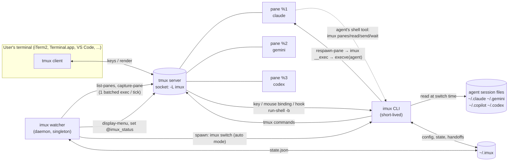
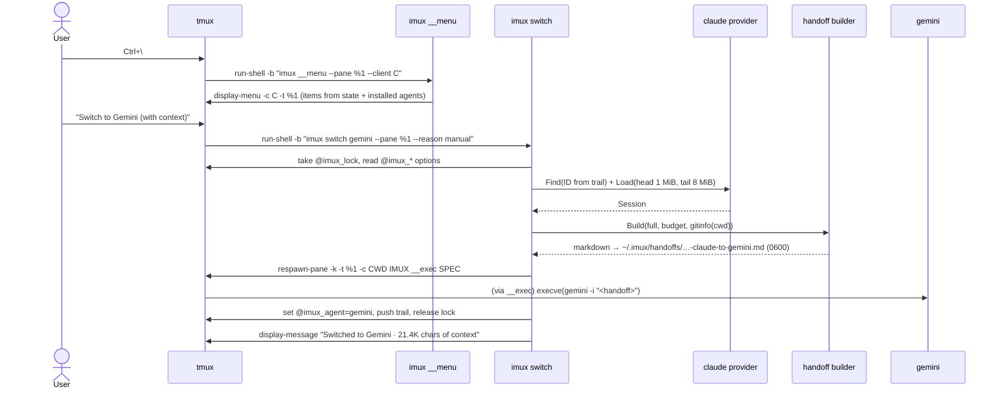
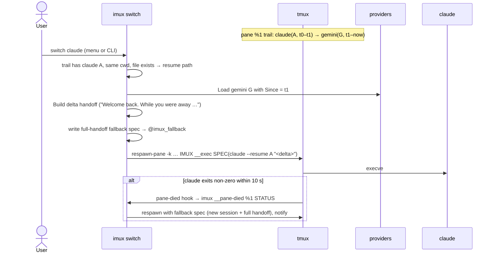
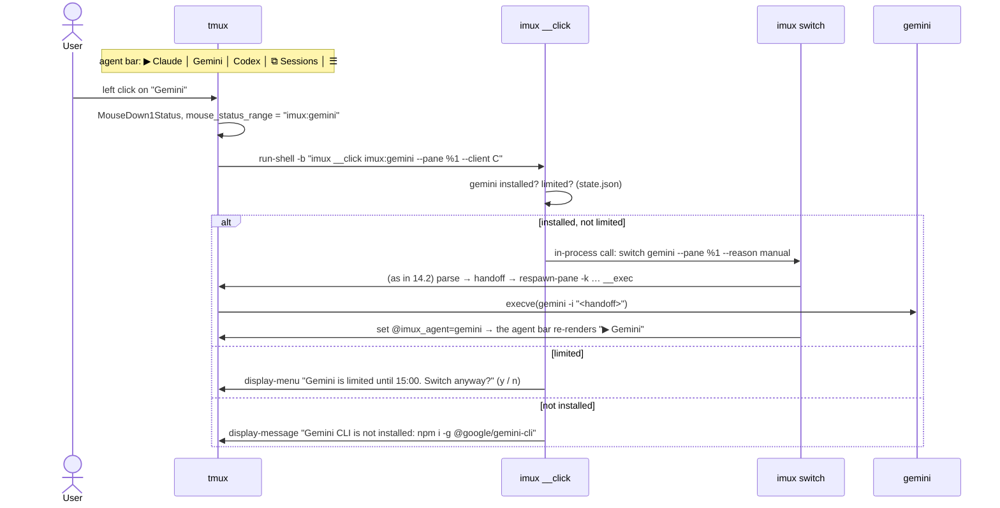

# i-mux: Architecture

> Status: implemented (M0–M8); the open questions in §20 are being closed by manual checks. Last updated 2026-11-06.
> Companion document: [TASKS.md](TASKS.md) (milestones and task plan).
> Naming: the product is i-mux; its command, config directory and environment prefix are `imux`, `~/.imux` and `IMUX_`.

---

## 1. Overview

i-mux is a very lightweight, tmux-based terminal workspace for AI coding CLIs:
**Claude Code**, **Gemini CLI**, **GitHub Copilot CLI** and, as a bonus, **OpenAI Codex CLI**.

Core user story:

> "I'm working in Claude Code, I hit my usage limit, and I want to continue the SAME
> conversation in Gemini CLI or Copilot CLI in the same terminal pane, with one keystroke
> and without re-explaining anything."

**Hard requirement: switching happens directly in the UI.**

- The user switches a pane's conversation to another agent with **one click** on the agent bar,
  or with one keystroke. The menu works with both mouse and keyboard (§9.3).
- The user can also browse earlier conversations of any agent and continue one of them from a
  picker. No command typing is needed for any of this.
- The CLI commands exist too, but the UI is the primary interface.

i-mux is a single static Go binary. All terminal work (PTYs, rendering, scrollback, keys) is
done by tmux on a dedicated socket. i-mux only:

1. starts and arranges agent CLIs in tmux panes,
2. reads the agents' on-disk session files when a switch happens and condenses them into a
   markdown **handoff document**,
3. relaunches the pane with another agent, passing the handoff as its initial prompt,
4. runs a tiny watcher that looks at the bottom of agent panes for usage-limit messages,
5. offers a small command set that lets agents talk to each other through tmux.

### Features

| ID | Feature | Summary |
|----|---------|---------|
| F1 | Context handoff | **From the UI:** click an agent in the agent bar, or pick it in the menu (`Ctrl+\`, `prefix a`, right-click on a pane border). **Automatic:** when a limit is detected (modes `ask` / `auto` / `off`, default `ask`). |
| F2 | Limits visibility | Per-agent OK / limited (with reset time) shown in the agent bar, plus an `imux limits` panel. |
| F3 | Multi-pane workspace | Several agents side by side, each pane labeled with its agent. |
| F4 | Agent-to-agent bus | Agents can list panes, read another pane, send it a message, and wait until it is idle. |
| F5 | Standalone handoff | `imux handoff --from claude --to gemini` in a plain terminal, or `--print` to output the document only. |
| F6 | Session picker | A menu listing recent conversations of all agents for this project. Pick one, then continue it natively or in another agent with context. |

## 2. Goals and non-goals

### Goals

- **One click or one keystroke in the UI** to continue a conversation in another agent, in the
  same pane. No commands need to be typed.
- **Lightness is a hard requirement.**
  - Our code is never in the keystroke or render path; tmux (C) is.
  - The only long-running i-mux process is the watcher: under 15 MB RSS and about 0% CPU when idle.
  - i-mux adds no per-pane resident processes.
- **Zero runtime dependencies besides tmux.** Users never need Go, Node or Python for i-mux itself.
- **Never touch the user's own tmux setup** (separate socket, generated config).
- **Robust against format changes.** Parsers degrade to partial output with warnings and never crash.
- **Privacy by default.** Everything stays local. Handoff files are 0600. Nothing is logged from screens or transcripts.

### Non-goals

- **Re-implementing a terminal multiplexer.** tmux does all PTY and rendering work.
- **Calling model APIs directly**, or reusing CLI subscription OAuth tokens to call models.
  That is against provider terms; we only orchestrate the official CLIs.
- **Converting a session into another CLI's native session format.**
  - Tool schemas differ between CLIs.
  - Claude's thinking blocks are signed and cannot be given to other models.
  - We inject a condensed markdown handoff instead: lossy, but robust.
- **Reading provider usage endpoints** in v1 (no undocumented APIs). This may become an opt-in module later.
- **Windows as the main target.** WSL with tmux is the supported way; since v0.49 i-mux also runs
  natively on psmux ([docs/WINDOWS.md](docs/WINDOWS.md)).

## 3. Key decisions

| # | Decision | Rationale |
|---|----------|-----------|
| D1 | **Go + tmux, one static binary** (`CGO_ENABLED=0`) | Small idle footprint, trivial cross-compilation, same proven architecture as claude-squad and agent-deck. Writing our own multiplexer is avoided. |
| D2 | **Dedicated socket `tmux -L imux`** with a generated `~/.imux/tmux.conf` | Isolation from the user's tmux. The user's own overrides go in `~/.imux/tmux.local.conf`, which is sourced last. |
| D3 | **Handoff = condensed markdown passed as the target CLI's initial prompt** | Works with every CLI that accepts an initial prompt. No dependency on internal session formats of the *target*. |
| D4 | **Returning to an agent that already has a native session in this pane resumes it natively** (`claude --resume <id> "<delta>"`), plus a *delta* handoff | Full fidelity on the way back; only what happened elsewhere is summarized. |
| D5 | **Limit detection by polling the screen** (every ~2.5 s, the last 25 non-blank lines of the visible screen, agent panes only) | Agents redraw spinners constantly, so streaming output (`pipe-pane`) would cost CPU around the clock. |
| D6 | **One `tmux` exec per tick, batched** (`cmd1 \; cmd2 \; …`), and **skip unchanged screens by hash** | Keeps the watcher's CPU near zero regardless of pane count. A control-mode client (`tmux -C`) is a later optimization, used only if measurements require it (§17). |
| D7 | **The watcher sleeps when no client is attached and exits when the i-mux tmux server is gone** | No work when nobody can see a prompt anyway. A `client-attached` hook wakes it. |
| D8 | **Session files are parsed only at switch time**, reading a bounded head and tail window | Long Claude sessions are tens of MB (the largest local file is about 64 MB). |
| D9 | **Agents are launched through `imux __exec <spec-file>`**, which replaces itself (`execve`) with the agent | No shell quoting at all (tmux runs multi-argument commands without `sh -c`, verified in the tmux 3.8 man page). No tmux command-size limit, because the prompt lives in a 0600 file. Correct `PATH` for nvm-installed CLIs. Zero resident cost. This replaces the brief's `exec <bin> "$(cat file)"` idea. |
| D10 | **Pane lifecycle via `remain-on-exit on` + a `pane-died` hook** instead of a wrapper shell or supervisor | Fallback when a resume fails fast, and a drop back to a shell when an agent exits. No process stays resident per pane. |
| D11 | **Pre-assign Claude session IDs** with `claude --session-id <uuid>` (verified in 1.0.110 `--help`) | Deterministic mapping from pane to session file for Claude, the most common source. Other agents use time + cwd discovery. |
| D12 | **Config in TOML** (`~/.imux/config.toml`); machine state in JSON (`state.json`) | Regex patterns are hand-edited: TOML literal strings (`'…'`) need no backslash escaping, while JSON would need `"\\d"`. TOML also allows comments (self-documenting defaults) and is familiar from Codex's `config.toml`. Cost: one small pure-Go dependency, `github.com/BurntSushi/toml`. |
| D13 | **Dependencies: stdlib + BurntSushi/toml (plus `golang.org/x/sys` on Windows).** No CLI framework, no YAML library, no SQLite driver | Small binary and less supply-chain surface. `workspace.yaml` (Copilot) needs only top-level scalars, so a 30-line reader suffices. SQLite is avoided (see Q5). On Windows, `golang.org/x/sys/windows` provides console, event and file-lock syscalls; the native Windows port on `psmux` is documented in [docs/WINDOWS.md](docs/WINDOWS.md). |
| D14 | **All UI strings in one catalog** (`internal/i18n`), English first | The primary user is Turkish; a `tr` catalog can be added without touching call sites. The handoff preamble is model-facing and always English. |
| D15 | **Distribution:** GoReleaser (darwin/linux/windows × arm64/amd64), `install.sh` (installs tmux if missing), `install.ps1` (installs psmux on Windows), Homebrew tap with `depends_on "tmux"` | Users never need Go. |
| D16 | **The UI is built only from tmux-native elements:** a clickable second status line (`status-format[1]` with `#[range=user\|…]` regions), `display-menu` (mouse and keyboard), `display-popup` and pane border labels. No TUI framework. | tmux draws everything and handles mouse and keys, so nothing of ours stays resident and the lightness budget holds. tmux 3.8 supports `range=user\|X` (verified in its man page): a click fires the `MouseDown1Status` binding with `X` in `#{mouse_status_range}`. |
| D17 | **The primary UI is a sidebar pane on the left of each window** (added 2026-11-07, at the user's request, after the bottom agent bar): a small `imux __sidebar` process drawing with ANSI escapes and reading keys and SGR mouse events, no TUI library. The agent bar stays as an option (`tmux.agent_bar`). | A sidebar can show what a status line cannot: every pane's agent and state, the switch targets, split buttons and help, all clickable. A familiar agent-workspace layout, built on tmux. Cost: one resident process per window (~6 MB, no CPU while idle: it sleeps until a tmux hook or the watcher signals it). |
| D18 | **The handoff stays in its file; the agent gets a two-line message pointing to it** (added 2026-11-07, v0.6): `[i-mux handoff · A → B · time]`, one sentence in the user's language and the file's path. The agent reads the file with its own tools; `--add-dir` lets Claude, Copilot and Antigravity read `~/.imux/handoffs` without asking. `handoff.deliver = "inline"` keeps the old behavior. | The user saw the whole 30 000-character document as their own first message: a wall of text in the pane. The file is 0600, so the document also leaves argv (no process-list exposure, no argv size limit). Cost: one file read by the agent. Chained handoffs follow the path back to the file. |
| D19 | **The sidebar is a full agent workspace UI** (added 2026-11-07, v0.7, at the user's request; our extra is moving a chat to another CLI): Projects (letter avatar, branch, roll-up status) above Agents grouped by project (icon, name, time since the state changed, status), and a "Continue this chat in" block for the switch. States: **Needs you** (the agent asks something), **Done** (finished while you looked elsewhere), working (spinner), idle (ring). | The sidebar answers "what needs me?" at a glance, and adds what other agent workspaces lack: moving the chat. imux keeps reading the screen it already captures: a question on a still screen is "Needs you", a working → idle change the user has not looked at is "Done". |
| D20 | **Tabs: a project holds tabs, a tab holds panes** (added 2026-11-07, v0.8, at the user's request). A tab is a tmux window; a tab bar at the top (the status line, `status-position top`) shows each tab's number, name and most urgent state, and a **+** that asks which agent the new tab starts with. | One project, several tasks: each task gets its own tab with its own agents and sidebar, instead of one crowded window. tmux windows already are tabs; only the bar and the naming are new. |
| D21 | **Long-running imux processes restart themselves after an upgrade** (v0.8): the watcher and each sidebar compare the imux binary's size and mtime with the ones they started from and `exec` the new binary when it changed; the restarted watcher rewrites the tmux config. | The user saw an old version keep running after the one-line install ("0.5.0 shows up out of nowhere"): the daemon and the sidebars of sessions started earlier never restarted. |
| D22 | **Folders are picked, not typed** (added 2026-11-07, v0.9): "open a project" shows a popup that filters as you type: recent projects first, then git repositories found under the home folder; a query starting with `/` or `~` browses folders, Tab completes. `imux` run in the home folder opens the same picker instead of making the home folder a project. | The user could not find paths in tmux's command prompt (Tab completes tmux commands there, not folders). Most projects are git repositories under the home folder, and most opens are of a recent one. |
| D23 | **Projects and tabs close from the UI** (v0.9): a click on the current project (or a right-click on any) opens its menu with Close; the current tab has a **×**; both ask first. Closing the project the client shows moves the client to another project first. | Sessions outlive the terminal, so projects piled up in the sidebar ("why does i-mux show up on its own?") with no visible way to close them. The agents' own session files stay, so a closed conversation can be continued from History. |
| D24 | **Projects reopen as they were** (added 2026-11-07, v0.10, at the user's request: "like VS Code, save what was open when I closed it"): the watcher snapshots every open project (tabs, names, layouts, each pane's agent, name and conversation) to `~/.imux/workspace.json`; closing a project snapshots it too. Opening a folder with a snapshot recreates its tabs and panes, each agent resuming its conversation natively. The picker shows **Recent** (with tabs, agents and age) above the other folders, and **Restore last session** after the tmux server went away (a reboot). | tmux sessions die with the machine and with Close, and the user had to rebuild tabs and find conversations again. The trail already records each run (agent, start, session id), so a snapshot is a list of trail entries; native resume (§8.6) brings each conversation back without a handoff. |
| D25 | **Plan percentages come from the CLIs themselves** (added 2026-11-07, v0.13): Claude Code gives its status-line command `rate_limits.five_hour` / `seven_day` (`used_percentage`, `resets_at`; Pro/Max, after the first reply), so imux starts Claude with `--settings=~/.imux/claude-settings.json` whose `statusLine` is `imux __statusline claude`: it records the numbers in `~/.imux/usage/claude.json` and prints the user's own status line (from their settings, highest precedence first) or a short usage line. Codex already writes `rate_limits` in its rollouts. Copilot writes `quotaSnapshots.premium_interactions` (entitlement, used requests, remaining %, reset date) in every `model.model_call_success` event of its session files (v0.14: read from there). Antigravity keeps its quota inside its local language server, behind a CSRF token of the running agy process; imux does not read it, so the panel shows only limits seen on screen for it. | The user found the limits panel unreadable and asked for percentages per window. No credentials are read and no request is sent: the numbers are the ones each CLI already has. The user's settings files are never written. |
| D26 | **The sidebar gets an activity bar like an editor's** (added 2026-11-08, v0.15, at the user's request): a 3-column rail of view icons (Agents, Explorer, Search, Source Control; Limits and Help at the bottom). Explorer is the project's file tree; Search and diffs open in wide popups; a diff shows the whole file with the changes highlighted, side by side when wide. | The user wanted the editor's way of looking at a project (files, search, changes) next to the agents, without leaving the terminal. A narrow sidebar is enough to choose; reading happens in popups that use the whole window. |
| D27 | **The sidebar's source control works like an editor's** (added 2026-11-08, v0.16): staged and unstaged changes, per-file stage / unstage / discard, stage / unstage / discard all, commit (a prompt; with nothing staged it stages everything first), push / pull / sync with ahead and behind counts, branch checkout and creation, and the recent history. Git runs in the project folder; discards ask first; network commands run in a popup so their output and any password prompt show. Files open in an editor (micro, $VISUAL/$EDITOR, nano, vim with the mouse on) or VS Code. | The user asked for the editor's source control "with every feature", and to edit files, not only read them. imux stays a thin layer over git and the user's editor: no git library, no editor of its own. |
| D28 | **OpenCode is the fifth agent** (added 2026-11-08, v0.18, at the user's request; taken out in v0.19, back in v0.20: its `/connect` adds an NVIDIA or Groq key without an account): an open-source coding CLI that works with any model endpoint (OpenAI-compatible APIs, Anthropic, Ollama, NVIDIA's and Groq's free tiers ...). imux supports it like the others: launch with a session id imux chooses, native resume, sessions read for handoffs, the picker and limits. | The user wants to code with free or self-hosted endpoints too. Writing an agent of our own would be a separate project (§17 Q32); OpenCode already does it well, so the cheap path is to support it. |
| D29 | **Commit messages are written by the user's own agents, run once without a UI** (added 2026-11-08, v0.23, at the user's request): the ✨ button in Source Control sends the changes to the agent of the pane the sidebar follows (or `git.commit_agent`) in its print mode and offers the reply; it never commits by itself. | Like the editor's "generate commit message", without an API or key of imux's own: the user's plans and keys (Claude, Codex, Copilot, Antigravity, or OpenCode with a free NVIDIA / Groq key) already pay for it. |
| D31 | **The sidebar draws backgrounds for hover and selection, and asks for every mouse motion** (added 2026-11-08, v0.30, at the user's request): a row or button under the pointer gets a background, the selected explorer row another; explorer menus follow the editor's. | The user could not tell which row the pointer or a menu was on. The "foreground colors only" rule (any theme keeps its background) gives way where the editor itself uses backgrounds; the sidebar's text colors already assume a dark theme. Motion reports cost a redraw only when the item under the pointer changes. |
| D30 | **AI completion in the editor is Neovim with GitHub's copilot.vim, in a profile i-mux manages** (added 2026-11-08, v0.25, at the user's request): when Settings turns it on, file edits open `nvim` with `NVIM_APPNAME=imux-nvim`; i-mux writes that profile's `init.lua` (mouse, Ctrl+S / Ctrl+Q, Tab accepts) and keeps copilot.vim in it. | Inline suggestions are an editor feature, and i-mux edits in an external terminal editor. Neovim with the official plugin gives the editor's Copilot suggestions with the user's Copilot plan; micro has no such plugin; our own editor would be a project of its own. A separate profile leaves the user's own Neovim setup untouched. |
| D32 | **Project skills live in `.agents/skills/`, are linked into `.claude/skills/` for Claude Code, and are written by the active agent** (added 2026-11-09, v0.36, at the user's request): a **🧩 Skills** view on the activity rail lists the project's `<name>/SKILL.md` skills across every CLI's folder, shows which of the five agents see each one (`✻▲◉◎▣`) and any front-matter problem (`⚠`), links `.agents/skills/` into `.claude/skills/` so one skill works in all five CLIs, and has **✨ Write with Agent…** to send a structured skill-authoring prompt to the active agent pane (since v0.37, D33: one **✨ New skill…** button and dialog). | Antigravity, Codex, Copilot CLI and OpenCode read `.agents/skills/`, while Claude Code, Copilot CLI and OpenCode read `.claude/skills/`: keeping the canonical folder in `.agents/skills/` with a relative symlink in `.claude/skills/` covers all five CLIs without copies drifting apart. Letting the active agent write or improve a skill uses its full repo access and requires no separate LLM client. |
| D33 | **A skill is written by an agent the user picks, in a new pane that starts with i-mux's skill-writing guide** (added 2026-11-10, v0.37, at the user's request): the Skills view has one **✨ New skill…** button; it opens a dialog (a popup) that asks who writes the skill (an agent in a new pane, the agent of the current pane, or the user from a blank `SKILL.md`), then what it should do (or the template's name) in a real text box. The chosen agent starts beside the current pane with the guide and the description as its first message; with nothing described, the guide tells it to ask first. | The user found two buttons (✨ and ➕) and tmux's one-line prompt in the status line ("a tiny thing at the top") poor for writing a skill: the description is a paragraph, and the user wants to choose the agent rather than always disturb the active one. A new pane keeps the current conversation clean; the agent's own input takes over from there. |
| D34 | **i-mux installs the Nerd Font its icons need, where the terminal draws text, and sets the terminals it knows to it** (added 2026-11-10, v0.38, at the user's request): `imux font install` (Settings, and the installer, offer it) downloads Nerd Fonts' JetBrainsMono (a pinned release, checked against its SHA-256), installs four styles for the user alone (no administrator rights), sets Windows Terminal's and VS Code's terminal font to it with a backup of their settings, and switches the icons to `nerd`. Under WSL all of this happens on the Windows side. | On a new PC the icons stayed emoji (or "?" boxes when set to `nerd`): no Nerd Font comes with Windows, i-mux only told macOS users to `brew install` one, and under WSL the font must be in Windows (the terminal draws the text there), not in Linux. Changing one value in the terminals' settings, comments and all kept, is what a user would do by hand; the backup undoes it. |
| D35 | **The explorer marks files by type, as the editor does** (added 2026-11-10, v0.39, at the user's request): each entry has an icon of its kind, folders open and closed, and indent guides mark the levels. With the editor's icons (`nerd`) they are the Nerd Font glyphs of the editor's default file icon theme (Seti) in its colors; with `emoji` an emoji per kind. | The user found the Files view plain: names alone are slow to scan. The editor's own icons, now that i-mux installs their font (D34), make it look like the explorer users know; the emoji keep it readable without the font. |
| D36 | **A click in the sidebar acts at once, and tmux's double and triple click no longer select a sidebar** (added 2026-11-10, v0.39.1, at the user's request): a click that leaves the sidebar under the pointer and opens nothing over it (a view on the rail, a folder, a section's fold, an agent of the window) runs at once; one that opens a menu, popup or prompt, or shows another window or project, still waits 350 ms. i-mux binds `DoubleClick1Pane` and `TripleClick1Pane` to tmux's own commands, except over a sidebar, where they only pass the click on. | The user found moving between panels slow ("about a second"). Every click waited 350 ms for tmux's double-click time: tmux's own double click, 300 ms after the second press, selects the pane under the pointer, and took the focus back from the agent pane a click had just focused. Without that selection only what a double click's second press (or the button's release) would land on needs the wait: a menu, a popup, another window. |
| D37 | **i-mux turns on synchronized output (DECSET 2026) for every terminal** (added 2026-11-10, v0.39.1, at the user's request): `terminal-overrides` gets `Sync=\E[?2026%?%p1%{1}%-%tl%eh%;`, the form tmux 3.4+ uses for the terminals it knows. tmux then sends an update of a pane in the background, with the cursor's way back to the active pane, as one synchronized update. | The user saw the text cursor in the sidebar now and then: tmux draws a change in a pane that is not active (the sidebar's spinner while agents work, its hover) by moving the cursor there and back, and Windows Terminal could show a frame in between. tmux 3.2 and 3.3 know only an older form of the sequence and turn it on for no terminal. Windows Terminal 1.24 supports 2026 (as do iTerm2, kitty, WezTerm, foot, Alacritty and Ghostty); a terminal without it ignores the sequence. |
| D38 | **"Working" means the agent works: the user typing, a resize and a restarted watcher do not count** (added 2026-11-10, v0.40, at the user's request): a pane is working while its agent's screen changes, except when only its input line and what is below it changed (the user typing; the agents' progress lines are above the input), when a quiet pane was resized (the panel opened or closed) or redraws right after it, and when the watcher meets the pane (a restarted watcher takes the last one's times from `activity.json`). The AGENTS title counts the agents at work. | The user saw the spinner turn at a project whose agent did nothing. Any screen change counted as work: every key typed into an agent, every resize, and every restart of the watcher (each install or Settings change), which then also marked every agent "Done". The count answers "how many are still working?" without reading every row. |
| D39 | **Every sidebar click acts at once; only a tmux menu (before tmux 3.5) and the command prompt wait** (added 2026-11-10, v0.40, at the user's request): a project, an agent in another tab or project, "Continue this chat in", a file and every popup now act on the press. tmux passes a double click's second and third press to a sidebar only when the first press went to that same pane (`MouseDown1Pane` notes the pane in `@imux_press`), and i-mux's popups ignore clicks in their first 400 ms. A sidebar a client shows gathers every 3 s, with its own project's git status at most 2 s old. | The user still found switching on the left slow after v0.39.1: a project took 350 ms (8 projects open: ~354 ms, almost all of it the wait), against ~30 ms for a view. The wait only kept a double click's second press from acting where the first one led; tmux can tell that itself. Freshness: the watcher's false "working" changes (D38) used to make sidebars redraw now and then; without them a file written outside an agent showed after up to 15 s. |
| D40 | **The "+" of Agents asks which agent, then where it opens** (added 2026-11-10, v0.41, at the user's request): after the agent (or Terminal), a second menu: Right, Left, Down, Up (a new pane beside the target pane; `split-window -b` for left and up) or a new tab. `prefix v` / `prefix -` keep their fixed direction; the project's "No agents" pane still takes the agent in its place. | The user wants to choose the place instead of i-mux picking right or down from the pane's shape, and to open an agent in a new tab from the same button. |
| D41 | **An agent that is not installed opens a small popup that installs it** (added 2026-11-10, v0.41, at the user's request): a click on it in "Continue this chat in" or the agent bar shows what it is, the command that installs it and **Install now** / **Close**. Install now runs the command in the popup (its output visible), checks the agent is found, then Enter continues the chat in it. When the command needs a program that is missing (npm without Node.js, curl), the popup says how to get it instead. `[agents.<id>] install` replaces i-mux's command. | The user found the one-line hint in the status line easy to miss and unclear; a popup at the click explains and does the step. Running the vendor's own install command (npm, or its install script) is what the user would type. |
| D42 | **Everything that scrolls shows a scroll bar, and the viewers are i-mux's own pager** (added 2026-11-10, v0.42, at the user's request): a one-column bar at the right edge (a dark `│` track, a lighter `┃` thumb sized to the part shown) in the sidebar's lists (Explorer, Source Control, Skills), search, Go to File, the folder picker, and the diff, file, commit and limits viewers; a click on it scrolls there. The viewers, `less` before, are `internal/pager`: less's keys (↑↓ j k, PgUp PgDn space b, g G, ←→, / n N, q), the wheel, a click or drag on the bar, `v` to edit a file. The search popup draws files with their icons, folder and a count, the matches in color, and starts folded when more than 5 files match; a button folds or unfolds all. | The user could not tell where they were in a long diff or search, and found the search plain ("colorless", every file open, no visible way to fold them). `less` cannot draw a bar; a pager of our own costs ~300 lines and keeps the keys. The bar is thin and dark so it does not fight the text. |
| D43 | **History searches the conversations' text** (added 2026-11-10, v0.43, at the user's request): History's last item, **🔍 Search their text…** (`/`), opens a popup with every conversation of the folder (pinned first, then the newest; 300 at most) and, as you type, the ones whose messages (or name, or first request) have the text, each with its count and up to three of its messages, the match marked. Enter opens the conversation's menu (resume, continue in another agent, ...). | The user wants to find a conversation by something said in it, not only by its first request. A conversation's file is read whole only when it can hold the text (a byte search first), so a search over a few hundred conversations takes a moment, shown as it goes. |
| D44 | **Replaced by D47 (v0.45).** **Web pages open in a pane, in a browser that draws in the terminal, installed only when wanted** (added 2026-11-10, v0.44, at the user's request): i-mux shows a web page (an HTML file of the project, or a URL such as `http://localhost:3000`) in a pane beside the agent, with Carbonyl (Chromium drawing in the terminal; a 74 MB download, about 170 MB on disk), which Settings installs into `~/.imux/tools` when asked and can remove. It is on by default (`[web] enabled`) and Settings turns it off. A click on an HTML file in the explorer opens its preview; until the browser is installed, a small popup offers to install it, to open the page in the system's browser, or to edit the file. | The user wants to see web pages without leaving i-mux, also over SSH and a VS Code tunnel, where the system's browser runs on another machine; a terminal browser works wherever the terminal does. Nothing is downloaded until the user asks: it is big and many never need it. Carbonyl draws real pages (CSS, JavaScript, images) where w3m or lynx show text only; `[web] browser` runs another program for those who prefer one. |
| D45 | **Files open in micro, which i-mux gets when asked, and the editor shows where you are in the file** (added 2026-11-11, v0.45, at the user's request): when no editor is chosen (`editor`, `$VISUAL`, `$EDITOR`) and micro is not installed, the first file opened asks once: **Get micro** (micro 2.0.15, a 5 MB download, its SHA-256 pinned, into `~/.imux/tools`) or **Use nano**; Settings → **Get the micro editor…** asks again. micro runs with its scroll bar (`-scrollbar true`), nano 5.0+ with its position indicator and the mouse (`--indicator --mouse`). | The user opened a file, got nano, and read in the README that micro has to be installed by hand. i-mux recommends micro, so it brings it, as it brings the Nerd Font: micro works like the editors people know (mouse, Ctrl+S, Ctrl+Q, Ctrl+C / Ctrl+V), and its release is one static program (no package manager, no sudo). It is a program from the network, so it is asked for once (Enter takes it). |
| D46 | **The rail's Agents icon shows how many agents are working** (added 2026-11-11, v0.45, at the user's request): a number on a blue background right of the icon, as an editor's activity bar shows a badge: the agents working now in every project (the AGENTS header's count, D38), `9+` above nine, nothing when none works. | The count is wanted where it is always in sight: the AGENTS header is hidden when the panel shows another view or is closed, the rail is not. |
| D47 | **Web pages open in the browser, served by i-mux with live reload, not in a browser drawn in the terminal** (added 2026-11-11, v0.45, at the user's request; replaces D44): a click on an HTML file serves its project on `http://localhost:<port>` (a small server in i-mux, one per project, for this machine only) and opens the page in a window of its own (the app window of Chrome or Edge: no tabs, no address bar; under WSL, Windows' browser) or in a tab of the default browser (Settings). The page reloads itself when a file it uses changes; another click shows the new page in that window. Nothing is downloaded. | Carbonyl drew pages with half-block cells: blurry text, blocky charts, its own bar on top (the user: "beyond terrible"). A terminal cannot draw a page as a browser does, and the browser is there anyway; a window of its own next to the terminal is the preview pane. Over HTTP a page also loads what `file://` blocks (a report's JSON next to it), and live reload shows what an agent rewrites as it happens. From VS Code (also over a tunnel) the page opens on the machine VS Code runs on. |
| D48 | **A button leaves i-mux: back to the terminal, or quit with every agent** (added 2026-11-11, v0.46, at the user's request): the tab bar ends on the right with **⏻ Exit**; its menu has **Back to the terminal** (this client detaches: the agents keep running, `imux` brings them back) and **Quit i-mux…** (after a confirm: the open projects are recorded, every agent stops, the tmux server ends; the next `imux` offers them back). `imux quit` does the same from a shell. | The user did not know how to leave i-mux for the shell. tmux's ways (`prefix d`, closing the terminal) are invisible and keep the agents running without saying so; a button with both choices says what each one does. |
| D49 | **`imux` asks which project to open, unless it starts in one that is open** (added 2026-11-11, v0.46, at the user's request; extends D22): outside tmux and without arguments, `imux` in the folder of an open project attaches to it; anywhere else, when projects are open or the last session can be restored, it shows the project picker with **↺ Restore last session** first (when there is one), then **this folder**, then the open and recent projects. With nothing open and nothing to restore it opens its folder as before (the home folder: the picker). | The user's workspace stopped coming back: the picker that offers it showed only in the home folder, so `imux` started elsewhere made a new project without a word, and the last session was offered only from home. |
| D50 | **A setting opens a menu of its values; the editor is one of them** (added 2026-11-11, v0.46, at the user's request): a click on a Settings row (or Enter on it, or its letter) opens a small menu of its values with `●` on the current one; choosing one saves it and opens Settings again. Nothing cycles any more. **Editor** lists Auto (micro, `$VISUAL`, `$EDITOR`, nano), micro (got when missing, D45), nano, Neovim, and Neovim + Copilot, which is AI completion (D30) and replaces its row. | Cycling hid the other values and made the user step through them; a list shows them all, as the commit agent's menu already did. The user wants to pick the editor among the ones i-mux knows, not only to turn AI completion on. |
| D51 | **A click on an HTML file asks how to open it** (added 2026-11-11, v0.46, at the user's request; changes D47): a menu at the click offers **Open in browser**, **Open in a new tab**, **Edit** and **View** (v0.47: shorter, without the 🌐); Settings has no row for it any more (`[web] enabled = false` makes the click edit at once). | The user wants to choose each time (the page to look at, or its source to fix) rather than once in Settings. |
| D52 | **The tab bar starts where the terminal does** (added 2026-11-11, v0.46, at the user's request): the tabs begin above the agent's pane, past the sidebar, wherever the panel's edge is: dragged, closed to the rail, hidden (`prefix b`), or a pane zoomed (then at the left edge). Only tmux formats do it, so nothing has to keep it in step. | Over the sidebar the tabs ran into the rail and the panel's title; above the terminal they sit over what they switch. |
| D53 | **After a click showed another project or tab, that client's presses on a sidebar are dropped for 0.5 s** (added 2026-11-11, v0.46.1, from a failing CI run; completes D39): the sidebar that switches the client sets `@imux_moved` to the client's name in the same tmux call, with `run-shell -b -C -d 0.5` clearing it; `MouseDown1Pane` drops a press on a sidebar while it names that client. | tmux 3.7 reports a press in another pane as a new press (`MouseDown1Pane`), not as the second press of a double click (`SecondClick1Pane`), so D39's guard missed it there: a double click on project B went to B and back to A. Homebrew's tmux on macOS is 3.8; the macOS e2e job caught it. tmux has no clock in milliseconds to compare presses, so the sidebar marks the switch and tmux ends the mark. |
| D54 | **Menus take the mouse on every tmux: before 3.5 i-mux draws them in a popup** (added 2026-11-11, v0.47, at the user's request): on tmux 3.2 to 3.4 every menu i-mux opens (display-menu) is shown by `imux __menu-popup` in a popup the size of the menu, where the menu would be: its title, its items with their keys, separators. The item under the pointer lights up; a click or Enter chooses one, and so does its key; Esc, q and ✕ close it. The chosen command runs once the popup has closed, as display-menu runs it: its formats expanded for the menu's pane and client. tmux 3.5+ keeps its own menus (`-M -O`). | On tmux before 3.5 a menu that a mouse binding did not open takes no mouse: a click closed it without choosing anything, and the user had to use the keyboard. Every i-mux menu is opened by a program (the sidebar, a click handler), never by tmux's mouse bindings. A popup's program gets the mouse on every tmux. |
| D55 | **"Working" is what the agent says: Claude Code, Codex, Copilot and Antigravity work while they show their busy line** (added 2026-11-11, v0.47, at the user's request; refines D38): a screen change of these agents counts as work only while the screen's last 16 non-blank lines show what the agent shows while it works, and only then: `esc to interrupt` (Claude Code's and Codex's progress line, Antigravity's "Press esc to interrupt generation"), `ctrl+c interrupt` (Copilot's footer). Other agents (OpenCode) keep D38's rule. | The spinner turned while the user moved through a list in the Copilot CLI (its screen changed above the input line too), not only after a prompt. Each of these CLIs shows how to interrupt it exactly while it works. |
| D56 | **No dots for uncommitted changes or for "Done"** (added 2026-11-11, v0.47, at the user's request): a project row shows its name and branch; the yellow dot (uncommitted changes) and the green dot (an agent finished while the user looked elsewhere) are gone from the sidebar and the tab bar, and a finished agent is idle (its notification still says it finished). Working, Needs you, limited and exited stay. | The user did not know what the dots meant. The rail's Git icon counts the changed files, and Source Control lists them. |
| D57 | **No Image button in the sidebar** (added 2026-11-11, v0.48, at the user's request): the row under "Continue this chat in" holds History alone; the 📎 Image button, which pasted the clipboard's image into the target agent, is gone. Ctrl+V and Alt+V in an agent's pane paste images as before (§9.3 "Pasting images"). | The user found it needless: copying and pasting an image already gives it to the agent, and Alt+V does where the terminal keeps Ctrl+V for itself. |
| D58 | **Source Control works like VS Code's, every action of it included** (added 2026-11-12, v0.49, at the user's request; extends D27): the view's title gets ⋯ (More Actions) with VS Code's menu and its submenus (View & Sort, Commit, Changes, Pull/Push, Branch, Remote, Stash, Tags, Worktrees) and its other items (Pull, Push, Clone, Checkout to, Fetch, Show Git Output); what to act on (a branch, tag, stash, remote, worktree) is chosen in a Quick Pick that filters as one types; names and messages are asked on the command prompt; the Commit button gets VS Code's dropdown and turns into Continue / Commit Merge while a rebase, merge, cherry-pick or revert is under way; conflicts get their own MERGE CHANGES section; files list as a list or a tree, sorted by name, path or status; a right-click on a file or a commit opens VS Code's menu for it; HISTORY is a graph with branch and tag labels and incoming / outgoing marks. | The user wanted the editor's source control with every feature of it. tmux menus do not cascade, so a submenu replaces its menu (‹ Back returns); tmux's own menus cannot show more rows than the window has, so long lists go to a Quick Pick. No ref, path or message from a repository goes into a shell or tmux command line: menus read what they act on from options, and the Quick Pick runs imux with an argv. |
| D59 | **CI's checks run here before a push: `make ci`** (added 2026-11-12, v0.49.1, at the user's request after v0.49.0's CI run failed on macOS and Windows): one target runs what CI runs, as close as this machine can: golangci-lint and vet for the Linux, Windows and macOS builds, generated files, fixtures and shellcheck, the unit tests with the race detector, again with `TMPDIR` behind a symlink (macOS's `/var` is `/private/var`), and on Windows: from WSL the Windows test binaries run on the Windows host through interop (`go test -exec scripts/wsl-exec.sh`), with Git for Windows' `sh` and `git` on `PATH` and a throwaway user profile (`USERPROFILE`, `APPDATA`, `LOCALAPPDATA`); then the size gate and the e2e tests. Coding agents run it before every commit that will be pushed (`.agents/skills/check-before-push`). | The unit tests ran on Linux only, so a test comparing a temp path with git's (a symlink on macOS, an 8.3 short name on Windows) and tests expecting POSIX shell commands (Windows runs PowerShell) passed here and failed in CI. WSL runs Windows programs, so Windows failures show here; macOS cannot run here, but its symlinked temp folder can be copied. The throwaway profile keeps tests from the developer's real Windows settings, which CI's runner does not need. |

## 4. Components



| Component | Lifetime | Responsibility |
|-----------|----------|----------------|
| tmux server (`-L imux`) | while sessions exist | PTYs, rendering, scrollback, key bindings, menus, popups, pane options. |
| `imux` CLI | per command | Start/attach, switch, split, handoff, limits, bus, doctor. Also invoked by tmux key bindings and hooks via `run-shell -b`. |
| `imux __exec` | milliseconds | Reads a launch spec, sets env/cwd, `execve`s the agent. Gone afterwards. |
| `imux __watch run` | while the i-mux server lives | Limit detection, status bar, `ask` / `auto` actions. |
| Session providers | in-process | Find and parse the four agents' session stores into a common model. |
| Handoff builder | in-process | Budgeted markdown rendering from the common model plus repository state. |

## 5. Go package layout

```
imux/
├── cmd/imux/main.go              # tiny: calls internal/cli.Main(os.Args)
├── internal/
│   ├── cli/                      # subcommand dispatch (stdlib flag), help text, exit codes
│   ├── config/                   # TOML load, defaults, merge, validation (regex compile)
│   ├── paths/                    # IMUX_HOME, dir creation with perms, umask
│   ├── state/                    # state.json: flock + atomic write; limits, bin cache, notices
│   ├── i18n/                     # message catalog (en; tr later), T(key, args...)
│   ├── agent/                    # agent registry: IDs, display names, default launch templates,
│   │                             #   binary resolution + PATH capture, install hints
│   ├── session/                  # common model (§6), Provider interface, Ref, helpers
│   │   ├── jsonl/                # bounded head/tail reader, reverse line scanner, safe decode
│   │   ├── claude/
│   │   ├── gemini/
│   │   ├── copilot/
│   │   └── codex/
│   ├── handoff/                  # builder, budget allocator, renderer, marker/chain parsing,
│   │   ├── toolsum/              #   generic tool-call summarizer
│   │   ├── clean/                #   wrapper-tag stripping, middle truncation (UTF-8 safe)
│   │   └── redact/               #   best-effort secret redaction
│   ├── gitinfo/                  # branch, status --short (capped), diff --stat; timeouts
│   ├── tmux/                     # exec wrapper (-L socket), batching, format parsing, errors,
│   │                             #   tmux.conf generator, version check
│   ├── workspace/                # start/attach/split/switch, pane options, trail, menus,
│   │                             #   pane-died handling, launch specs
│   ├── launch/                   # __exec implementation (spec read, env, argv limits, execve)
│   ├── watch/                    # daemon: pidfile lock, loop, detector, actions, status bar
│   ├── limits/                   # pattern sets, reset-time parsing, usage stats, panel render
│   └── bus/                      # panes/read/send/wait, target resolution, idle detection
├── testdata/                     # SYNTHETIC fixtures only (see TASKS.md, testing strategy)
├── e2e/                          # end-to-end tests: separate tmux socket, fake agents
│   └── fakeagents/               # shell scripts that record argv/env and print screens
├── scripts/                      # measure-watch.sh, gen-large-fixture, etc.
├── .goreleaser.yaml
├── install.sh
├── ARCHITECTURE.md
└── TASKS.md
```

Dependency rules:

- `session/*` must not import `tmux`, `workspace` or `watch`. Parsers are pure.
  `imux handoff --print` therefore works without tmux.
- `handoff` depends only on `session`, `gitinfo` and `i18n`.
- Only `workspace`, `watch` and `bus` talk to tmux.

## 6. Common data model

```go
package session

type AgentID string

const (
	Claude  AgentID = "claude"
	Gemini  AgentID = "gemini"
	Copilot AgentID = "copilot"
	Codex   AgentID = "codex"
)

// Ref identifies a session on disk without parsing it.
type Ref struct {
	Agent     AgentID
	ID        string    // native session id (a UUID for all four agents)
	Path      string    // file (Claude, Gemini, Codex) or directory (Copilot)
	CWD       string    // may be "" until parsed
	StartedAt time.Time
	UpdatedAt time.Time // file mtime
	Size      int64
}

// Session is the agent-neutral result of parsing.
type Session struct {
	Ref
	Model      string          // last real model seen (Claude "<synthetic>" ignored)
	GitBranch  string
	Entries    []Entry         // chronological; superseded and excluded lines removed
	Omitted    int             // entries known to exist but not included (outside window, compacted)
	Compaction *Compaction     // latest compaction, if any
	Todos      []Todo          // latest task-list snapshot
	Files      FileActivity
	Usage      Usage
	Errors     []APIError      // never in Entries; used for the switch reason and limits
	Chained    *ChainedHandoff // set when the first user message is an imux handoff
	Warnings   []string        // non-fatal parse problems ("312 unknown lines skipped", ...)
}

type Role uint8

const (
	RoleUser Role = iota
	RoleAssistant
	RoleNotice // CLI info/warning lines, compaction summaries
)

type EntryKind uint8

const (
	KindMessage EntryKind = iota
	KindSlashCommand   // "/name args"
	KindCompactSummary // text of a compaction summary
	KindHandoff        // an imux handoff document (excluded from Conversation, parsed into Chained)
)

type Entry struct {
	Role  Role
	Kind  EntryKind
	At    time.Time
	Text  string     // cleaned text, may be empty for tool-only turns
	Tools []ToolCall // tool calls issued in this assistant turn, in order
}

type ToolCall struct {
	Name   string
	Args   map[string]any // decoded; JSON-string arguments (Codex) are decoded too
	Failed bool           // when the result says so (Copilot success=false, Gemini status=error, ...)
}

type TodoStatus uint8 // Pending, InProgress, Done, Blocked

type Todo struct {
	Text   string
	Status TodoStatus
}

type FileActivity struct {
	Edited    []string // deduped, ordered by last touch
	Created   []string
	Read      []string // capped sample
	ReadCount int
}

type Usage struct {
	InputTokens, OutputTokens        int64
	CacheReadTokens, CacheWriteTokens int64
	Replies                           int     // assistant API messages (Claude: deduped by message.id)
	PremiumRequests                   float64 // Copilot
	RateLimits                        *RateLimitSnapshot // Codex, when present
}

type RateLimitSnapshot struct {
	At                   time.Time
	PrimaryUsedPercent   float64
	PrimaryResetsAt      time.Time
	SecondaryUsedPercent float64
	SecondaryResetsAt    time.Time
}

type APIError struct {
	At   time.Time
	Code string // e.g. "rate_limit", "authentication_failed"
	Text string
}

type Compaction struct {
	At      time.Time
	Trigger string // "auto" | "manual"
	Summary string
}

type ChainedHandoff struct {
	From, To        AgentID
	At              time.Time
	OriginalRequest string
	History         string // the earlier doc's "Earlier history" + "Conversation", as text
}
```

Provider interface (one implementation per agent):

```go
type Provider interface {
	Agent() AgentID
	// Find lists candidate sessions, newest first. Never reads whole files.
	Find(ctx context.Context, q Query) ([]Ref, error)
	// Load parses one session. Malformed input never panics; problems go to Session.Warnings.
	// An error is returned only when nothing usable could be read.
	Load(ctx context.Context, ref Ref, opt LoadOptions) (*Session, error)
}

type Query struct {
	CWD   string
	ID    string    // exact id when known (trail, --session)
	Since time.Time // ignore sessions not updated since (pane start time)
	Limit int
}

type LoadOptions struct {
	HeadBytes int64     // default 1 MiB: original request, metadata
	TailBytes int64     // default 8 MiB: recent history, latest todos
	Since     time.Time // delta mode: only entries after this time
}
```

Workspace state attached to each pane as tmux user options (§9.4):

```go
type TrailEntry struct {
	Agent     session.AgentID `json:"a"`
	Start     int64           `json:"s"`           // unix ms
	End       int64           `json:"e,omitempty"` // unix ms; 0 = current
	SessionID string          `json:"id,omitempty"`
	File      string          `json:"f,omitempty"`
	Handoff   string          `json:"h,omitempty"` // handoff file that seeded this run
	Resumed   bool            `json:"r,omitempty"`
}

// LaunchSpec is written to ~/.imux/launch/<rand>.json (0600) and consumed by `imux __exec`.
type LaunchSpec struct {
	Agent    session.AgentID
	Bin      string            // absolute path
	Args     []string          // fully expanded; includes the prompt in argv mode
	Dir      string
	Env      map[string]string // at least PATH
	Pane     string            // "%3"
	Fallback *LaunchSpec       // used by the pane-died hook when a resume fails fast
}
```

## 7. Agent adapters

All formats below are internal to their CLIs and may change in any release. Every parser:

- decodes one line (or document) at a time, ignores unknown fields and line types, and never panics;
- counts skipped and bad lines into `Warnings`;
- reads large files through `session/jsonl`: a head window (≤ 1 MiB, for the original request and
  metadata) plus a tail window (≤ 8 MiB). The tail starts at the first full line in the window.
  Single lines over 16 MiB are skipped with a warning.

Notes marked **[verified]** were checked on the dev machine on 2026-11-05 (§21). **[expected]**
means taken from the research brief or public knowledge but not seen locally. **[unverified]**
means a known unknown, tracked in §20.

### 7.1 Claude Code

- **Store:** `~/.claude/projects/<encoded-cwd>/<sessionId>.jsonl`; respect `$CLAUDE_CONFIG_DIR`.
- **Encoding** [verified for local paths]:
  - `<encoded-cwd>` is the absolute cwd with every non-alphanumeric character replaced by `-`.
  - All local project directory names match `^[A-Za-z0-9-]+$`; the longest is 166 characters.
  - Long-path behavior is [unverified] (Q7). Fallback: scan project folders for recent files
    whose first lines contain a matching `"cwd"`.
  - Project folders may also contain `memory/` and `<uuid>/` subdirectories. Ignore them.
- **Locating a pane's session:** i-mux launches Claude with `--session-id <uuid>`, so the path is
  known exactly. For sessions not started by i-mux (standalone handoff), take the newest
  `*.jsonl` in the encoded folder.
- **Lines** [verified on files written by Claude Code 2.1.x]:
  - `type ∈ {user, assistant, system, attachment, last-prompt, mode, queue-operation,
    file-history-snapshot, file-history-delta, api-request, api-request-blob, custom-title,
    ai-title, agent-name, cost-state, …}`.
  - Only `user`, `assistant` and `system` matter; ignore everything else.
- **Common fields** [verified]: `uuid`, `parentUuid`, `sessionId`, `timestamp`, `cwd`, `gitBranch`,
  `version`, `isSidechain`, `message`. Optional: `isMeta`, `isApiErrorMessage`, `error`, `isCompactSummary`.
- **Messages:**
  - `message.content` is a string or a list of blocks `text | tool_use{name,input} | tool_result | thinking`.
  - **Each assistant line holds exactly one block.** Lines of the same API message share
    `message.id` and carry identical `message.usage` [verified].
    - The parser merges consecutive lines with the same `message.id` into one `Entry`.
    - Usage is counted **once per `message.id`**.
  - Skip `isSidechain: true` and `isMeta: true` lines.
  - `message.model == "<synthetic>"` marks client-generated messages; never use it as the model name.
- **Errors** [verified]. Two shapes exist; neither enters the transcript.
  1. An assistant line with `isApiErrorMessage: true`, model `<synthetic>`, and a top-level
     `error` string code (seen: `authentication_failed`; `rate_limit` is [expected]).
     Used for the switch reason.
  2. `{type:"system", subtype:"api_error", error:{message, formatted, rateLimits, connection,
     isNetworkDown, noResponse}, retryAttempt, maxRetries, retryInMs}`: retry notices.
     `error.rateLimits` was `null` in every local sample (Q11).
  - Other `system` subtypes seen (`stop_hook_summary`, `model_consent_fallback`) are ignored.
- **Compaction** [verified on one local occurrence]:
  - `{type:"system", subtype:"compact_boundary", compactMetadata:{trigger, preTokens, postTokens,
    preservedSegment{headUuid, anchorUuid, tailUuid}, preservedMessages{uuids, allUuids, anchorUuid}, …}}`.
  - The summary is a later `user` line with `isCompactSummary: true` (and `isVisibleInTranscriptOnly: true`).
    It is **not** the line right after the boundary; attachment lines come in between.
  - Rule: entries before the latest boundary are superseded by the summary, **except** entries
    whose `uuid` appears in `compactMetadata.preservedMessages.uuids`. Newer versions keep a
    preserved segment (exact semantics: Q8).
- **Text cleaning (user text):**
  - Strip `<system-reminder>…`, `<ide_selection>…`, `<ide_opened_file>…`, `<system-note>…`.
  - `<command-name>/x</command-name><command-args>y</command-args>` becomes the slash command `/x y`.
  - Drop `<local-command-stdout>…`.
  - Replace `<task-notification>…` (background task results, [verified] present) with a one-line notice.
  - The tag list is data (`handoff/clean`), not code.
- **Task list:** latest `TodoWrite` input `todos[{content, status, activeForm}]` [expected].
  Newer task tools are [unverified] (Q9).
- **Launch** [verified in `claude --help`, 1.0.110]:
  - new: `claude --session-id {uuid} {prompt}`
  - resume: `claude --resume {id} {prompt}`
  - The installed CLI (1.0.110) is outdated, while the local session files come from 2.1.x apps.
    `imux doctor` recommends updating it.

### 7.2 Gemini CLI (removed 2026-11-07)

> **Removed.** Google stopped serving personal Google accounts in Gemini CLI on 2026-06-18, and
> i-mux replaced it with Antigravity CLI (§7.6). Configs that still name `gemini` load with a
> warning (`config.RemovedAgents`). The notes below are kept as history.

- **Store:** `~/.gemini/tmp/<project-id>/chats/session-<YYYY-MM-DDTHH-MM>-<shortid>.json[l]`.
- **Project id** [verified in the installed 0.30.0 source, `config/storage.js`]:
  - Newer versions: a short id from the registry `~/.gemini/projects.json`
    (`{"projects": {"<abs cwd>": "<short-id>"}}`).
  - 0.30.0 migrates legacy `tmp/<sha256(cwd)>` directories to `tmp/<short-id>`.
  - Each project dir contains `.project_root` with the absolute root [verified].
  - Lookup order: (1) `projects.json[cwd]`, (2) `tmp/<sha256hex(cwd)>`, (3) scan `tmp/*/.project_root`.
  - Cross-check: `projectHash` in chat files equals `sha256(cwd)` [verified in all local dirs with chats].
- **`.json` format** (written by 0.30.0) [verified in the type definitions and local files]:
  - `{sessionId, projectHash, startTime, lastUpdated, messages[], summary?, directories?}`.
  - `messages[].type ∈ {user, gemini, info, error, warning}`; `content` is a string or
    `PartListUnion` (`[{text}]`, other parts become `[attachment]`); optional `displayContent`.
  - Gemini messages: `model`, `thoughts[{subject, description, timestamp}]` (skipped),
    `tokens{input, output, cached, thoughts, tool, total}`,
    `toolCalls[{id, name, args, result, status, timestamp, displayName, description, resultDisplay}]`.
  - The file is rewritten in full on each update. Read it whole, capped at 64 MiB with a warning.
- **`.jsonl` format** [verified shape, written by a newer producer, short id `a2a-serv`]:
  - The first line is `{kind:"main", sessionId, projectHash, startTime, lastUpdated}`.
  - Then patch lines `{"$set": {lastUpdated, messages}}`.
  - Parser: apply `$set` patches in order. Also accept bare message lines `{id, type, …}`.
    Messages are keyed by `id` (last write wins, first-seen order kept), which is correct whether
    `$set.messages` is a full replacement or incremental (Q16).
- **Tool names** [expected]: read_file, write_file, replace, run_shell_command, glob,
  search_file_content, list_directory, web_fetch, google_web_search, write_todos.
- **Task list:** latest `write_todos` args [unverified shape] (Q17).
- **Launch** [verified in `gemini --help` and source, 0.30.0]:
  - new: `gemini -i {prompt}` (`--prompt-interactive`). A positional query also starts interactive mode in 0.30.0.
  - resume: `gemini --resume {id} -i {prompt}`. `--resume` accepts `latest`, an index **or a UUID**
    (the UUID form is in the source, not the help text). Combining it with `-i` is [unverified] (Q2).

### 7.3 GitHub Copilot CLI

- **Store:** `~/.copilot/session-state/<sessionId>/` [verified, but the local sessions were written
  by VS Code's Copilot agent (`producer: "copilot-agent"`); the CLI is not installed (Q3, Q4)].
  - `workspace.yaml`: keys `id, cwd, git_root, repository, branch, created_at, updated_at, name,
    user_named, summary_count, client_name, host_type, fork_count`. Only top-level scalars are read.
  - `events.jsonl`: one event per line, `{type, data, id, timestamp, parentId}`.
    May be missing [verified: one local session dir has none]; then the session is skipped.
  - `session.db` (SQLite): tables `todos(id, title, description, status ∈ pending|in_progress|done|blocked)`,
    `todo_deps`, `inbox_entries`.
  - Lock files `inuse.<pid>.lock` mark live sessions.
  - Also present: `checkpoints/index.md`, `files/`, `research/`. A global
    `~/.copilot/session-store.db` (SQLite: sessions, turns, …) exists; its role is Q4.
- **Events** [verified]:
  - `session.start`: `data.context.cwd` (plus branch, gitRoot, …), `data.selectedModel`, `data.copilotVersion`.
  - `session.resume`: `data.context`, `data.sessionLimits` (null locally).
  - `user.message`: `data.content` (string). Use it, not `transformedContent`.
  - `assistant.message`: `data.content` (string), `data.model`,
    `data.toolRequests[{name, arguments (object), toolCallId, intentionSummary, type}]`.
  - `tool.execution_start` / `tool.execution_complete` (`data.success`, `data.toolCallId`).
  - `session.usage_checkpoint` and `session.shutdown`: `data.totalPremiumRequests`,
    `data.codeChanges{filesModified, linesAdded, linesRemoved}`.
  - Also `abort`, `permission.*`, `hook.*`, `assistant.turn_*`, `subagent.*`, `skill.*`,
    `system.message`. Ignore them.
- **Tool names** [verified]: `view, rg, bash, create, edit, skill, report_intent`.
  Skip `report_intent`.
- **Task list:** from `session.db` → Q5. Decision for v1: if a `sqlite3` binary is on `PATH`, run
  `sqlite3 -readonly -json session.db "select title,status from todos"`; otherwise omit the section
  with a warning. No SQLite driver in the binary.
- **Launch** [unverified, CLI not installed]: new `copilot -i {prompt}`? resume `copilot --resume {id}`? (Q3).

### 7.4 OpenAI Codex CLI

- **Store:** `~/.codex/sessions/YYYY/MM/DD/rollout-<YYYY-MM-DDTHH-MM-SS>-<uuid>.jsonl`; respect `$CODEX_HOME`.
- **Lines** [verified, cli 0.38.0]: `{timestamp, type, payload}`.
  - `session_meta`: `payload{id, cwd, cli_version, originator, instructions, timestamp}`.
  - `turn_context`: `payload{cwd, model, approval_policy, sandbox_policy, summary}`.
  - `response_item`: `payload.type` is one of:
    - `message` (role `user`/`assistant`, parts `input_text` / `output_text`)
    - `function_call` (`name`, `arguments` as a **JSON string**, `call_id`)
    - `function_call_output`, `reasoning` (skip)
    - `custom_tool_call` (apply_patch) and `local_shell_call` [expected]
  - `event_msg`: `token_count` (`info.total_token_usage`, `info.last_token_usage`,
    `info.model_context_window`), `user_message`, `agent_message`, `agent_reasoning`,
    `turn_aborted`. `error` is [expected].
- **Duplicates:** `event_msg/user_message` and `agent_message` duplicate `response_item` messages
  [verified both present]. Build the transcript **only from `response_item`**.
- **Skip** user messages starting with `<environment_context>` [verified] or `<user_instructions>` [expected].
- **Tool names:** `shell` [verified]. Its `command` argument is an argv array such as
  `["bash","-lc","…"]` [expected]; the summarizer prints the last element when the array looks like
  `[sh, -c|-lc, X]`. Newer versions add `exec_command` and `write_stdin` [seen as strings in the binary].
- **Rate limits:** `token_count.rate_limits{primary, secondary}{used_percent, window_minutes, resets_at…}`
  is [unverified]; it is absent in 0.38.0 files (Q13).
- **Task list:** latest `update_plan` args `plan[{step, status}]` [unverified shape] (Q17).
- **Launch** [verified in `codex --help` / `codex resume --help`, 0.38.0]:
  - new: `codex {prompt}`
  - resume: `codex resume {id} {prompt}`
  - **Note:** `codex -i` means `--image`, not prompt.

### 7.5 Default launch templates

Placeholders: `{prompt}`, `{id}`, `{uuid}` (a new v4 UUID). `args` from config are inserted
after the binary, before the template.

| Agent | New session | Resume | Status |
|---|---|---|---|
| claude | `--session-id {uuid} {prompt}` | `--resume {id} {prompt}` | verified (help, 1.0.110) |
| copilot | `-i {prompt}` | `--resume {id}` + paste delta | unverified |
| codex | `{prompt}` | `resume {id} {prompt}` | verified (help, 0.38.0) |
| antigravity | `-i {prompt}` | `--conversation {id} -i {prompt}` | both flags verified in `agy --help` (1.5.2); their combination is unverified (Q30) |

### 7.6 Antigravity CLI (`agy`)

Added 2026-11-06. Google stopped serving personal Google accounts (free, Google AI Pro and Ultra)
in Gemini CLI on 2026-06-18. Sign-in then fails with "This client is no longer supported for Gemini
Code Assist for individuals. … migrate to the Antigravity suite of products". Antigravity CLI is
the `antigravity` agent and follows Claude in the default order. Gemini CLI support was removed on
2026-11-07 (§7.2).

- **Binary and install** [verified by reading Google's installer, not running it]:
  `curl -fsSL https://antigravity.google/cli/install.sh | bash` installs the native binary `agy`
  to `~/.local/bin` (macOS and Linux, so WSL too). No Node.js needed.
- **Launch** [verified in `agy --help`, 1.5.2]: `-i, --prompt-interactive` runs an initial prompt
  and stays interactive; `--conversation <id>` resumes by id; `-c, --continue` the newest. The id is
  the `brain/<id>` directory name of the conversation.
- **Store** [verified on Antigravity CLI 1.5.2, 2026-11-06; not documented by Google]: every
  conversation has a directory `~/.gemini/antigravity-cli/brain/<conversation-id>/` (the desktop app
  uses `~/.gemini/antigravity/brain/`) holding
  - `.system_generated/logs/transcript_full.jsonl` (and `transcript.jsonl`): one step per line,
    `{step_index, source, type, status, created_at, content, …}`:
    - `USER_EXPLICIT`/`USER_INPUT`: `content` wraps the request in `<USER_REQUEST>`, followed by
      context such as `<ADDITIONAL_METADATA>` and `<USER_SETTINGS_CHANGE>` (stripped);
    - `MODEL`/`PLANNER_RESPONSE`: `content` (text), `thinking` (skipped),
      `tool_calls[{name, args}]`, `input_tokens`, `cache_read_tokens`, `output_tokens`;
    - `MODEL`/`GENERIC`, `LIST_DIRECTORY`, …: a tool's result, in tool-call order; `status: ERROR`
      with an `error` string;
    - `SYSTEM`/`SYSTEM_MESSAGE`, `CONVERSATION_HISTORY`: skipped.
    Tool names seen: `run_command` (`CommandLine`), `read_file` (`Path`), `list_dir`
    (`DirectoryPath`), `manage_task`. Argument names are mapped to the summarizer's (`command`,
    `file_path`, `path`, `query`, `url`).
  - `task.md`: the plan as a markdown checklist (`[x]` done, `[/]` in progress).
  - The transcript has no working directory. `~/.gemini/antigravity-cli/history.jsonl` has one
    `{display, timestamp (ms), workspace}` line per typed prompt; a conversation's directory is the
    entry with the same text within 10 minutes, else the closest entry within a minute.
  - Also present and not read: `conversations/<id>.pb` (protobuf), `conversation_summaries.db`.
- **As a handoff source:** `internal/session/antigravity` reads the transcript like the other
  providers read theirs: user and assistant turns, tool lines, failed tools, token usage, the task
  list, and a chained handoff when the first request is one (imux starts agy with the handoff as its
  first prompt). Discovery for a pane uses the run's start time; a conversation without a known
  directory matches only a time-bounded query. The scrollback (§18) remains the fallback.
- **Return with resume:** the trail records the conversation id found at switch time, so switching
  back to Antigravity runs `agy --conversation <id> -i "<delta>"` (verified with a fake agy; the real
  combination is Q30).
- **Limits:** quota messages are not documented. The defaults keep Gemini CLI's verified wording
  (Antigravity runs Gemini models: "usage limit reached for", "exhausted your daily quota") plus the
  usual phrasings (Q31). `imux limits` shows today's requests and tokens from the transcripts.
- **Agent bar:** its range is `imux:agy`, because `imux:antigravity` is 16 bytes and tmux drops
  ranges over 15 bytes (the entry could not be clicked in v0.2.0). `workspace.AgentRange` picks the
  binary name whenever the id would not fit.

### 7.7 OpenCode (`opencode`, v2)

Verified 2026-11-08 with OpenCode 2.2.6 against a local fake OpenAI-compatible server (no
provider, no quota; synthetic prompts only).

- **Store:** a SQLite database, `$XDG_DATA_HOME/opencode/opencode.db` (default
  `~/.local/share/opencode/opencode.db`). Table `session_v2` (id `ses_…`, `directory`, `title`,
  `parent_id`, `time_created` / `time_updated` in ms, token totals, `model` JSON) and
  `session_message` (`type` user | assistant | idle …, `seq`, `data` JSON).
- **Reading:** listing (`Find`) queries `session_v2` with the `sqlite3` CLI (`-readonly -json`,
  top-level sessions only); without `sqlite3`, only sessions whose id imux knows are found.
  Loading (`Load`) runs `opencode session export --standalone <id>`: JSON `info` (id, directory,
  time, title, model, tokens) and `messages`: user `{text}`; assistant `{content: [{type: text,
  text} | {type: tool, name, state: {status, input}}], tokens}`. Tool names: read, write, edit,
  bash, glob, grep, list, webfetch, todowrite …; inputs use `path`, `command`, `pattern`.
- **Launch:** `opencode --session ses_imux<uuid> --prompt <handoff>` (the TUI; `--session`
  creates a session with that id: it must start with "ses"); resume: `--session <id> --prompt
  <delta>`. The handoff file is read without a prompt (external directories are allowed by
  default in v2).
- **Round trips** (verified for v0.20 with the real TUI and a fake model, both `deliver` modes):
  Claude → OpenCode (new session with imux's id; it reads the handoff file) → Claude (Claude's own
  session resumes with OpenCode's part) → OpenCode (its own session resumes, reads the welcome-back
  file) → Codex (the original request, OpenCode's replies and the meanwhile block). E2E tests with
  the fake OpenCode cover the same with Antigravity, Copilot and Codex as the other side.
- **Keys:** `/connect` in OpenCode adds a provider key (NVIDIA and Groq are in its list) to
  `~/.local/share/opencode/auth.json`; `/models` picks the model new sessions use. No account.
- **Limits:** OpenCode has no plan of its own; the provider's limits apply. On-screen patterns:
  "rate limit", "429", "quota exceeded", "insufficient credits". The panel shows the last 5 hours'
  tokens from `session_v2`.
- **Known issue:** OpenCode needs a writable `$XDG_STATE_HOME` (default `~/.local/state`); a folder
  owned by root (made by an earlier `sudo` command) stops it. `imux doctor` warns with the fix.
- **OpenCode 1 is not supported:** its `--session` only continues an existing session ("Session
  not found", so a new tab exits at once to a shell), its store has no `session_v2`, and it has
  no `session export`. Its install script and npm's `latest` still give OpenCode 1 (Homebrew gives
  2); `opencode upgrade --major` moves to 2. `imux doctor` fails below 2.0.0 (it
  re-probes a cached 1.x version first: the bin cache lags an in-place upgrade by up to a day).

## 8. Handoff document

### 8.1 Storage

- Path: `~/.imux/handoffs/<YYYYMMDD-HHMMSS>-<from>-to-<to>.md`, mode **0600**, directory 0700.
- Pruned after `handoff.keep_days` (default 30) by any i-mux command, at most once a day.

### 8.2 Layout

```markdown
[i-mux handoff · Claude Code → Gemini CLI · 2026-11-05 14:32]

You are continuing a coding session that the user was running in Claude Code (model: <model>).
They switched to you because Claude Code hit its usage limit (resets 15:00).
- Treat the record below as your own memory of this session.
- Do not redo finished work. Files may have changed since; re-read a file before editing it.
- Tool names in the record (Bash, Edit, ...) belong to the previous agent. Use your own tools.
- Reply in the language the user writes in.

## Original request
...

## Earlier history (carried over from a previous handoff)
...

## Current task list
- [x] ...
- [~] ... (in progress)
- [ ] ...

## Files touched
Edited: src/a.ts, src/b.ts · Created: src/c.ts · Read: 23 files (README.md, go.mod, ...)

## Repository state
cwd: /path/to/project · branch: feature/x
git status --short (12 lines):
 M src/a.ts
...
git diff --stat:
 ...

## Conversation (condensed, oldest first; 37 earlier entries omitted)
**User:** ...
**Assistant:** ...
  · $ npm test
  · edited src/a.ts
  · (+4 more tool calls)
...

## Where it stopped
Last user request: ...
Last assistant message: ...

## What to do now
If the last request is not finished, continue it. Otherwise give a 2–3 sentence status
and wait for the user.

Full transcript of the previous session (read only if needed): <path>
```

Details:

- **Marker** (first line): `[i-mux handoff · <From CLI> → <To CLI> · <YYYY-MM-DD HH:MM>]`.
- **Chained handoff:** if the source session's first user message starts with `[i-mux handoff ·`:
  - parse it by `## ` headings;
  - its "Original request" becomes this document's "Original request";
  - its "Earlier history" + "Conversation" become this document's "Earlier history"
    (truncated from the *oldest* end, within its budget);
  - the handoff message itself is not shown as a user message.
- **Later handoffs** (v0.20): a handoff further down a session is the "Welcome back" its agent got
  when it resumed. It is not a user message: the conversation shows "**Meanwhile the user
  continued in X:**" with that handoff's conversation indented under it (at most 2 500 characters),
  and "Where it stopped" takes the last request and reply from there unless later turns follow.
  Without this, a round trip (Claude → OpenCode → Claude → Codex) carried the whole welcome-back
  document, instructions included, as the user's last request.
- **Reason line:** "hit its usage limit (resets HH:MM)" | "the user switched manually".
  The reason comes from `--reason`, the watcher's detected text, or the source session's last `APIError`.
- **Excluded:** API error messages, the limit message itself, sidechains, meta lines, thinking blocks.
- **Delta mode** (target resumed natively, §8.6) replaces the preamble with "Welcome back. While you
  were away the user continued in X; here is what happened there." It keeps only Conversation,
  Files touched, Repository state, Where it stopped and What to do now.

### 8.2a Arrival: wait for the user (v0.5)

`handoff.on_arrival` decides what the new agent does with the handoff:

- `wait` (default): "Read the record, reply with one short sentence that you have the context, then
  wait for the user's next message; do not start working." Reading the handoff costs its input
  tokens once (they would be spent on the next message anyway); no work is started unasked.
- `continue`: the v0.1 behavior: continue the unfinished request, or give a short status.

### 8.2b Delivery: a short message, the record in a file (v0.6)

The user should not see the record. With `handoff.deliver = "file"` (default) the agent's first
message is:

```
[i-mux handoff · Claude Code → Codex CLI · 2026-11-07 09:47]
Claude Code hit its usage limit, so we continue here. First read this file in full: it is the record of this session and ends with what to do now.
/Users/me/.imux/handoffs/20261107-094700-claude-to-codex.md
```

- The sentence is in the UI language (`i18n`): it is what the user sees, and it sets the reply
  language. Variants: limit, manual switch, delta ("Welcome back…").
- The path is the saved handoff (§8.1), alone on the last line (paths may contain spaces).
- Claude, Copilot and Antigravity get `--add-dir=<handoffs dir>` so that reading it asks nothing
  (the `=` form: Claude's `--add-dir` is variadic). Codex reads any path in every sandbox mode.
- **Chained handoffs:** when a session's first user message is such a message, `ParseChained`
  reads the file named on its last line (only a `YYYYMMDD-HHMMSS-a-to-b[-n].md` file inside a
  `handoffs` directory, at most 4 MiB) and parses that. A pruned file leaves From/To/At only.
- `deliver = "inline"` passes the whole document as before (argv or paste). Doctor's argv-exposure
  warning applies only to inline.
- Reading the handoff file (a read tool, or `cat` / `sed -n` / `head` ... of it in a shell) is how
  the agent got its context, not work: the summarizer skips it (no conversation line, not in Files
  touched, not among the tool names) (v0.20).

### 8.3 Budget allocation

Default `handoff.budget_chars = 30000` (characters, i.e. runes). Algorithm:

1. Render header + preamble + "What to do now" + source path (~1K, not truncated).
2. Fixed sections with caps, sized to their real content: task list ≤ 2K, files ≤ 1.5K,
   repository state ≤ 2.5K (git status ≤ 40 lines, diff --stat ≤ 25 lines). About 6K in total.
3. Original request ≤ 12% of the budget (middle truncation).
4. Earlier history ≤ 25% (chained only; keep the newest part).
5. Where it stopped: last user ≤ 3K, last assistant ≤ 4K (middle truncation).
6. **Everything left goes to the Conversation**, filled **newest-first**:
   - per-entry caps: user 1.5K, assistant 1.2K (middle truncation);
   - at most 12 tool lines between two messages (`(+N more tool calls)`), each ≤ 160 chars;
   - stop at the first entry that does not fit; render in chronological order with "N earlier entries omitted".
7. Unused budget from capped sections flows to the Conversation.
8. **Byte guard for argv:** the encoded prompt must stay under `handoff.max_arg_bytes`
   (default 100 KiB; Linux's single-argument limit `MAX_ARG_STRLEN` is 128 KiB, and macOS
   `ARG_MAX` is 1 MiB [verified]). If it is larger, shrink the Conversation and re-render.

Middle truncation keeps 60% head and 40% tail, cuts on rune boundaries (Turkish text is
multi-byte), and inserts `[… 1,234 chars omitted …]`.

### 8.4 Tool-call summarizer (`handoff/toolsum`)

A generic, ordered rule list keyed on the tool name (case-insensitive regex) and argument names.
The first rule that matches wins. Paths are shown relative to cwd when inside it.

| # | Match | Output | Counts as |
|---|-------|--------|-----------|
| 1 | name `report_intent` | (skipped) | |
| 2 | name ~ `todo\|plan\|task` with a list argument (`todos`, `plan`) | (captured as task list) | Todos |
| 3 | name ~ `apply_patch` or input with `*** Begin Patch` | `edited x`, `created y`, `deleted z` (from `*** Update/Add/Delete File:` headers) | Edited/Created |
| 4 | args `command` / `cmd` (string or argv array; `[sh, -c, X]` → X) or name ~ `bash\|shell\|exec_command\|run_shell` | `$ <first line, ≤ 120 chars>` | |
| 5 | name ~ `edit\|replace\|str_replace\|multi_?edit` + path arg | `edited <path>` | Edited |
| 6 | name ~ `write\|create` + path arg | `wrote <path>` | Created |
| 7 | name ~ `read\|view\|cat\|open` + path arg | `read <path>` | Read |
| 8 | name ~ `grep\|rg\|search\|glob\|find` + `pattern` / `query` | `searched "<pattern>"` | |
| 9 | name ~ `list\|ls` + path | `listed <path>` | |
| 10 | arg `url` | `fetched <url>` | |
| 11 | name ~ `web_?search\|google_web_search` + `query` | `web search "<q>"` | |
| 12 | name `mcp__<server>__<tool>` | `mcp <server>.<tool>(<first short scalar arg>)` | |
| 13 | fallback | `<name>(<first short scalar arg ≤ 60>)` | |

Path argument names: `file_path`, `absolute_path`, `path`, `filename`, `notebook_path`.
Failed calls get a ` (failed)` suffix.

### 8.5 Secret redaction (`handoff/redact`)

- Best effort, on by default (`handoff.redact_secrets = true`).
- High-confidence patterns only, to avoid mangling code:
  - private key PEM blocks
  - AWS access key ids (`AKIA…`)
  - GitHub tokens (`ghp_`, `gho_`, `ghs_`, `github_pat_`)
  - OpenAI (`sk-…`) and Anthropic (`sk-ant-…`) keys
  - Google API keys (`AIza…`)
  - Slack tokens (`xox[abpr]-…`)
  - `Authorization: Bearer …` headers
- Matches are replaced by `[REDACTED:<kind>]`.
- Applied to the final document, so it also covers git output.

### 8.6 Delta handoff (return with resume)

- The pane's trail lists runs, for example `claude(A, t0–t1) → gemini(G, t1–t2) → codex(X, t2–now)`.
- When switching back to an agent that has an earlier entry in the trail with a session id,
  the same cwd, and an existing session file, i-mux resumes that session natively.
- The delta covers every run *after* the agent's last run, concatenated in order
  (here G and X, each loaded with `Since = t1`).
- If the delta is empty, the resume runs without a prompt.
- A conversation picked in History and continued in another agent joins the trail as a closed
  entry (its agent, id and file) right before the new run, in the same pane or the new one
  (v0.25.1). Going back to its agent then resumes that conversation with what happened since,
  not an older run of that agent in the pane (before, Claude → History: Claude X → Antigravity →
  Claude resumed the pane's first Claude chat).

## 9. tmux integration

### 9.1 Socket, config, environment

- All tmux calls use `tmux -L imux -f ~/.imux/tmux.conf …`. The socket name can be overridden
  with `IMUX_TMUX_SOCKET` (used by tests).
- The **minimum tmux version is 3.2** (popups, extended keys); 3.4+ is recommended. `imux doctor`
  checks it. The dev machine has 3.8.
- **Environment:** the tmux server inherits the environment of the client that starts it. Agent
  CLIs installed under nvm need `node` on `PATH` (their bins are `#!/usr/bin/env node` scripts).
  i-mux therefore:
  1. resolves each agent's absolute path with `exec.LookPath` in the *invoking* process (an
     interactive shell, which has nvm's PATH);
  2. caches `{path, PATH, version}` per agent in `state.json → bins` whenever the CLI runs
     interactively;
  3. launches every agent through a `LaunchSpec` whose `Env.PATH` is the cached PATH with the
     binary's *unresolved* directory prepended (nvm's `bin/` holds both `claude` and `node`).
  Menus and the watcher (which run with the server's env) use the cache.

### 9.2 Generated `tmux.conf` (sketch)

```tmux
# Generated by imux. Do not edit; put overrides in ~/.imux/tmux.local.conf
set -g  default-terminal "tmux-256color"          # present on the dev machine; doctor checks
set -as terminal-features ",*:RGB"                # truecolor
set -g  extended-keys on                          # Shift+Enter etc. in agents (verify, Q20)
set -as terminal-features ",*:extkeys"
set -as terminal-overrides ',*:Sync=\E[?2026%?%p1%{1}%-%tl%eh%;'  # synchronized output (D37)
set -s  escape-time 10
set -g  history-limit 50000
set -g  mouse on
set -g  focus-events on
set -g  pane-border-status top
set -g  pane-border-format " #{?@imux_label,#{@imux_label},#{pane_current_command}} #{?@imux_flag,#{@imux_flag},} "
set -g  status 2                                  # line 0: window list, line 1: imux agent bar
set -g  status-format[1] "…generated agent bar, see §9.3…"
set -g  status-right "#{@imux_status} "
set -g  @imux_status ""
bind -n 'C-\' run-shell -b "/abs/imux __menu --pane '#{pane_id}' --client '#{client_name}'"
bind    a     run-shell -b "/abs/imux __menu --pane '#{pane_id}' --client '#{client_name}'"
bind    S     run-shell -b "/abs/imux __menu --sessions --pane '#{pane_id}' --client '#{client_name}'"
# Clicks on agent-bar regions (range=user|imux:<x>) go to imux; other status clicks keep tmux's default.
bind -n MouseDown1Status if -F '#{m:imux:*,#{mouse_status_range}}' \
  "run-shell -b \"/abs/imux __click '#{mouse_status_range}' --pane '#{pane_id}' --client '#{client_name}'\"" \
  "switch-client -t ="
# Right-click on a pane border opens that pane's menu ("-t =" targets the pane under the mouse).
bind -n MouseDown3Border run-shell -t = -b "/abs/imux __menu --pane '#{pane_id}' --client '#{client_name}'"
# Double and triple clicks: tmux's own, except over a sidebar, which acts on a click at once (D36).
bind -n DoubleClick1Pane if -F -t= '#{==:#{@imux_role},sidebar}' { send -M } { …tmux's default… }
bind -n TripleClick1Pane if -F -t= '#{==:#{@imux_role},sidebar}' { send -M } { …tmux's default… }
set-hook -g pane-died       "run-shell -b \"/abs/imux __pane-died '#{pane_id}' '#{pane_dead_status}'\""
set-hook -g client-attached "run-shell -b '/abs/imux __watch ensure'"
source-file -q ~/.imux/tmux.local.conf
```

- The config is regenerated when the binary path or config changes, compared by content hash.
  The running server reloads it with `source-file`.
- The i-mux binary's absolute path comes from `os.Executable()` (symlinks resolved).
- Lines that append to a list (`terminal-features`, `terminal-overrides`) are guarded by a server
  option (`@imux_loaded`, `@imux_sync`), so a reload does not append them again. tmux reads
  `terminal-overrides` when a client attaches: a terminal attached before an upgrade gets a new
  override after detaching and attaching again.

### 9.3 UI: agent bar, menus, session picker, keys

**Switching from the UI is the primary interface.** tmux draws everything below; i-mux only
generates format strings and menu items, then exits (D16).

#### Screen layout

```
┌─ Claude · opus ───────────────────────┬─ Gemini · 2.5-pro ────────────────────┐
│ > fix the login redirect bug           │ > review src/auth.ts                   │
│ ● Reading src/auth.ts …                │ ✦ Looking at the handler …             │
│                                        │                                        │
└────────────────────────────────────────┴────────────────────────────────────────┘
 0:proj*                                                               14:32 · imux
 i-mux │ ▶ Claude │ Gemini │ Codex ⛔15:00 │ Copilot (not installed) │ ⧉ Sessions │ ☰
```

- **Status line 0:** tmux's normal window list, plus `@imux_status` on the right.
- **Status line 1, the agent bar:** always refers to the **active pane**. Focusing another pane
  (click or keys) updates it immediately, with no i-mux process involved.
- **Pane border labels** (`pane-border-status top`): ` Claude · opus `, plus `⛔15:00` when limited.
  - Right-click on a border (`MouseDown3Border`) opens that pane's menu.
  - Left click keeps tmux's default behavior (focus and resize).

#### Sidebar (default since v0.4)

Each imux window has a sidebar pane on its left (`tmux.sidebar = true`, width `tmux.sidebar_width`,
default 30 columns), running `imux __sidebar`:

```
 i-mux · acme-api
 ⎇ main · 3 changed
 ──────────────────────────
 PANES
 ▌● Claude      working
   ○ Codex      idle
 ──────────────────────────
 CONTINUE HERE IN
   Claude       current
   Antigravity
   Codex        ⛔15:00
   Copilot      not installed
 ──────────────────────────
 [→] Split right
 [↓] Split down
 [⧉] Sessions
 [◔] Limits
 [?] Keys
 ──────────────────────────
 ^b b hide · Ctrl+\ menu
```

- **Target pane:** the agent pane the user last focused in the window (window option `@imux_last`,
  written by the sidebar). Every action applies to it; the sidebar never becomes a target.
- **PANES:** one row per pane of the window with its agent and state: `●` working (screen changed in
  the last 3 s), `○` idle, `⛔` limited, `✕` exited, `·` plain shell. The target is marked `▌`.
  Click: focus that pane.
- **CONTINUE HERE IN:** the switch targets, as on the agent bar: click switches the target pane
  with context (limited agents ask first; missing ones show the install hint).
- **Buttons:** Split right / Split down open a menu "New pane with: Claude / Antigravity / …" and
  split the target pane; Sessions opens the session picker; Limits the limits popup; Keys a help
  popup listing every key.
- **Keyboard** (when the sidebar is focused): ↑/↓ select, Enter activates, `c a x p` continue in
  an agent, `v` / `-` split right / down, `s` sessions, `l` limits, `?` keys, Esc back to the
  target pane. After any action focus returns to the target pane.
- **Global keys:** `prefix b` shows/hides the sidebars, `prefix v` / `prefix -` split the active
  pane after asking for the agent, on top of `Ctrl+\` and `prefix a`/`S`.
- **Lifecycle:** created with every imux window (`split-window -hbf -l <width> -d`), marked
  `@imux_role=sidebar` and `remain-on-exit off`; it exits when it is the window's last pane, so
  closing the last agent closes the window. It keeps its width on resize (SIGWINCH →
  `resize-pane -x`); since v0.32 a width the user drags its edge to becomes its width (§9.3
  "Resizing the panel"). Menus and commands given the sidebar pane act on the target pane.
- **Refresh:** event-driven, no polling loop: it redraws on `SIGUSR1`, sent by
  `imux __sidebar-refresh` from tmux hooks (`pane-focus-in`, `after-split-window`, `pane-exited`,
  `pane-died`), by imux after a switch or split, and by the watcher when a pane's state changes;
  plus a 15 s safety refresh. One redraw = one batched tmux exec plus `state.json`.
- **Pane state:** the watcher already hashes each agent pane's bottom lines every tick; it now also
  writes `@imux_state` (`working` / `idle`) on change. Only while a client is attached. What
  counts as work: D38.

#### Sidebar v2: projects, changes, names (v0.5)

Feedback on v0.4 (2026-11-07): the user wanted to see the project and its git changes, to tell the
agents apart ("Claude, Copilot… I can't name them"), to see the agents of every open project and
jump between projects, and asked why the new agent starts working (spending tokens) right away.

```
 PROJECTS
 ▾ acme-api             current
  ▌● backend fix   Claude
   ○ tests         Codex
 ▸ blog                ●○ 2
 + Open a project…
 ──────────────────────────────
 CHANGES · main
  M src/auth.ts
  A test/auth.test.ts
  ? notes.md
 ──────────────────────────────
 SWITCH TO · keeps the chat
 c Claude          current
 a Antigravity      Google
 x Codex            OpenAI
   Copilot   not installed
 ──────────────────────────────
 ✎ Name this pane
 → Split right   ↓ Split down
 ⧉ Sessions  ◔ Limits  ? Keys
```

- **PROJECTS** replaces PANES: every imux session (one per project directory) with its agents. The
  current project is expanded; others show their state dots and count. Click: another project →
  `switch-client` to it; an agent → focus it (in another project: switch to it). **+ Open a
  project…** asks for a folder (`command-prompt`) and runs `imux open <dir>` (start the project's
  session and switch the client to it).
- **CHANGES** (git only): branch and `git status --short` files, at most 8 rows plus "+N more".
  Click a file: a popup with its diff (`git diff --color=always -- <file> | less -R`; the file
  itself when untracked). Hidden outside a git repository.
- **Names:** `@imux_name` on a pane; **✎ Name this pane** (or `n`) asks for it with `command-prompt`
  (`%%%` escapes quotes) and `imux rename`. The name leads the sidebar row and the pane border
  (`backend fix · Claude`).
- **Who is who:** each agent row shows its maker (Anthropic, Google, GitHub, OpenAI) when no status
  is shown; headings use plain words.
- Rows that do not fit the height are cut from the bottom of PROJECTS and CHANGES first; the
  action buttons always stay.

#### Sidebar v3: agents first (v0.6)

Feedback on v0.5 (2026-11-07, screenshot): the panel looked like a list of text buttons; "agents"
should be a section of their own, and "here", key letters in front of rows and six
buttons made it hard to read.

```
 PROJECTS
 ▌acme-api                 ●○
   blog                     ●
   + Open a folder…

 AGENTS
 ▌● backend fix       working
      Claude · opus
  ○ Codex                idle
   + New agent…

 CHANGES · main             3
   M src/auth.ts
   A test/auth.test.ts
   ? notes.md

 MOVE THIS CHAT TO
   Antigravity         Google
   Codex               OpenAI
   Copilot      not installed

 ────────────────────────────
  ✎ Rename      ⧉ History
  ◔ Limits      ? Help
  ^b b hide · Ctrl+\ menu
```

- Sections separated by blank lines, not rules; the toolbar is anchored to the bottom.
- **PROJECTS:** one row per project with its agents' state dots (up to 4, then `+N`); the current
  one is marked `▌`. Click another: switch to it.
- **AGENTS:** the current project's agent panes as cards: the name (the pane's name, else the
  agent), the state on the right, and a second dim line with the agent (and model) when the pane is
  named or the label has a model. **+ New agent…** splits the target pane with an agent chooser,
  side by side when it is at least twice as wide as tall (in cells), else one above the other.
- **MOVE THIS CHAT TO:** the other agents (the current one is left out), maker on the right.
  No key letters in rows; keys are in Help.
- **Toolbar:** two buttons per row; a click hits the button under the pointer, the keyboard
  selection moves over buttons. Rename, History (the session picker), Limits, Help.
- Rows that do not fit: CHANGES shrinks to 2 + "+N more", then cards lose their second line,
  then other projects shrink, then blank lines go.

#### Sidebar v4: agent workspace (v0.7)

Feedback on v0.6 (2026-11-07, with a reference screenshot): a full agent-workspace layout, with
moving a session to another CLI as our extra. Drawn in the terminal with our own code.

```
 Projects                       +
  W  website    main ● Needs you        ← current project: highlighted row
  C  core       master ●    ●
  P  plugins        main ⠹
 ────────────────────────────────
 Agents                         +
 website
  ✻ pricing page          <1m ⠹         ← target pane: highlighted row
  ◎ og tags                4m ⠹
  ▲ blog pass              9m ○
  ✻ docs nav       <1m Needs you
 core
  ✻ doc comments          <1m ●

 ────────────────────────────────
 Continue this chat in
  ▲ Antigravity     ◎ Codex
  ◉ Copilot
 ────────────────────────────────
  ✎ Rename   ± 3 files
  ⧉ History  ◔ Limits  ? Help
```

- **Projects:** a coloured letter avatar (colour from the name), the name, the branch and the most
  urgent state of its agents (Needs you > limited > working; nothing when they are idle; no dot for
  uncommitted changes or a finished agent since v0.47, D56). Click: switch to it. **+** (header):
  open a project.
- **Agents:** every project's agent panes, grouped under the project's name. The title counts the
  agents at work (a spinner and "2 working", the number alone in a narrow panel; folded, also the
  number of panes). A row: the agent's
  icon in its colour (Claude ✻, Antigravity ▲, Codex ◎, Copilot ◉, shell ›), the name, the time
  since its state changed (`<1m`, `9m`, `2h`, `3d`) and the state. Click: go to it (switching
  project if needed). **+** (header): which agent (or Terminal), then where (D40): right, left,
  down or up of the target pane, or a new tab (`imux __menu --new`, then `--place <agent>`;
  `imux split <agent> -h|-v [--before]`, `imux tab <agent>`).
- **Names:** the pane's name (`@imux_name`), else the terminal title the agent sets (Claude Code
  titles it after the task; spinner glyphs stripped; ignored when it is the host name or the
  program name), else the agent's name.
- **States:**
  - working: a braille spinner, animated every 120 ms from the cached model (no tmux exec) while
    a visible agent works (D38): its screen changed in the last 3 s, while it showed its busy line
    for the agents that have one (D55: `esc to interrupt` for Claude Code, Codex and Antigravity,
    `ctrl+c interrupt` for Copilot, among the last 16 non-blank lines), but not by the user typing
    (only the input line, the last line among the bottom 12 that starts like a prompt: `>`,
    `❯`, `›`, `▌` after box edges, and what is below it changed), not by a resize of a quiet
    pane or its redraw at the next tick (a working pane's changes during a resize still count),
    and not by the watcher meeting the pane (a restarted watcher starts from the last one's
    `activity.json`, so no agent turns "working", then "Done", after an install, and from the
    states tmux has, so it writes only real changes and an agent's time since its state changed
    survives the restart);
  - **Needs you:** a pill; the watcher sets `@imux_state = blocked` when an idle screen's last lines
    ask a question (Claude's "Do you want to …", a numbered "1. Yes" choice, Codex's "Would you
    like to run …", `(y/n)`, `[Y/n]`);
  - idle: a dim ring, also for an agent that finished while the user looked elsewhere (v0.47,
    D56: its green "Done" dot is gone; `@imux_done_at` and `@imux_seen` are still kept); limited:
    a red pill with the reset time; exited: ✕.
- **Continue this chat in:** the other agents as buttons (two per row): click switches the target
  pane with the conversation. Not installed: dim (a click opens the install popup, D41, "Not
  installed"); limited: red.
- **Toolbar:** History alone since v0.48 (D57: the 📎 Image button is gone; Ctrl+V and Alt+V paste
  images). Rename moved to the agent's row (v0.26), the changed files to Source Control, Limits
  and Help to the rail.
- Default width 32. When rows do not fit: blank lines go, then the other projects' agent groups
  shrink to one row each, then rows are cut above the bottom blocks.

#### Tabs (v0.8)

```
  1 backend fix ●   2 tests !   3 Claude    +
```

- (v0.27) Nothing on the right of the tab bar: the agents' states and limits it listed, and the
  clock, are in the sidebar (the user asked it gone).

- The status line moves to the top (`tmux.tabs = true`, default) and shows the session's windows as
  tabs: ` <n> <name> <state> `; the current tab on a dark background. A click selects it (tmux's
  window ranges); the **+** (`range=user|imux:tab`; before tmux 3.4 `range=right`, v0.33) opens
  "New tab with: Claude / Antigravity / …"
  and `imux tab <agent>` opens a window with that agent (and its sidebar) after the current one.
- **Name:** the user's (`@imux_tab`, set with `prefix ,`), else the name of the tab's target agent
  (`@imux_tab_auto`, kept by the tab's sidebar), else the window name. `#` is escaped.
- **State:** the most urgent of the tab's panes as a coloured glyph (`@imux_tab_state`, kept by
  the sidebar): `!` needs you, `●` blue working, `◆` limited; nothing when idle (v0.47, D56: no
  green "done").
- Keys: `prefix c` new tab (asks for the agent), `prefix ,` rename the tab, `prefix 1..9` /
  `prefix n` / `prefix p` select (tmux's).
- The agent bar (`tmux.agent_bar`) stays an option on a second status line.
- Clicks on imux ranges act on `MouseUp1Status` (window ranges keep `MouseDown1Status`): a menu
  that opens while the button is still down is closed by the release (measured: 0 of 4 menus
  survived a 600 ms press; 2 of 4 a 30 ms click).
- **Over the terminal** (v0.46, D52): the bar starts with as many blanks as the window's sidebar
  is wide, plus its border: `#{?window_zoomed_flag,,#{P:#{?#{==:#{@imux_role},sidebar},#{p/#{e|+:#{pane_width},1}/:},}}}`
  (tmux 3.2 expands a modifier's argument given between `/`s), so the first tab is above the
  agent's pane and moves with the panel's edge; tmux redraws the bar when a pane is resized or
  closed. Before tmux 3.4 the blanks are the current window's range (a click there is a click
  on the current tab).
- **⏻ Exit** at the right end (D48, §9.3 "Leaving i-mux").
- The state glyph always takes its column (a space when idle) so the × and later tabs stay put.
- Every range is followed by a cell outside any range: tmux 3.4 makes a range one cell longer
  than drawn, so a range right after another lost its first cell (the × of the current tab took
  the click as a window click; measured in Ubuntu 24.04's tmux 3.4).

#### Leaving i-mux (v0.46, D48)

```
  0 backend fix ●  ×   1 tests   +                                   ⏻ Exit
```

- **The button:** **⏻ Exit** at the right end of the tab bar (`range=user|imux:quit`; before tmux
  3.4 the status line's right range, so the tab bar's **+** moves to the part of the bar outside
  any range: a click on the bar's empty space also opens "New tab with:"; tmux 3.2 makes that a
  key of its own, `MouseUp1StatusDefault`).
- **Its menu:** **↩ Back to the terminal · agents keep running** (`b`: `detach-client`; the
  terminal shows tmux's "[detached …]" and the shell; `imux` attaches again) and **⏻ Quit
  i-mux…** (`q`) → "Stop N agents and close i-mux?" → `imux __quit`: the snapshot is written
  (every open project with its tabs and conversations, §9.3 "Recent and restore"), the live
  preview servers stop, the tmux server is killed (the terminals show "[server exited]"). The
  next `imux` offers **↺ Restore last session** (D49).
- **`imux quit`** asks in the terminal (`--yes` does not) and does the same.


#### Open and close projects (v0.9)

```
 Open a project
 > acm▏
 ─────────────────────────────────────
 ▸ ~/code/acme-api              recent
   ~/work/acme-mobile              git
   ~/Documents/acme-notes          git
 ↑↓ choose · Enter open · Tab complete · Esc cancel
```

- **Picker** (`imux __open-picker`, in a `display-popup`; `imux open` without a folder and `imux`
  in the home folder run it in the terminal): candidates are recent project folders
  (`state.json` `recent`, written by every start, newest first, at most 30), the folders of open
  projects, then git repositories under the home folder (depth ≤ 4; hidden folders, `Library`,
  `node_modules`, `vendor` and similar skipped; at most 40 000 folders or 2 s, run in the
  background while the list is shown; cached in `~/.imux/folders.json` for 10 minutes).
- **Matching:** case-insensitive subsequence on the `~`-shortened path; a match in the folder name
  ranks first (prefix, then substring), recent folders before the rest.
- **Browsing:** a query starting with `/` or `~` lists the subfolders of its directory part whose
  name starts with the rest; Tab completes the selection (adding `/`); Enter opens the selection,
  or the typed folder when nothing matches.
- **Starting** (v0.46, D49): `imux` without arguments, outside tmux: in the folder of an open
  project it attaches to it. Elsewhere, when the server has projects open or the snapshot has
  projects of an earlier server (the last session), the picker opens in the terminal: **↺
  Restore last session · N projects** (when there is one), then **this folder** (the current one,
  not the home folder), then RECENT and ON THIS MAC; Enter on the first row is the usual answer,
  Esc does nothing. With nothing open and nothing to restore, `imux` opens its folder (the home
  folder: the picker, D22).
- **Close a project:** `imux close [--session S]`; the sidebar's project menu (click the current
  project, right-click any) → "Close project…" → confirm ("stops its N agents; their
  conversations stay in History"). A client showing it is switched to the most recent other
  project first; without one it detaches.
- **Plain terminals** (v0.12): every "which agent?" menu (the Agents **+**, `prefix v` / `prefix -`,
  the tab bar's **+**, `prefix c`) ends with **Terminal (shell)**: a pane or tab with the user's
  shell in the project folder, no agent (`imux split shell`, `imux tab shell`). The sidebar lists it
  as "Terminal". Shell panes are not part of snapshots.
- **Agent menu** (v0.11): a right-click on an agent row, or a click on the agent already selected,
  opens its menu: Go to it, Rename… (a `command-prompt` filled with the current name; empty
  clears it, the agent's own name shows again), Close agent… (confirm: "its conversation stays in
  History"). Closing the last agent of a tab closes the tab; of the last tab, the project (the
  client moves first). The name belongs to the pane, so it stays when the chat moves to another
  CLI.
- **Renaming is on the agent's row only** (v0.26): the toolbar's Rename is gone. It named the
  window's current pane, not the row the user had in mind, so naming "Claude" could name the
  OpenCode pane instead. A click on a row of another tab goes there; on the selected agent (or
  a right-click anywhere) it opens the menu with Rename…. The sidebar key `n` still names the
  current pane.
- **No pane id in a prompt's template** (v0.26.1): `command-prompt` turns `%1` in its template
  into the answer, so a template holding `%14` targeted "<name>4" ("no such pane"; panes
  %1, %10-%19, %100-… could not be renamed). The pane goes to `@imux_rename_pane` before the
  prompt, the answer to `@imux_rename`, and `imux rename --from-option` names the pane.
- **Close a tab:** the **×** after the current tab (`range=user|imux:close`; before tmux 3.4
  `range=left`) → confirm → `imux __close-tab`; the last tab closes the project as above.

#### Recent and restore (v0.10)

```
 Open a project
 > ▏
 ─────────────────────────────────────────────
 ↺ Restore last session · 2 projects
 RECENT
 ▸ ~/Documents/i-mux            open
   ~/code/acme-api              3 tabs · 4 agents · 2h
   ~/code/blog                  1 tab · 1 agent · 3d
 ON THIS MAC
   ~/Desktop/meshtopia          git
```

- **Snapshot** (`~/.imux/workspace.json`, 0600): per project folder: tabs in order (name, layout,
  active), panes in order (agent, name, the current trail entry: agent, start, session id, file),
  the tmux server it was open in (`#{pid}-#{start_time}`), open or closed, time. Written by the
  watcher every 30 s while a client is attached (one `list-panes -a`), and by `CloseProject`
  before the kill. Folders absent from the running server that were open in it become closed;
  those of an earlier server stay "open" (they died with it). At most 30 projects.
- **Restore** a project: a session in its folder; per tab a window, per agent pane a pane (the
  first starts the tab, the rest split it), each agent resumed with the session `RefFor` finds
  for its trail entry (fresh when none, or when the agent has no resume form); names and tab
  names set; sidebars added; the saved layout applied when the pane count matches. Shell panes
  are not restored, nor panes of an agent that is not installed or that this version does not
  know (a pane another version left: shown under its id in the sidebar, and it can be switched
  to a known agent). Opening a folder (picker, `imux open`, `imux` in the folder) restores its
  snapshot when the project is not open.
- **Picker:** with an empty query, sections: Restore last session (when projects of an earlier
  server were open), RECENT (open projects, then snapshots and recent folders by time, with
  "N tabs · M agents · age"), ON THIS MAC (git folders). Typing ranks all of them together.

#### Sidebar v5: folding, source control, contrast (v0.13)

```
 ▾ PROJECTS                        +
  O  opcua-qtclient       main ●
 ▾ AGENTS                          +
  opcua-qtclient
  ✻  Claude                 1h ○
 ▾ SOURCE CONTROL · main          5
   M  src/app.py          +12 −3
   A  tests/test_x.py        +40
   ?  notes.md
 ▸ (folded sections show only their header and a count)
```

- **Folding:** a click on a section's title folds or unfolds it (`▾` / `▸`); the state is the
  global tmux option `@imux_fold` (folded section names), shared by every sidebar.
- **SOURCE CONTROL** replaces the toolbar's "Changes N" button: the branch and the changed files
  with their added / removed lines (`git diff --numstat HEAD`, cached with the status), at most
  10 rows and "+N more" (the full menu); a click shows the file's diff.
- **Contrast:** titles bold and bright (252), secondary text 247, dim text 244; the terminal's
  font size is the user's (Cmd + / Cmd − in most terminals).
- **Limits panel** (`imux limits`, ◔ Limits): one block per agent with a bar per window:
  `5-hour ███████░░░ 72% · resets 15:00`, `weekly ██░░░░░░░░ 18% · resets Mon 09:00`; a limit seen
  on screen in red; "not reported by <agent>" for Copilot and Antigravity, with their local counts.

#### Sidebar v6: activity bar, explorer, search, diffs (v0.15)

```
 ✻ │ ▾ PROJECTS                    +        ✻ Agents (default)
   │  O  opcua-qtclient     main ●          ▤ Explorer
 ▤ │ ▾ AGENTS                      +        ⌕ Search (popup)
   │  ✻  Claude               1h ○          ⑂ Source Control (yellow when files changed)
 ⌕ │ ...                                    ◔ Limits, ? Help (bottom)
 ⑂ │
 ◔ │
 ? │
```

- **Rail:** 3 columns; the active view is marked (`▌` and a background). The view of a sidebar is
  kept in the window option `@imux_view`. Default width 38 (rail 3 + 35).
- **Explorer:** the target pane's project folder as a tree: folders first, then files, by name;
  hidden entries and `.git`, `node_modules` and similar left out; folders open and close on click
  (kept per sidebar); files changed in git are colored (modified yellow, added / untracked green,
  deleted red) and their folders too. A file opens in a popup viewer: `bat` when installed
  (`--style=numbers,changes`), else the file with line numbers, in i-mux's pager (D42). Long
  trees scroll (wheel, ↑↓; the scroll bar).
- **Search** (`imux __search`, popup 90%): a query line; results as you type (150 ms), grouped by
  file with line numbers and the match highlighted; smart case (uppercase in the query makes it
  case-sensitive); files from `git ls-files` (tracked and untracked, not ignored) or a walk with
  the explorer's skip list; text files under 2 MB; at most 2 000 matches. Enter opens the file
  at the line in the viewer. Drawn as in D42, "Scroll bars".
- **Source Control:** every changed file with +/− lines; a click opens the diff viewer
  (`imux __diff`): `git diff -U<all> HEAD` of the file (an untracked file is all added) drawn with
  line numbers, removed lines on a red background and added ones on green; side by side when the
  popup is at least 120 columns wide, otherwise one column; the pager (D42) starts at the first
  change, the file's name and +/− counts stay on top.

#### Sidebar v7: bigger rail, source control, editing (v0.16)

```
  🤖  │ SOURCE CONTROL                 ⟳
 Agent│ ⎇ main  ↑1 ↓0            ⇅ Sync
      │ [ ✓ Commit… ]
  📁  │ ▾ STAGED CHANGES  1           −
 Dosya│   M  a.go        +3 −1        −
      │ ▾ CHANGES  2                ↶ +
  🔍  │   M  b.go        +1         ↶ +
  Ara │   ?  c.txt                  ↶ +
      │ ▾ HISTORY
  🔀  │   a1b2c3d feat: login      2h
  Git │
```

- **Rail:** 7 columns: the item (an icon with a short label under it, one item per three rows;
  on short windows, < 26 rows, the labels go) and a separator line. Icons (v0.17, `tmux.icons`):
  `nerd` = the editor's codicons from a Nerd Font (v3: hubot U+EB08, files U+EAF0, search
  U+EA6D, source_control U+EA68, dashboard U+EACD, question U+EB32), `emoji`, or `auto` = nerd
  when a Nerd Font file is installed (`*Nerd*`, `*NF-*`, `*NFM-*` in the font folders) or the
  client terminal brings Nerd Font symbols (Ghostty, WezTerm, kitty: `client_termname`), else
  emoji. Default sidebar width 41.
- **Source control:** `git status --porcelain` splits into STAGED CHANGES (index column) and
  CHANGES (work tree column, untracked included); each row: status, path, +/− (`git diff
  --cached --numstat` / `git diff --numstat`), then its buttons. Row click: the diff of that side
  (`imux __diff --staged|--worktree`). Buttons: + stage (`git add --`), − unstage (`git restore
  --staged --`), ↶ discard (confirm; `git restore --worktree --` or, untracked, `git clean -f
  --`); on the titles: all of them. Commit…: `command-prompt` → `imux __git commit`
  (`git commit -m`; nothing staged → `git add -A` first). ⇅ Sync / ↑ Push / ↓ Pull: a popup
  running git with its output, ending on "press Enter". ⎇ branch: a menu of local branches
  (checkout) and "New branch…". HISTORY: `git log -n 15`; a click shows the commit
  (`git show --stat --patch`). Every action refreshes the view at once.
- **Editing:** a file click in the explorer or Enter on a search result opens the editor in a
  popup at the line: `editor` in the config, else micro (on the PATH, or the one i-mux got: D45),
  $VISUAL, $EDITOR, nano, vim (`+set mouse=a`). micro gets `-scrollbar true` (a `┃` at the
  right edge), nano 5.0+ `--indicator --mouse`. Right-click on a file: Edit, View, Open in VS Code
  (when its `code` CLI or app is found). In the file viewer `v` opens the editor at the first line
  shown.
- **Getting micro (D45):** when the editor would be nano or vi because nothing else is chosen or
  installed, the editor popup first shows a small dialog: "Files open in nano", what micro is,
  **Get micro** (Enter, `g`) and **Use nano** (`n`, remembered in `state.json`). Get micro
  downloads `micro-2.0.15-<os>.tar.gz` (linux64-static, linux-arm64, osx, macos-arm64; 5 MB;
  `IMUX_MICRO_URL` for a mirror) with its progress, checks its SHA-256, unpacks `micro` into
  `~/.imux/tools/micro-2.0.15/`, and opens the file in it. `imux editor` says which editor files
  open in; `imux editor install` gets micro; Settings → **Editor** → micro (when micro is missing, v0.46)
  runs it in a popup.
- **Mouse:** the viewers (i-mux's pager, D42), the folder picker and the search popup scroll with
  the wheel and their scroll bar; search results fold per file (click the file, ← →) and all at
  once (Tab, or the button in the title).

#### Closing the side panel (v0.21)

- A click on the active view's icon closes the panel, as in the editor: the sidebar pane narrows
  to the rail's item (6 columns; the pane border is the line) and the agent pane gets the room.
  A click on any view's icon opens it again with that view, at the sidebar width. The view keys
  (`1`, `2`, `4`) do the same.
- Kept per tab in the window option `@imux_collapsed` (`1` when closed), like `@imux_view`; the
  sidebar keeps the narrow width while closed (window resizes, a bigger client) and a restarted
  sidebar reads it back. Search, Limits and Help work while closed.

#### Sidebars come back (v0.36.1)

- **Why:** on 2026-11-09 a development build was copied over `~/.local/bin/imux` in place while
  imux ran. macOS ties a running program to its file's code signature: every imux process (the
  sidebars, the watcher) was killed (`SIGKILL (Code Signature Invalid)`), and so was every imux
  started from that file until it was replaced. The sidebars' panes closed and nothing brought
  them back. `imux update` and install.sh were never affected: they copy to a new file and `mv`
  it over the old one (a new file, a new signature).
- **Off is remembered:** `imux sidebar off` (prefix b) sets the window option `@imux_sidebar_off`;
  `on` clears it.
- **The watcher brings them back:** every 10 s it lists the windows that have no sidebar, are not
  turned off, while `[tmux] sidebar` is on. A window missing one in two checks in a row (so a new
  tab, whose sidebar comes a moment later, is never doubled) gets it back (`imux sidebar on`).
  The watcher itself restarts on the next client attach or imux command.
- **Installing a build:** `make install-local` builds and replaces `~/.local/bin/imux` the safe
  way (a new file, then `mv`); never `cp` or `go build -o` onto a running binary (CONTRIBUTING,
  AGENTS.md).

#### Buttons (v0.22)

- Every button in the sidebar draws an icon of the rail's theme with a space on each side, so it
  takes at least 3 columns to see and to hit. Before, they were 1-column signs (⟳ ↶ ⇅ ↓ ↑ + −) in
  2-column cells: too small for either.
- `nerd`: the editor's codicons: add U+EA60 (stage, new project / agent), remove U+EB3B
  (unstage), discard U+EAE2, refresh U+EB37, arrow down / up U+EA9A / U+EAA1 (pull / push), sync
  U+EA77, check U+EAB2 (Commit), git branch U+E725, chevron down / right U+EAB4 / U+EAB6 (sections
  and folders), edit U+EA73 (Rename), history U+EA82 (History), search U+EA6D (the explorer's).
- `emoji`: ➕ ➖ ⏪ 🔄 ⏬ ⏫ 🔃 ✅ 🌿 📝 📜 🔍, which every font draws at full size (2 columns; the width
  table counts these BMP emoji as wide); folds keep ▾ ▸.
- The tab bar's × takes 3 columns (" × "), like its +.

#### Pinned conversations (v0.24)

- In History (the session picker) a conversation's menu has **Pin to the top** / **Unpin** (key
  `t`); after it the list opens again.
- The list itself ends with **📌 Pin or unpin…** (key `p`, v0.26): the same conversations, each
  marked 📌 when pinned; choosing one pins or unpins it and the list opens again. (In v0.24 the
  pin was only in the second menu, and users did not find it.)
- Rows line up: the agent's name is padded to the longest one (Antigravity), and a preview drops
  the `<pasted_content …>` tags some agents wrap pasted text in.
- Pins are kept in `state.json` (`pinned`: `agent:id`, the newest pin first). The picker lists the
  folder's pinned conversations first, marked 📌, each looked up by its id (so an old one shows
  even when it is not among the 50 newest), then the others, newest first. Unpinned rows get the
  same indent, so the columns line up.
- i-mux never deletes conversations; a pinned one the agent deleted itself (Claude Code's
  `cleanupPeriodDays`) is simply not shown.

#### Settings (v0.25; menus v0.46, D50)

```
 i-mux · Settings                          Icons
 Editor: micro                    e        ● Auto        1
 Notifications: On                n          Nerd Font   2
 Icons: Auto                      i   →      Emoji       3
 Commit messages by: Auto         m
 After a handoff the new agent: … w
 When an agent hits its limit: …  l
 ──────────────
 Open the config file…            o
```

- **⚙ Settings** on the rail (bottom, above Help; codicon settings-gear U+EB51, emoji 🔧) and
  `imux settings` open the menu; each row shows the current value.
- **A row opens a menu of its values** (v0.46, D50): `●` marks the current one; choosing one
  changes `~/.imux/config.toml` (written from the commented default when missing; only that
  key's line changes, comments stay) and opens Settings again. Rows: Editor, Notifications
  (On / Off), Notification sound, Paste images with Ctrl+V, Icons (Auto / Nerd Font / Emoji),
  Commit messages by (Auto / the installed agents), After a handoff the new agent (waits for you
  / continues at once), When an agent hits its limit (ask me / switch on its own / do nothing).
  The values have keys 1, 2, 3…; `imux __settings menu <row>` opens one.
- **Editor:** **Auto** (`editor = ""`: micro, `$VISUAL`, `$EDITOR`, nano; the row says which),
  **micro** (got first when missing: `imux editor use micro` in a popup, D45), **nano**,
  **Neovim** (`editor = "nvim"`; when missing a popup says how to install it and offers `sudo
  apt-get install neovim` or `brew install neovim`), **Neovim + Copilot** (AI completion, D30:
  `imux __completion setup` in a popup; then **Sign in to GitHub Copilot…** is a row). Choosing
  any other turns AI completion off.
- It applies at once: commands read the config each time; sidebars and the watcher reload it
  when its modification time changes.

#### AI completion in the editor (v0.25, D30)

- `[completion] enabled = false` (default). When on, a file opened for editing (explorer, search,
  Edit…) opens in Neovim with `NVIM_APPNAME=imux-nvim`; when off, the configured editor as before.
- The profile `~/.config/imux-nvim/init.lua` is written by i-mux: mouse, line numbers, starts in
  insert mode, Ctrl+S saves, Ctrl+Q quits, Tab accepts a suggestion (copilot.vim's own key), the
  status line names these keys, and `g:copilot_node_command` is the Node.js i-mux found (PATH,
  then `~/.nvm/versions/node/*`, then Homebrew). Neovim is `$IMUX_NVIM` when set (one outside the
  PATH; the e2e tests' fake), else the PATH, else Homebrew's. copilot.vim lives in
  `~/.local/share/imux-nvim/site/pack/imux/start/copilot.vim`.
- **Setup** (`imux __completion setup`, a popup, when Settings turns it on): Neovim (offers
  `brew install neovim` when Homebrew is there, else names the package command), Node.js (the
  version copilot.vim asks for), `git clone --depth 1 https://github.com/github/copilot.vim` (or
  `git pull`), the profile; then it offers the one-time sign-in (`nvim +"Copilot setup"`: a
  GitHub device code in the browser). Only a finished setup turns `enabled` on. Verified on
  macOS with Neovim 0.12.6, Node.js 22 and copilot.vim 1.59.0: the Copilot language server
  (1.566.0) starts in the profile and asks for the sign-in.
- Settings shows "Sign in to GitHub Copilot…" while it is on. Turning it off keeps the profile.

#### Icons, Settings on the rail, updates (v0.27)

- **Icons `auto`** picks the editor's icons only when the terminal draws them: Ghostty, WezTerm
  and kitty bring the symbols; Terminal.app and iTerm2 when their default profile's font is a
  Nerd Font (its name has "Nerd", or "NF" / "NFM" / "NFP" as a word); VS Code's terminal when
  `terminal.integrated.fontFamily` names one. Else emoji. The terminal is `TERM_PROGRAM` of the
  shell that ran `imux` (Windows Terminal: `WT_SESSION`), kept in the global option
  `@imux_terminal`. Before, a Nerd Font file anywhere in the font folders was enough, and a
  terminal using another font drew "?" boxes. Under WSL (v0.38) the terminal runs on Windows:
  `vscode` reads the Windows user's VS Code settings too, `WindowsTerminal` reads Windows
  Terminal's `profiles.defaults.font.face`, and an unknown terminal (WSL started from the Start
  menu: Windows hands it to its default terminal without TERM_PROGRAM or WT_SESSION) either. The
  Windows user's folder comes from the Windows PATH WSL adds (`/mnt/c/Users/<name>/…`), else
  `/mnt/*/Users/*`; `IMUX_WINDOWS_HOME` overrides it (the e2e harness points it at an empty
  folder).
- **Rail:** 9 columns (an 8-column item and the line), so "Settings" fits; the default sidebar
  width is 43 (the view keeps its 34 columns).
- **Badges (v0.45, D46):** while agents work, the Agents icon has their number right of it, one
  cell (two for `9+`) in bold white on blue (256-color 25), one column after the icon; Git keeps
  the changed files' count in its label.
- **Updates:** `imux update` installs the latest release with the release's own installer
  (`releases/download/<tag>/install.sh --version <tag> --prefix <imux's folder>`); `--check`
  only tells. The watcher asks GitHub once a day (`update_check = true`; the latest tag from the
  `releases/latest` redirect, kept in `state.json`). When a newer one is out, the rail's Settings
  turns yellow and Settings starts with "Update i-mux: A → B" (u); else "Update i-mux… (A)". The
  watcher and the sidebars restart with the new binary on their own.
- **Releases** build GoReleaser from the Go module proxy (`go install …/goreleaser/v2`), not a
  GitHub download: three releases (0.24.0–0.25.1) failed on a 504 from that download.

#### Pasting images (v0.29)

- **Why:** a copied screenshot is image data on the clipboard; a terminal's Cmd+V / Ctrl+V pastes
  only text, so the agents never got it. The agent CLIs take images as files (Codex `--image`,
  Copilot `--attachment`, a path dragged into the window: Claude Code, Codex, Copilot, OpenCode;
  `@path` in Antigravity).
- **Keys:** `Ctrl+V` and `Alt+V` in an agent pane (Windows Terminal keeps Ctrl+V for itself;
  Alt+V gets through) run `imux __paste-image --pane P` (so did 📎 in the sidebar's toolbar until
  v0.48, D57). In any other pane, or when the clipboard holds no image, the key goes to the pane
  as before.
- **Reading the clipboard**, by platform:
  - macOS: `osascript` writes `the clipboard as «class PNGf»` to the file; a Finder copy of image
    files (`«class furl»`) gives their paths;
  - Linux, Wayland (`WAYLAND_DISPLAY`): `wl-paste --list-types`, then `wl-paste --type image/png`
    (or the first `image/*`); `text/uri-list` for copied files;
  - Linux, X11 (`DISPLAY`): `xclip -selection clipboard -t TARGETS -o`, then `-t image/png -o`;
  - WSL (`/proc/version` names Microsoft, or `WSL_DISTRO_NAME`): `powershell.exe -STA` reads the
    Windows clipboard (`System.Windows.Forms.Clipboard`: an image as base64 PNG, or the copied
    files, turned into WSL paths with `wslpath -u`).
- **Each paste is a new file:** `~/.imux/images/<YYYYMMDD-HHMMSS>-<n>.png` (0600); files older than
  30 days go. Copied image files are used where they are.
- **Into the agent:** the path, as a bracketed paste (`tmux paste-buffer -p`), as if the file
  were dropped on the window; Antigravity gets `@path`. A space follows, so the next paste or the
  text goes after it.
- `[paste] images = true` (Settings: "Paste images with Ctrl+V"). `imux doctor` says what reads
  the clipboard here (or what to install: `wl-clipboard`, `xclip`).

#### File icons in the explorer (v0.39, D35)

- **A row:** indent guides (a faint `│` per level, under the arrow of the folder above), a
  folder's arrow, the entry's icon, its name in its git color, the git letter at the right.
- **Which icon** (`iconOf`, `fileicons.go`): a folder's (closed `U+E5FF`, open `U+E5FE`);
  else by the whole name, any case (the agents' instructions `AGENTS.md` / `CLAUDE.md` /
  `GEMINI.md` take the rail's Agents icon, `SKILL.md` the Skills one; manifests, lock files,
  `Makefile`, `Dockerfile`, `CHANGELOG.md`, `TASKS.md` ...); then names starting with README or
  LICENSE; then the extension (about 60 languages and file kinds); else a plain file. A test
  file (`x_test.go`, `x.test.ts`, `x.spec.js`, `test_x.py` ...) gets a beaker in its language's
  color.
- **Themes:** `nerd` draws Seti's glyphs (and codicons) from the Nerd Font, one column each, in
  Seti's palette in 256 colors (Go in its own cyan); `emoji` draws an emoji per kind, two columns
  each (none needs a variation selector, whose width terminals disagree on). Within a theme every
  icon has the same width, so the names line up.

#### Explorer menus and hover (v0.30, D31)

- **Hover:** whatever a click would act on (a row, a button, a rail icon, in every view) gets a
  background while the pointer is over it, as in the editor. The sidebar asks for every mouse
  motion (`\e[?1003h`; tmux forwards motion to a pane that asks for it) and redraws only when the
  thing under the pointer changes. tmux sends nothing when the pointer leaves a pane, and has no
  key for motion to bind (no `MouseMove…` key in 3.2a, 3.4 or 3.8), so the sidebar works it out:
  the hover goes on the first and last column, and when no motion follows for 150 ms and the last
  step, repeated, would land outside the sidebar (the pointer was on its way out). A pointer at
  rest inside keeps it. Colors: hover 256-color 238, selection 24 (the editor's dark blue).
- **Selection:** the explorer row last clicked, right-clicked, created, renamed or pasted keeps
  the selection background, so it is clear which file a menu or popup is about.
- **Right-click menus** (`display-menu` at the pointer), as in the editor; items that do not
  apply are left out. The position is `-x '#{e|+:#{popup_pane_left},X}' -y
  '#{e|+:#{popup_pane_top},Y}'`: tmux's own variables, in its own coordinates (the terminal's up
  to 3.7, the window's from 3.8, where the status line is not counted; `popup_pane_top` already
  holds the menu's height, as `-y` is the menu's bottom line).
- **Clicking a menu:** a menu i-mux opens is not opened by a mouse key binding, so tmux gives it
  the keys only, unless `display-menu -M` (tmux 3.5+): every i-mux menu then has `-M -O`, so it
  is clicked like the editor's (the pointer highlights an item, a click chooses it, a click
  outside closes it). tmux 3.2–3.4 (Ubuntu 22.04 / 24.04): the item's letter, or ↑↓ and Enter.
- **Opening at once:** with `-O` the menu ignores the right button's release, so on tmux 3.5+ a
  right-click opens its menu on the press (about 30 ms); older tmux waits for the release
  (`OpenAfter`), which would close a menu that takes keys only.
- **Nothing drawn under an open menu:** a right-click and opening a menu gather nothing, and the
  sidebar writes a frame only when it differs from the last one. Hooks (a menu moves the focus)
  ask for redraws; before, each rewrote the whole pane and tmux drew it over the menu, which
  showed the menu behind the panel first.
  - **file:** Open (the editor popup, as a click) · Open to the Side (the editor in a new pane
    beside the target) · Open in VS Code · View · Add to Agent (its path, as a bracketed paste,
    into the target agent) · Reveal in Finder (macOS) / Reveal in File Explorer (WSL) / Open
    Containing Folder (Linux with a desktop) · Open in Terminal (a shell pane in its folder) ·
    Select for Compare / Compare with Selected · Cut · Copy · Paste (into its folder) · Copy
    Path · Copy Relative Path · Rename… · Delete;
  - **folder:** New File… · New Folder… · Reveal / Open Containing Folder · Open in Terminal ·
    Find in Folder… (the search popup in that folder) · Add to Agent · Cut · Copy · Paste ·
    Copy Path · Copy Relative Path · Rename… · Delete;
  - **empty space and the title:** New File… · New Folder… · Reveal · Open in Terminal · Find in
    Folder… · Paste · Copy Path · Collapse Folders.
- **Operations** run `imux __file <op>`; the item's path is not in the menu's commands but in the
  global options `@imux_file` (absolute) and `@imux_file_root` (the project), set just before the
  menu opens, so any character in a name is safe. Names typed in a prompt arrive through
  `@imux_file_name` (`command-prompt` with `"%%%"`).
  - New File / New Folder: in the folder (a file's: its folder); `a/b.txt` makes the folders on
    the way; an existing name is an error message. A new file opens in the editor.
  - Rename: the prompt starts with the current name; the target must not exist.
  - Delete: a confirm menu, then the Trash: macOS `NSFileManager trashItemAtURL` (osascript JXA;
    Put Back works); Linux `gio trash`, else the freedesktop home Trash
    (`$XDG_DATA_HOME/Trash/files` + `.trashinfo`). When the Trash cannot take it (another disk), a
    second menu offers Delete Permanently. `IMUX_TRASH_DIR` replaces the Trash (tests).
  - Cut / Copy / Paste: `@imux_file_clip` = `cut|copy` and the path (every sidebar shares it, as
    in the editor). Paste copies (folders recursively) or moves (rename; another disk: copy, then
    remove) into the folder; a taken name becomes `name copy.ext`, `name copy 2.ext` …; a folder
    is never pasted into itself. A cut is pasted once.
  - Copy Path / Copy Relative Path: the system clipboard (`pbcopy`; `wl-copy`; `xclip -selection
    clipboard`; WSL `clip.exe` through PowerShell `Set-Clipboard` for non-ASCII) and always the
    tmux buffer with `set-buffer -w` (OSC 52: the terminal's clipboard, over SSH too).
    `IMUX_COPY_COMMAND` replaces the system clipboard (tests).
  - Reveal: `open -R` (macOS); `explorer.exe /select,<wslpath -w>` (WSL); D-Bus
    `org.freedesktop.FileManager1.ShowItems`, else `xdg-open` on the folder (Linux).
  - Compare: Select for Compare keeps `@imux_compare`; Compare with Selected shows `imux __diff
    --compare A B` (`git diff --no-index`, else `diff -u`, drawn like the other diffs).
  - Open in Terminal: `split-window -v -l 30%` beside the target pane, in the folder, the user's
    shell. Open to the Side: `split-window -h` running the editor.
  - Every change redraws the sidebars and reveals the result: `@imux_reveal` (a counter and the
    path) makes each sidebar of that project open the folders above it and select it.

#### Clicks at once (v0.39.1, D36; v0.40, D39)

- **At once:** a click runs its action as soon as the sidebar reads the press: a view on the rail
  (open, switch, close the panel), a folder, a section's fold, an agent (its pane gets the focus;
  in another tab or project the client goes there), a project, "Continue this chat in", a file
  (the editor popup), search, Go to File, a diff, the folder picker, a skill's dialog. The press
  itself is drawn from the model (the row it selected); the action's redraw is the one gather
  (two before). In the e2e tests with eight projects open a project is shown ~5 ms after the press
  (~354 ms before) and a view ~0-15 ms after it.
- **Waits 350 ms (`OpenAfter`):** a click that opens the command prompt (rename, commit message).
  Menus open on the press: on tmux 3.5+ tmux's own (`-M -O`), before 3.5 i-mux's popup menu
  (v0.47, D54; it ignores clicks in its first 400 ms, like i-mux's other popups); a right-click's
  menu too. There a double click's second press,
  when it comes after the menu is drawn, lands outside it and closes it, as a second click outside
  a menu does (the e2e test presses twice at once).
- **A double click's second press:** it acts again only where the first one did.
  `MouseDown1Pane` is tmux's own plus `set -gF @imux_press '#{mouse_pane}'`; `SecondClick1Pane`
  and i-mux's `TripleClick1Pane` pass the press to a sidebar only when it is that pane (any other
  pane gets it as before). A click that showed another tab or project therefore does not act
  again in that one's sidebar, where the same row is something else (a double click on project B
  went to B and back to A). In the same sidebar a click on the same row within 400 ms
  (`ClickIgnore`) is dropped; a quick click on another row still counts. Checked on tmux 3.2a
  with a real client: a quick second click on another row of the same sidebar arrives; after a
  switch neither the second nor the third press reaches the new sidebar (with tmux's bindings
  they did); a double click on another pane is unchanged.
  tmux 3.7 and later report a press in another pane as a new press (`MouseDown1Pane`), so a
  click that switches the client also marks it (D53): `@imux_moved` holds the client's name,
  set in the switch's own tmux call and cleared by tmux 0.5 s later (`run-shell -b -C -d 0.5`),
  and `MouseDown1Pane` drops that client's presses on a sidebar meanwhile.
- **Popups:** a double click's second press lands on the popup the first one opened (outside it
  tmux drops it). i-mux's popups that take clicks (search, Go to File, the folder picker, the
  skill dialog) ignore clicks in their first 400 ms (`sidebar.PopupGuard`). An editor gets it as a
  click (the cursor moves there).
- **Double and triple clicks:** tmux's own `DoubleClick1Pane` (fired 300 ms after the second
  press) selects the pane under the pointer: it took the focus back from the agent pane a click had
  just focused. i-mux binds `DoubleClick1Pane` and `TripleClick1Pane` to tmux's own commands for
  every other pane; over a sidebar they only pass the click on (`send -M`; tmux marks the late
  double click as already sent, so nothing arrives twice).
- **Fresh while shown:** the gather knows whether a client shows the sidebar (`window_active`,
  `session_attached`). Shown, it gathers every 3 s (`FreshEvery`) and keeps its project's git
  status at most 2 s (`FreshTTL`; other projects' and a hidden sidebar's 20 s): files an agent or
  editor wrote, or a new untracked file, show within a few seconds. A switch to a tab or project
  makes its sidebar redraw at once (`pane-focus-in` fires on `switch-client` and `select-window`).
- **The cursor stays put (D37):** tmux draws a change in a pane that is not active by moving the
  cursor there and back afterwards, and Windows Terminal could show a frame in between: the cursor
  flashed in the sidebar while it redrew (its spinner, every 120 ms while agents work; hover). With
  `Sync` in `terminal-overrides` tmux sends that update, the way back included, between
  `\e[?2026h` and `\e[?2026l`, and the terminal shows only the result. Checked on tmux 3.2a with
  a client in a pty and a pane updating in the background: no such pair without the override, 51
  pairs in 2.5 s with it.

#### Scroll bars (v0.42, D42)

- **The bar:** `sidebar.ScrollBar(total, top, view)`: one cell per shown row in the last column, a
  thumb of `max(1, view²/total)` rows placed by `top`; nothing when all fits. Track `│` in color
  236, thumb `┃` in 245. `ScrollTo` turns a click on row y of the bar into a top row (the first
  row: the top, the last: the end).
- **Where:** the sidebar's Explorer, Source Control and Skills lists (`scrolled`: the bar is a cell
  whose action is `ActScroll`; the keyboard skips it); search; Go to File; the folder picker; the
  pager. A click on the bar scrolls there; in the pager a drag too (mouse mode 1002).
- **The pager** (`internal/pager`, the diff, file, commit and limits viewers): a fixed header (the
  diff's file name and counts), the text, a footer with where you are ("31–45 of 120 (37%)") and
  the keys. ↑↓ j k Enter a line; PgUp PgDn space b f a page; Home End g G; ←→ h l eight columns
  sideways (long lines are cut, not wrapped); `/` searches (plain text, the line's colors kept
  around the match), n N the next and previous match, around the ends; `v` edits the file
  (the file viewer); q Esc close. Tabs are every fourth column.
- **Search, drawn:** the title with the search icon and a **⊟ Collapse all** / **⊞ Expand all**
  button; `❯ query` and the count; a file row is its fold arrow, its icon (the explorer's, D35),
  its name in bold, its folder dimmed and the number of matches in a grey pill; a match row is
  its line number (dim, right-aligned) and its text with the match on an orange background; the
  selected row has a cyan `▌`. More than 5 files: they start folded, one row each (`FoldMany`).

#### Search in History (v0.43, D43)

- **Opening it:** History (the menu: the sidebar's ⧉ History, `prefix S`, the agent bar) ends with
  **🔍 Search their text…** (`/`): `display-popup -E -w 90% -h 80%` running `imux __history
  --pane P --client C` in the folder.
- **The list:** the folder's conversations of the installed agents (`WS.History`: the pinned ones,
  then the newest first, at most 300), each a row: the agent's icon and name, its name or first
  request (📌 when pinned), how long ago; the scroll bar (D42).
- **Searching:** 250 ms after the last key a search starts (a new one cancels it): for each
  conversation in that order, a byte search of its file (Copilot: `events.jsonl`) skips the ones
  without the text, unless the text has what JSON may escape (`"`, `\`, `<`, `>`, `&`, letters
  beyond ASCII, which some writers escape); the others are parsed whole (`histsearch.Whole`) and
  their user and agent messages searched (smart case: an uppercase letter makes it
  case-sensitive). The popup shows "searching 12/48 · 3 found" and the conversations as they are
  found, in list order; a conversation whose name or first request has the text is found too.
- **A result:** the conversation's row with the number of its messages that have the text, then up
  to three of them as `you  …text…` or `Claude  …text…` (one line around the match, the match on
  orange); ← → fold one, Tab all, a click on the arrow too.
- **Choosing:** Enter, or a click on a conversation or one of its messages, closes the popup and
  opens the conversation's menu (`run-shell -b -d 0.15 imux __menu --session …`: after the popup,
  which a menu would replace).

#### Menus on tmux before 3.5 (v0.47, D54)

```
┌──────────────────────────┐
│ New agent with:        ✕ │
│  Claude                c │
│  Codex                 x │
│  ──────────────────────  │
│  Terminal              t │
└──────────────────────────┘
```

- **Where:** every menu i-mux opens goes through `tmux.Client.ShowMenu` (the sidebar's, `w.Show`).
  On tmux 3.5+ it spawns the display-menu (`-M -O`). Before 3.5 it writes the menu (title, items,
  keys, commands, the menu's client and pane) to `~/.imux/menus/<id>.json` and spawns, in one tmux
  client, `display-popup -c <client> -t <pane> -E -w W -h H -x X -y Y '<imux> __menu-popup <id>'`
  then `source-file -q <id>.tmux` and `run-shell -b 'rm -f <id>.tmux'`: tmux runs the chosen
  command once the popup has closed (a popup or a menu cannot open over another one), in a
  client whose `TMUX_PANE` is the menu's pane. The popup has the menu's `-x`/`-y` and its size
  (the longest row, the items and the title; tmux keeps it on the screen). On tmux 3.3 and 3.4
  the chain starts with `display-message -d 1 -c <client> ''`: a status-line message freezes the
  client's terminal, and those versions then draw none of a popup's output until it goes (one
  shown with `-d 0`, such as "✨ Writing a commit message…", stays until a key). tmux 3.2 draws a
  popup through the freeze, and needs it there.
- **The popup:** the title (bold) and ✕ on the first row, then the items: the name, its key on
  the right (dim), disabled items dim, separators as a line. The item under the pointer is
  selected (blue); the arrow keys, Home and End move the selection (`k`/`j` too when no item has
  them as keys); a click, Enter or an item's key chooses; Esc, `q`, Ctrl+C, Ctrl+G and a click on
  ✕ close; the wheel scrolls a menu taller than the screen. Clicks in its first 400 ms are
  dropped (a double click's second press). A click outside the popup does nothing (tmux keeps
  popups open).
- **The choice:** `imux __menu-popup` expands the command's formats as display-menu does
  (`display-message -p -c <client> -t <pane>`, with `%` doubled for its strftime; without `-c` on
  tmux 3.2, whose display-message takes `-c` as a flag and picks the client), writes it to
  `<id>.tmux` and exits; nothing is written when the popup is closed.

#### Live preview in the browser (v0.45, D47)

- **Serving:** `imux web open <file>` serves the file's project (the pane's project folder when
  the file is in it, else the file's folder) at `http://localhost:<port>/`: `imux __web-serve
  <folder>`, a detached process per folder, listening on 127.0.0.1 only, on a port taken from the
  folder's path (43000–43999, else the next free one; the same after a restart, so an open page
  reconnects), recorded in `~/.imux/web/<hash>.json` (folder, port, pid, a random token). It
  answers only requests whose Host is localhost, 127.0.0.1 or [::1] (no web site reaches it by DNS
  rebinding); serves no path with a part starting with "." (`.git`, `.env`) and nothing outside
  the folder (links included); a folder shows its `index.html`, else a list of its files. Nothing
  is cached (`Cache-Control: no-store`). It exits after 30 minutes with no page open and no
  request; `imux web stop` stops them all.
- **Live reload:** each HTML page it serves gets `<script src="/__imux/live.js">` before
  `</body>`: an EventSource on `/__imux/events`. Twice a second the server compares the
  modification times of the files it served and the folders it listed; when one changed (and
  stayed so for 250 ms), every open page reloads. A page that reconnects to a restarted server
  reloads too.
- **Opening:** when a page of that server is open, it shows the new page (`location.replace`)
  and, on Windows, its window comes to the front (PowerShell `WScript.Shell.AppActivate` with the
  page's title, in the background). Else the browser opens it:
  - `[web] browser` when set (its words, then the URL);
  - attached from VS Code's terminal (also over a tunnel or SSH): VS Code's `BROWSER` helper
    (`…/helpers/browser.sh`), which opens it where VS Code runs and forwards the port; `imux`
    keeps it and `VSCODE_IPC_HOOK_CLI` at attach (`@imux_browser`, `@imux_vscode_ipc`);
  - WSL, in a window of its own (`[web] open = "window"`): Windows' default browser when it is
    Chrome, Edge, Brave or Vivaldi (`reg.exe` UserChoice), else Edge, with `--app=<url>`; in a
    tab: `explorer.exe <url>`;
  - macOS: `open -na "<Chrome|Edge|Brave|Chromium>.app" --args --app=<url>`, else `open <url>`;
    Linux with a desktop: `google-chrome`, `chromium`, `microsoft-edge` or `brave-browser`
    `--app=<url>`, else `xdg-open`;
  - no browser (SSH): the message gives the URL and the port to forward, and the URL goes to the
    clipboard (`set-buffer -w`, OSC 52).
  The message says where: "🌐 index.html is open in Chrome · it reloads when its files change".
- **Addresses:** `imux web open <url>` and **+** → **🌐 Web page…** open an address (a dev server:
  `localhost:5173`, or just `5173`) the same way, without serving.
- **Where:** a click on an HTML file (`.html`, `.htm`, `.xhtml`) in the explorer opens a menu
  at the click (v0.46, D51): **Open in browser** (`w`), **Open in a new tab** (`t`), **Edit**
  (`e`), **View** (`v`) (v0.47: shorter, without the 🌐; both open the page live); with
  `[web] enabled = false` the click edits at once.
  **Open Preview** (`w`) in the menu of HTML and SVG files opens it as `[web] open` says
  (window by default); **+** → **🌐 Web page…** opens an address.
- **v0.44's terminal browser (D44) is gone:** `imux __watch run` deletes the
  `~/.imux/tools/carbonyl-*` it left.

#### Not installed (v0.41, D41)

- **Where:** a click on an agent that is not installed in "Continue this chat in" or on the agent
  bar (`imux __click` → `ClickInstall`) opens `imux __install <agent> --pane P --client C` in a
  popup (72 × 13).
- **The popup:** the agent's icon and "Codex is not installed", why ("to continue this chat in
  Codex, install it first"), the command (`$ npm i -g @openai/codex`), and **Install now** (Enter,
  or `i`) and **Close** (Esc); Tab moves between them, a click chooses one (after the first
  400 ms, `PopupGuard`).
- **The command:** `[agents.<id>] install` when set, else i-mux's: npm for Claude Code, Copilot
  and Codex, the vendor's script for Antigravity and OpenCode (`agent.Install`). When it starts
  with a program that is not on the PATH (`npm`, `curl`, `brew`), the popup says how to get it
  (Node.js from nodejs.org or the package manager) and offers only Close.
- **Install now:** the popup clears, prints the command and runs it with `sh -c` (its output and
  questions in the popup). Then: found on the PATH → "✓ Codex is installed. Press Enter to
  continue this chat in Codex" (Enter runs the same switch as a click, `__click imux:<id>`);
  installed but not on the PATH i-mux uses → says so; failed → the error. Enter closes.

#### Go to File (v0.31, Ctrl+P)

- **What:** the editor's Quick Open: type a few letters of a file's name, Enter opens it in the
  editor. A popup (`imux __goto`, 80% × 70%) in the project folder.
- **Opening it:** `Ctrl+P` in any pane (`[tmux] quick_open_key_root = "C-p"`; `""` for none), and
  a button in the explorer's title next to 🔍. The key runs `imux __goto --pane P --client C`,
  which finds the pane's project folder (on the sidebar: its target pane's) and opens the popup
  there. Cmd+P cannot work: macOS terminals keep it (Print). Ctrl+P is taken from the program in
  the pane (a shell's and OpenCode's previous command; ↑ does the same there).
- **The list:** the project's files as search lists them (`git ls-files -co --exclude-standard`,
  else a walk with the explorer's skip list). Empty query: the files changed last first.
- **Matching:** the query's letters in order, not necessarily together (`sbrnd` finds
  `internal/sidebar/render.go`); case-insensitive unless the query has a capital; spaces split it
  into parts that must all match. Ranking: letters in the file's name over its folders,
  consecutive letters, letters at a word start (after `/ . _ -`, a capital), then shorter paths.
  The matched letters are highlighted; up to 200 rows. `name:42` opens at line 42.
- **Keys:** ↑↓ (and Ctrl+N / Ctrl+P), the wheel, Enter or a click opens, Esc closes.

#### Resizing the panel, file names in Source Control (v0.32)

- **Dragging the edge:** tmux's own `MouseDrag1Border` (`resize-pane -M`) moves the border
  between the panel and the agent. Up to v0.31 the sidebar undid it at once: it took its width
  back on every SIGWINCH. Now it tells a drag from the other resizes by what else changed since it
  last looked (its width, the window's width, the window's panes as `#{P:#{pane_id} }`): only its
  width → the user's (a drag, or `resize-pane` from the keys); the window's width (a client
  attached, the terminal resized) or its panes (the agent next to it closed and gave it the room)
  → not the user's, and it takes its width back as before.
- A dragged width is kept within 20-80 columns (what `tmux.sidebar_width` allows) and drawn at
  once from the last model (nothing is gathered while the edge moves). 600 ms after the drag rests
  it is written to the config (`config.Set`: only the `sidebar_width` line changes) and the other
  sidebars are signaled: they read the config and take the width, so every tab has the same
  panel, as in the editor. New tabs open at it, and it survives a restart.
- A closed panel (the rail alone) keeps the rail's width; a click on a view's icon opens the
  panel at the dragged width.
- **File names in Source Control:** a changed file shows its name first and whole, then its folder
  in gray, as in the editor (`config.py tests/_bdd`). A short row cuts the folder (at its end)
  first, then the middle of the name, which keeps its start and its extension (`blim_s…ps.py`);
  an untracked folder (`docs/`) is a name. Up to v0.31 the path was cut at its start
  (`…_bdd/config.py`), which hid the name behind its folders.

#### A project without agents, the tab bar on tmux 3.2 (v0.33)

- **Closing the last agent keeps the project.** Up to v0.32 closing a project's last agent
  (the agent menu's Close agent…, or the last pane going any other way) closed its tab and with
  it the project: the user had not closed the project (user report, 2026-11-09). Now the pane
  stays and says so: `imux __empty` runs in it, with `@imux_role=empty`, the project's folder
  (`@imux_cwd`) and "No agents" on its border and its tab.
- **The pane:** "No agents in <project>", then the agents to start in config order, each with
  its key (`c a p x e`, `t` for a terminal), missing ones grayed out; a key, ↑↓ and Enter, or a
  click starts one. It runs `imux split <agent> --pane <it>` through `run-shell -b` (respawning
  the pane ends the process that asked). `imux split` (and the + of AGENTS, which splits the
  target) given the "No agents" pane starts the agent in its place: `respawn-pane`, and the
  role is cleared; `--from-session` continues the conversation there.
- **The sidebar:** the pane is never an agent: not in AGENTS, not a place to continue, not saved
  in snapshots (Restore starts the default agent for a project without agents). The project
  stays in PROJECTS; under AGENTS its name and "No agents · + to start one" (the + of AGENTS).
  It is the target only when nothing else is in the window, and then "Continue this chat in" is
  hidden.
- **Other ways the last pane goes** (a terminal's `exit`, `kill-pane`, `on_exit = "close"`): the
  sidebar, finding itself alone in the project's only window, opens the same pane beside it
  (`split-window` running `imux __empty`, then its own width). At most once in 5 s: a pane that
  cannot run must not make a loop; the project then closes as before.
- **Unchanged:** the last agent of a tab when the project has other tabs closes that tab; the ×
  of the last tab and the project's Close close the project.
- **The tab bar's + and × on tmux 3.2 and 3.3:** they were `range=user|…` ranges, which only
  tmux 3.4 has; there a click did nothing. Before 3.4 the × is a `range=left` and the + a
  `range=right` (the tab bar uses neither otherwise), and `MouseUp1StatusLeft` /
  `MouseUp1StatusRight` run `imux __click imux:close` / `imux:tab` (on the release, like the
  3.4 bindings). The tabs themselves were window ranges, clickable since tmux 3.0.

#### Named conversations (v0.35)

- **Why:** agents can be named in the sidebar (`@imux_name`), but History listed conversations by
  agent, age and first request only, so a named one was hard to find again (user request,
  2026-11-09).
- **Where names live:** `state.json` `names`, conversation key (`agent:id`) → name, at most 500.
  An agent's name is its conversation's: `RememberNames` maps each named pane's trail runs
  (`RefFor`) to their conversations, so a chat that moved to another CLI keeps the name on every
  conversation of the chain. It runs on rename, when History opens (conversations whose file came
  later), and before an agent, a tab or a project closes or an agent exits with `on_exit =
  "close"` (the pane's trail goes with it). Taking a pane's name away removes it from its current
  conversation.
- **History:** a named row reads `name · preview` (name up to 24 characters, the preview
  shortened). A conversation's menu shows the name in its title and has **Rename…** (`r`):
  `command-prompt` with the current name; the key, the pane and the client go through global
  options (`@imux_name_key/_pane/_client`), the answer through `@imux_name_value`, then `imux
  __name-session --from-option` names it, gives the name to open panes whose current run is that
  conversation, and opens History again. Nothing but the answer is in the prompt's template (a pane
  id's `%1` would become the answer, v0.26.1).
- **Back:** continuing a named conversation from History (`switch` / `split --from-session`)
  names the pane after it.

#### Skills (v0.36, D32; the New skill dialog v0.37, D33)

- **Where:** **🧩 Skills** on the activity rail (Nerd Font: `extensions` U+EAE6; key `5` in the
  sidebar), view `skills`.
- **Discovery and sharing:** `internal/skills` scans the project's skill folders from the git root
  (`.agents/skills`, `.claude/skills`, `.github/skills`, `.opencode/skills`, `.opencode/skill`,
  `.agent/skills`, `.codex/skills`). Canonical project skills live in `.agents/skills/<name>/SKILL.md`
  (read by Antigravity, Codex, Copilot and OpenCode); `skills.Sync` keeps a relative symlink
  `.claude/skills/<name> → ../../.agents/skills/<name>` so Claude Code sees them too. A skill found
  only in a CLI-specific folder shows which agents see it (`✻▲◉◎▣` vs dim `·`) and offers **Share
  with all agents** in its menu to move it into `.agents/skills/` and link `.claude/skills/`.
- **Validation:** checks `SKILL.md` for YAML front matter (`---`), `name` (lowercase letters,
  digits and single hyphens, ≤ 64 chars, matching the folder) and `description` (non-empty, ≤ 1024
  chars). A problem marks the row with `⚠` and explains it on the subtitle line.
- **Authoring and actions:** one full-width **✨ New skill…** button (v0.37, D33) opens the New
  skill dialog (`internal/skilldialog`, `imux __skill dialog` → a popup of at most 78×22 running
  `imux __skill new`). Step 1 asks who writes the skill: an agent in a new pane (config order;
  the current pane's agent chosen first, not-installed ones dimmed, a limited one marked), `h`
  the agent of the current pane ("knows this conversation"), or `t` a blank `SKILL.md`. Step 2 is
  a text box (word wrap, ←→↑↓, Home/End, Delete, Ctrl+W, Ctrl+U, bracketed paste; an Enter that
  arrives with more text is a pasted newline) for what the skill should do, under a summary of
  the guide the agent gets; or the template's name, with its slug's path and a warning when it is
  taken. The dialog only asks: an agent's answer goes to `@imux_skill_text` and `imux __skill
  write --agent A | --here` runs in the background once the popup closes. `skills.WritePrompt`
  puts i-mux's guide first (where to save, front matter, description rules, checked steps) and
  the description last; with an empty description the agent is told to ask first, in the UI's
  language. `--agent` starts the agent with it as its first message (`workspace.StartPrompt`:
  beside the target pane, below it when the pane is narrower than 120 columns, or in the "No
  agents" pane's place; named "new skill"; pasted when the template takes no prompt); `--here`
  pastes it into the target pane. A template is created, linked and opened in the editor in the
  same popup. Right-clicking the view's empty space offers **New skill…** and **Blank
  SKILL.md…** (the dialog at the name). Clicking a skill edits its `SKILL.md`; clicking **✨**
  on a skill row (or right-clicking the row) opens its menu: **Open**, **View**, **Add to
  Agent**, **Improve with Agent**, **Share with all agents**, and **Delete** (to the Trash,
  removing its links too). Every menu and dialog passes paths and pane ids in `@imux_skill*`
  options, never in a menu's command or a popup's.

#### Nerd Font setup (v0.38, D34)

- **`imux font`** prints the icons setting, whether i-mux's font (or another Nerd Font) is
  installed, and each terminal's font. **`imux font install`** prints what it will do and asks
  (`--yes` does not; without a terminal to ask on, or with no answer, nothing changes), then:
  downloads `JetBrainsMono.tar.xz` of Nerd Fonts v3.5.1 (7 MB; `IMUX_NERD_FONT_URL` for a mirror),
  checks its SHA-256 (pinned, as the release's `SHA-256.txt` has it), unpacks the Regular, Bold,
  Italic and BoldItalic styles with `tar -xJf`, and copies them (unless the same file is there:
  Windows keeps a font in use locked). `--check` exits 1 unless a Nerd Font is installed and every
  terminal i-mux can set uses one (the installer asks only then). Settings → **Install the Nerd
  Font for the icons…** (`f`) runs it in a popup.
- **Where** (`internal/nerdfont`): macOS `~/Library/Fonts`; Linux `$XDG_DATA_HOME/fonts` then
  `fc-cache -f`; WSL the Windows user's `%LOCALAPPDATA%\Microsoft\Windows\Fonts` (`cmd.exe` names
  the folders, `wslpath` maps them), registered like Windows' own per-user install
  (`reg.exe add HKCU\Software\Microsoft\Windows NT\CurrentVersion\Fonts /v "JetBrainsMono NF
  Regular (TrueType)" …`) and loaded at once (`AddFontResource`, `WM_FONTCHANGE` through
  PowerShell; a terminal may still want a restart). No administrator rights anywhere.
- **Terminals:** Windows Terminal (`profiles.defaults.font.face`, every profile and the sessions
  Windows hands to it; release, preview and unpackaged installs) and VS Code (`terminal.integrated.
  fontFamily`, put first in the list: the old fonts stay as fallbacks), when their settings file
  exists and does not name a Nerd Font yet. The family is `JetBrainsMono NF` on Windows (the font's
  legacy family name, which GDI and DirectWrite both find) and `JetBrainsMono Nerd Font` elsewhere
  (its typographic name). `internal/jsonc` changes that one value in the JSON-with-comments file
  and keeps every other byte (comments, order, trailing commas, CRLF, BOM); the file is written in
  place (it may be a link into dotfiles), the first change keeps `settings.json.imux-backup`.
- **Icons** become `nerd` when a terminal i-mux knows uses a Nerd Font (on Linux always:
  fontconfig finds it for any terminal), else `auto` if they were `emoji`; the sidebars redraw.
  Terminal.app, iTerm2 and other terminals are told where to pick the font.
- **Installer and doctor:** `install.sh` asks (`--yes` installs, `--no-font` / `IMUX_NO_FONT=1`
  skips) unless `imux font --check` passes; `imux doctor` says whether the font is in place.

#### Versions and updates (v0.34)

- **Where:** Settings → **Versions and updates…** (key `c`), a popup running `imux versions
  --popup`; `imux versions` prints the same list. The row reads `⚠ Versions and updates… (tmux
  3.2a is old)` when tmux is older than 3.4 (v0.47: menus take the mouse on every tmux, D54).
- **Rows:** i-mux (`imux update`; "the newest" when the last check says so), tmux, then the agents
  in config order. Each shows the version read now (agents: `--version`, which also refreshes
  state.json's bin cache, kept for a day otherwise) and what updates it.
- **tmux:** below 3.2 i-mux does not run; below 3.4 the agent bar takes no clicks. The command is
  the package manager's, picked like install.sh does
  (Homebrew's tmux → `brew upgrade tmux`). apt is asked first (`apt-cache policy`, in the C
  locale): a candidate with the same upstream version (Ubuntu 22.04: 3.2a-4ubuntu0.2 → 0.3) adds
  nothing, so the row says that apt has no newer tmux and points to Homebrew. After an update the
  popup says that i-mux's tmux server keeps the old one until it restarts.
- **Agents:** their own updaters (`claude update`, `copilot update`, `agy update`, `opencode
  upgrade`; OpenCode 1 `upgrade --major`); Codex has none, so npm or Homebrew by where it lives.
  A missing agent shows its install hint.
- **No network:** whether a newer CLI is out is its updater's business; i-mux only knows its own
  latest release (the daily check).

#### Notifications (v0.28)

- **When:** an agent pane goes from working to idle after working at least 10 s ("Claude
  finished"), or starts asking ("Claude needs you"). Not when the user is looking at it: a client
  whose terminal has the focus (`client_flags` has `focused`; `focus-events on`) shows the pane's
  window. At most one of each kind per pane per 30 s (a question right after "finished" still
  comes). With notifications on, the watcher reads the agents' screens with no client attached
  too (at the idle interval): a closed terminal is when they matter most.
- **Text:** title "Claude finished · opcua-qtclient" (the pane's name when it has one, else the
  agent; the project folder); the message is the tab and what to do ("Click the tab to look").
- **How**, in order, the first that works:
  1. `[notify] command`: run with the title and the message as arguments (a phone push, …);
  2. macOS: `osascript -e 'display notification … with title … [sound name "Glass"]'`;
  3. Linux: `notify-send -a i-mux [-h string:sound-name:message-new-instant] title message`, else
     `gdbus call --session … org.freedesktop.Notifications.Notify` (needs the desktop session's
     D-Bus: the watcher inherits it from the tmux server);
  4. otherwise (SSH, no desktop): the terminal's own notification, written to each client's
     tty: OSC 9 for iTerm2 (`\e]9;title: message\a`), OSC 777 for the others
     (`\e]777;notify;title;message\a`: Ghostty, WezTerm, foot, GNOME Terminal and other VTE
     ones, kitty); terminals that know neither ignore it.
  Every notification also shows as a tmux message on the clients.
- **Settings:** "Notifications: On/Off" (n) and "Notification sound: On/Off" (`[notify] enabled`,
  `sound`; default on). The e2e tests turn them off unless a test turns them on with a
  `command` that logs.

#### Commit message suggestions (v0.23, D29)

```
 ✅ Commit…                      ✨        ✨ → "Writing a commit message with Claude Code…"
                                             → menu:  feat: add OpenCode round-trip tests
                                                      Commit                       c
                                                      Edit before committing…      e
                                                      Write another                r
                                                      Cancel                       q
```

- **Button:** ✨ right of Commit… (codicon sparkle U+EC10; emoji ✨). It runs `imux __git suggest
  --cwd D --client C --pane P` in the background.
- **Agent:** `git.commit_agent = "auto"` (default) takes the agent of the pane the sidebar follows,
  else the first installed in `order`; or one agent by name. `git.commit_model` (default "")
  passes a model when `commit_agent` names an agent (`haiku` for Claude,
  `groq/llama-3.3-70b-versatile` for OpenCode ...).
- **Changes sent:** the staged changes (`git diff --cached --stat` and the patch); with nothing
  staged, what Commit would commit: the work tree (`git diff`) plus untracked files (names, and
  text under 8 KB). The patch is cut at 48 KB, secrets are redacted (§8.5), and the last 10
  commit subjects show the style.
- **Prompt:** one line, at most 72 characters, imperative, in the style of the recent subjects
  (a `feat:` / `fix:` prefix when they use one), the message only.
- **Runs** in an empty temporary folder (the agent cannot touch the project; its session does not
  join the project's history) with the agent's resolved PATH, at most 120 s:
  - Claude: `claude -p --no-session-persistence --tools "" [--model M] <instructions>`, changes on
    stdin;
  - Codex: `codex exec --skip-git-repo-check --sandbox read-only --color never
    --output-last-message F [-m M] -`, prompt on stdin;
  - Copilot: `copilot -p <prompt> -s --no-color [--model M]` (one premium request);
  - Antigravity: `agy -p <prompt> [--model M]`;
  - OpenCode: `opencode run --archived --title "imux commit message" [-m M] <prompt>` (the reply on
    stdout; `--archived` keeps it out of its session list).
- **Reply:** ANSI and code fences stripped; the first line that is not a lead-in ("Here is ...:")
  without quotes or backticks, at most 200 characters.
- **Offer:** the message goes to `@imux_git` and a menu shows it: Commit (`__git commit
  --from-option`), Edit before committing… (the editor in a popup on a file holding it; lines
  starting with `#` are dropped; empty cancels), Write another, Cancel. Never committed without
  the user's key press.
- **First use:** a menu asks once whether the changes may be sent to that agent ("Yes, do not ask
  again" stores the notice `commit_suggest_ok`).
- **Feedback:** "Writing a commit message with X…" until the menu opens; a failure shows the
  agent's last error line; no changes: "Nothing to commit".

#### Agent bar

Each region is marked with `#[range=user|imux:<x>]`. A left click fires `MouseDown1Status`, and
the binding (§9.2) passes `#{mouse_status_range}` to `imux __click`.

| Region | Range | Click does |
|---|---|---|
| `▶ Claude` (current agent of the active pane, reverse video) | `imux:cur` | opens the pane menu |
| `Gemini`, `Codex`, … (installed agents) | `imux:<agent>` | **switches the active pane to that agent with context**, same as the menu item |
| a limited agent, e.g. `Codex ⛔15:00` | `imux:<agent>` | asks first in a one-line menu: "Codex is limited until 15:00. Switch anyway?" |
| `Copilot (not installed)`, dimmed | `imux:<agent>` | shows the install hint (`display-message`) |
| `⧉ Sessions` | `imux:sessions` | opens the session picker |
| `☰` | `imux:menu` | opens the pane menu |

- Range arguments must be ≤ 15 bytes (tmux limit, verified). The longest, `imux:sessions`, is 13.
- `status-format[1]` is generated from the config `order` and the bin cache.
  - Highlighting uses conditional formats (`#{?#{==:#{@imux_agent},gemini},#[reverse],}`) on the
    active pane's options.
  - Limit markers read global options `@imux_lim_<agent>`, which the watcher sets.
  - i-mux regenerates the format only when the installed agents or the config change.
- In a plain-shell pane (no agent running), clicking an agent starts it there. It carries context
  from the pane's last trail entry if one exists, and starts fresh otherwise.
- With `tmux.mouse = false` the bar is just an indicator; everything stays reachable by keyboard.
- Two status lines need `status 2` (tmux ≥ 2.9). Setting `tmux.agent_bar = false` hides the bar.

#### Pane menu (`display-menu`, mouse or keyboard)

Opened by `Ctrl+\` (root table), `prefix a`, a click on `☰` or on the current agent, or a
right-click on a pane border. `imux __menu` builds the items from state and runs
`display-menu -c <client> -t <pane> -T "i-mux · <Agent>" -x C -y C …`:

1. If the current agent is limited: a disabled title line "Claude: limited until 15:00".
2. `Switch to <Agent> (with context)` for each other agent.
   - Disabled (`-` prefix) when the agent is not installed.
   - Suffix `(limited until HH:MM)` when it is limited.
   - Mnemonic keys `c` / `g` / `p` / `x`: **`Ctrl+\` `g` = switch to Gemini**.
3. `Sessions…` (key `s`) opens the session picker.
4. `New pane → <Agent>`, one per installed agent.
5. `Preview handoff` (`display-popup -E -w 90% -h 90% "imux handoff --pane %N --print | LESSCHARSET=utf-8 less -R"`;
   UTF-8 whatever the popup's locale).
6. `Limits` (`display-popup -E "imux limits --pager"`).
7. `Close pane`.

Each item runs `run-shell -b "<imux> <subcommand> --pane %N …"`. Inside menus you can use the
arrow keys and Enter, the mnemonic keys, Esc to close, or click an item.

#### Session picker

Opened by `⧉ Sessions`, menu → `Sessions…`, `prefix S` or `imux pick`. It is a `display-menu`:

```
 Sessions · ~/proj
 ─────────────────────────────────────────────
 Claude   12 min ago   fix the login redirect…   (1)
 Gemini   2 h ago      review src/auth.ts        (2)
 Codex    yesterday    add rate limiter          (3)
 Claude   3 days ago   set up CI                 (4)
 ─────────────────────────────────────────────
 More…                                           (m)
```

- Rows show conversations of all installed agents for the pane's project dir (`@imux_cwd`),
  newest first, up to 9 per page.
- The preview is the conversation's first user request: cleaned, one line, 40 characters.
  It is shown only on the user's own screen and never logged.
- Selecting a row opens a second menu for that conversation:
  - `Continue in <its agent> (resume)`: only when the agent supports native resume (§7.5).
  - `Continue in <other agent> (with context)`: a handoff built from *that* conversation.
  - `Preview handoff`.
  - The target is the pane the picker was opened from. `… in new pane` variants open a split.
- Cost: only metadata and the first user message are read, from the head window of each file,
  capped at 50 candidate files. Target < 150 ms to show the menu.

#### Keys (defaults, configurable)

| Key | Action |
|---|---|
| `Ctrl+\` | pane menu (root table, no prefix) |
| `prefix a` | pane menu |
| `prefix S` | session picker (`prefix s` stays tmux's own session tree) |
| left click on an agent-bar entry | switch the active pane to that agent with context |
| right click on a pane border | that pane's menu |

- `Ctrl+\` is SIGQUIT in cooked mode. Binding it means shells inside imux panes lose that key; acceptable.
- Pass-through in VS Code's terminal is Q1.
- Menu latency target: < 100 ms from key press or click (one i-mux exec plus one tmux exec).

#### Source Control like VS Code (v0.49, D58)

```
 SOURCE CONTROL                 ⟳ ⋯
 ⎇ main ▾  ↑1 ↓0             ⏬ ⏫ 🔃
 [        ✓ Commit…        ] ▾ ✨
 ▾ MERGE CHANGES  1               +
   !  api.go  internal
 ▾ STAGED CHANGES  1              −
   M  a.go                +3 −1   −
 ▾ CHANGES  2                   ⏪ ➕
   M  b.go                +1    ⏪ ➕
   U  c.txt                     ⏪ ➕
 ▾ HISTORY  50
   ● ↑ 1a2b3c4 (main) feat: login  2h
   ● 9f8e7d6 (origin/main) fix: …  1d
```

- **⋯ More Actions** (title, next to ⟳): VS Code's menu, in its order and groups: View & Sort ›;
  Pull, Push, Clone…, Checkout to…, Fetch; Commit ›, Changes ›, Pull, Push ›, Branch ›, Remote ›,
  Stash ›, Tags ›, Worktrees ›; Show Git Output. A submenu (`imux __scm menu <name>`) opens where
  its menu was, with ‹ Back first. Its items:
  - **View & Sort:** View as List / View as Tree; Sort by Name / Path / Status (● the current).
  - **Commit:** Commit, Commit Staged, Commit All, Undo Last Commit (`git reset --soft HEAD~`; the
    first commit: `git update-ref -d HEAD`), Abort Rebase / Merge / Cherry-Pick / Revert (only
    during one); Commit (Amend), Commit Staged (Amend), Commit All (Amend); Commit (Signed Off),
    Commit Staged (Signed Off), Commit All (Signed Off).
  - **Changes:** Stage All Changes, Unstage All Changes, Discard All Changes (asks).
  - **Pull, Push:** Sync; Pull, Pull (Rebase), Pull from…; Push, Push to…, Push Tags; Fetch,
    Fetch (Prune), Fetch From All Remotes.
  - **Branch:** Merge…, Rebase Branch…; Create Branch…, Create Branch From…; Rename Branch…,
    Delete Branch… (not merged: asks to force), Delete Remote Branch… (asks); Publish Branch….
  - **Remote:** Add Remote… (its name, then its URL), Remove Remote… (asks).
  - **Stash:** Stash…, Stash (Include Untracked)…, Stash Staged…; Apply Latest Stash, Apply
    Stash…; Pop Latest Stash, Pop Stash…; Drop Stash…, Drop All Stashes… (both ask); View Stash….
  - **Tags:** Create Tag… (a name, then a message: annotated; none: lightweight), Delete Tag…,
    Delete Remote Tag… (asks).
  - **Worktrees:** Create Worktree… (a branch, or a new one, in `<project>.worktrees/<branch>`
    next to the project), Open Worktree… (as an i-mux project, `imux open`), Delete Worktree…
    (asks; one with changes asks again to force).
- **Quick Pick** (`imux __quickpick <id>`, a popup like Go to File): its title, an input that
  filters as one types (Go to File's matching), the items in groups (branches, remote branches,
  tags, …) with a description each (the commit's subject, a stash's branch, a remote's URL).
  ↑ ↓, the wheel and the pointer move; Enter or a click chooses; Esc closes. Typing lists the
  best matches first and the fixed items (+ Create new branch…) after them, as VS Code does, so
  Enter takes the best match. Its items run imux with an argv: actions that print (merge,
  rebase, push…) in the same popup, the others once it closed, as tmux shows one popup at a time
  and no menu or prompt over it: the popup keeps the choice in `menus/<id>.run.json`, and
  `run-shell -b "imux __quickpick --run <id>"`, queued after the popup, runs it. **Checkout to…**
  (also a click on the branch row, as VS Code's status bar): + Create new branch…, + Create new
  branch from…, Checkout detached…, then the branches, the remote branches (a local branch
  tracking it is made, or switched to) and the tags (detached). What was typed is the new
  branch's name to start from.
- **Asking:** names and messages on the command prompt (`@imux_git`, as Commit…), the amend's
  pre-filled with the last subject (left as it is: the whole message is kept); what cannot be
  undone asks in a menu first.
- **Where git runs:** local actions at once, with a message; network ones (pull, push, fetch,
  sync, publish, clone, deleting a remote branch or tag) and the ones that may stop on a conflict
  (merge, rebase, pull (rebase), cherry-pick, revert, continue) in a popup showing git's output
  (with `--progress`, as it goes to a pipe too), ending on "press Enter". Every command i-mux runs
  from the view, with its exit and what git said (a progress line as it ended), goes to
  `~/.imux/git.log` (the last 256 KB); Show Git Output pages it.
- **Commit button:** "✓ Commit…"; while a merge is under way "✓ Commit Merge" (`git commit
  --no-edit`); during a rebase, cherry-pick or revert "✓ Continue" (`--continue`,
  `GIT_EDITOR=true`, in a popup). ▾ next to it: Commit, Commit (Amend), Commit & Push, Commit &
  Sync (the commit, then the push or sync popup).
- **Branch row:** a click opens Checkout to…; with no upstream ☁ Publish takes Sync's place.
- **Sections:** MERGE CHANGES (conflicted files; + stages them: resolved), STAGED CHANGES,
  CHANGES. Letters as VS Code's: U untracked (green), ! conflict (red), M, A, D, R. Files list as a
  list or a tree (`@imux_scm_view` = `tree`), sorted by path (default), name or status
  (`@imux_scm_sort`), both global like `@imux_fold`. The tree joins folders with one child
  (`internal/api`); a folder row folds (per sidebar) and carries its section's buttons for all
  under it.
- **Right-click on a file:** Open Changes, Open File, Open File (HEAD); Stage / Unstage Changes,
  Discard Changes; Add to .gitignore (untracked); Reveal in Explorer View, Reveal in Finder /
  File Explorer; Copy Path, Copy Relative Path. Like the explorer's menu, it reads its file from
  `@imux_file` and `@imux_file_root`.
- **HISTORY** is a graph: `git log --graph --topo-order` of HEAD and its upstream, 50 commits,
  read again only when a ref moved (HEAD, the upstream, `for-each-ref`). Lanes as ● │ ╱ ╲, the
  refs as labels (the branch cyan, remote branches dim, tags yellow), ↑ for commits not pushed
  and ↓ for incoming ones. A click shows the commit (`git show`); a right-click: Open Changes,
  Checkout (Detached), Create Branch…, Create Tag…, Cherry Pick, Revert, Copy Commit ID, Copy
  Commit Message.
- **Not a repository:** Initialize Repository (`git init`) and Clone Repository… buttons, as
  VS Code's.
- Menu commands carry no repository data: the folder is in `@imux_scm_cwd` (set by the sidebar
  as it opens a menu), a file in `@imux_file`, a commit in `@imux_scm_commit` (a hash); Quick Pick
  items are argv. A branch named `$(…)` or `#H` stays a name.

### 9.4 Pane options

| Option | Example | Written by | Meaning |
|---|---|---|---|
| `@imux_agent` | `claude` | start/switch, cleared by pane-died | agent currently running in the pane |
| `@imux_start` | `1762352000123` | start/switch | unix ms when the current agent was launched |
| `@imux_cwd` | `/Users/x/proj` | start | project directory (stable even if the agent cd's) |
| `@imux_label` | `Claude · opus` | start/switch | border label |
| `@imux_flag` | `⛔ 15:00` | watcher | per-pane limit marker in the border |
| `@imux_trail` | JSON `[TrailEntry…]` | start/switch | history of runs in this pane (max 10) |
| `@imux_fallback` | path to spec | switch (resume) | fallback LaunchSpec if a resume dies within 10 s |
| `@imux_lock` | pid | switch | guards against concurrent switches on one pane |

### 9.5 Launch, switch and exit mechanics

- **Launch:** `respawn-pane -k -t %N -c <cwd> <imux> __exec <spec>` (or `new-session` / `split-window`
  with the same command). `__exec`:
  1. reads the spec and deletes it;
  2. checks the argv size;
  3. sets `PATH`, `IMUX_PANE=%N` and `IMUX_AGENT=<id>`, plus any extra env;
  4. `chdir`s, then `syscall.Exec`s the agent.
- **Prompt injection:** `handoff.inject`:
  - `argv` (default): the prompt is in argv.
  - `paste`: launch without a prompt, wait until the screen is stable for 1.5 s (max 20 s), then
    `load-buffer` + `paste-buffer -p -d` + `Enter`. This avoids exposing the prompt in `ps`
    (§19). It is also the fallback for agents with no initial-prompt flag.
- **Kill semantics:** `respawn-pane -k` sends SIGHUP to the old agent. All four CLIs write their
  transcripts incrementally [observed: files grow during sessions], so only an in-flight streaming
  turn is lost, which is usually the limit message itself.
  - **The source session is parsed and the handoff file written *before* the kill.** Any error
    aborts the switch with the old agent still running.
- **Exit:**
  - imux panes set `remain-on-exit on` (pane option).
  - The `pane-died` hook runs `imux __pane-died %N <status>`, which:
    - if `@imux_fallback` is set and the agent died < 10 s after `@imux_start` with a non-zero
      status: respawns with the fallback spec (full handoff, new session) and notifies;
    - otherwise: closes the trail entry, clears `@imux_agent`, and respawns the pane with the
      user's login shell in `@imux_cwd`, so the user keeps a usable pane. The `on_exit = "close"`
      config value kills the pane instead.

## 10. Watcher daemon (limit detection)

- **Singleton:** `~/.imux/watch.pid` held with `flock(LOCK_EX|LOCK_NB)` for the process lifetime.
  A stale file is harmless because the lock dies with the process.
- **Start:** `imux __watch ensure` (called by every interactive `imux` command and by the
  `client-attached` hook) takes the lock or, if it is held, sends `SIGUSR1` (wake).
  The daemon is the same binary started with `Setsid`, stdio to `/dev/null`, stderr to
  `~/.imux/watch.log`.
- **Runtime knobs:** `GOMAXPROCS=1`, `debug.SetGCPercent(50)`, `debug.SetMemoryLimit(12 MiB)`,
  regexes compiled once, buffers reused.
- **Loop:**
  1. `tmux list-clients -F … \; list-panes -a -F '#{pane_id}\t#{@imux_agent}\t#{@imux_start}\t#{pane_dead}\t#{pane_height}\t#{session_name}'`
     (one exec).
  2. Server gone (`no server running`) → exit 0.
  3. No non-control clients → sleep `limits.idle_interval` (15 s) or until `SIGUSR1`.
  4. For live panes with `@imux_agent`, one batched exec of
     `display -p '\t\timux:%N' \; capture-pane -p -J -t %N \; …` (the visible screen; its last
     `limits.scan_lines` non-blank lines are scanned, because inline CLIs write from the top and a
     short session's message is not on the bottom rows). The delimiter line splits the output.
  5. Per pane, skip if the FNV-64 hash of the capture equals last tick's.
     Otherwise strip ANSI and normalize whitespace, then match each line against the agent's patterns.
  6. Sleep `limits.poll_interval` (2.5 s).
- **Patterns have a severity:**
  - `limit`: switch-worthy;
  - `warn`: "approaching", shown in the status bar only;
  - `ignore`: e.g. Claude's "Opus limit reached, now using Sonnet" model fallback.
- **False-positive guards:**
  - **Grace:** matches within 20 s of `@imux_start` go into the seen-set and never prompt.
    This covers resumed sessions that re-render an old limit message.
  - **Seen-set:** normalized matched lines per pane instance (pane id + `@imux_start`).
  - **Cooldown:** 10 minutes per pane after a prompt or action.
  - **Confirmation** in `ask` mode.
- **On a `limit` hit:**
  1. `state.json → limits[agent] = {at, text, reset_at, expires_at, source:"screen", pane}`.
     - `reset_at` is parsed from the text (§10.1).
     - `expires_at` is `reset_at`, or `at + limits.default_expiry` (5 h).
  2. Update `@imux_status` (global) and `@imux_flag` (pane), only when they change.
  3. Act by mode:
     - `ask`: `display-menu` on the client showing that pane's session (else the most recently
       active client), titled "<Agent> hit its limit (resets 15:00): continue in …", with one item
       per installed, non-limited agent in config order, plus "Dismiss".
     - `auto`: spawn `imux switch <first installed, non-limited agent in order> --pane %N
       --reason limit`, then `display-message`.
     - `off`: record and `display-message` only.
  - If every other agent is limited too: notify only.
- **Status bar:** `@imux_status` is rendered from state, e.g.
  `Claude ⛔15:00 · Gemini ● · Codex ●` (installed agents only; `◐` for `warn`).
  The watcher also sets the global options `@imux_lim_<agent>` (e.g. `⛔15:00`, or empty).
  The agent bar (§9.3) shows these next to each agent's name.
  Expired limits are dropped on the next tick.
- **Logging:** pane id, agent, pattern id and timestamps only. **Never screen text**, except the
  matched limit line, which goes to `state.json` only.

### 10.1 Default patterns and reset parsing

Patterns are RE2 (Go `regexp`), case-insensitive, matched per line. Users can extend them per agent.

| Agent | Severity | Pattern (simplified) | Source |
|---|---|---|---|
| claude | limit | `(5-hour\|weekly\|opus weekly\|usage) limit reached` | verified strings in the 1.0.110 bundle |
| claude | limit | `claude (ai )?usage limit reached` (incl. legacy `…\|<epoch>`) | verified (bundle) |
| claude | limit | `limit reached – contact an admin` | verified (bundle) |
| claude | limit | `you've hit your .* limit` | brief |
| claude | warn | `approaching (5-hour\|weekly\|opus weekly\|opus usage) limit` | verified (bundle) |
| claude | ignore | `opus limit reached, now using` | verified (bundle) |
| gemini | limit | `usage limit reached for`, `exhausted your daily quota` | verified (0.30.0 bundle) |
| gemini | limit | `quota exceeded`, `exceeded your current quota`, `RESOURCE_EXHAUSTED` | brief, unverified |
| copilot | limit | `exceeded your premium request allowance`, `(session\|weekly) limit reached` | brief, unverified |
| codex | limit | `you've hit your usage limit` | verified (0.38.0 binary) |

Claude's real messages use ` ∙ ` as the separator ("5-hour limit reached ∙ resets 3pm"), not
" - ", so patterns must not depend on the separator.

Reset-time parser (`limits.ParseReset(text, now, loc)`), first match wins:

- `\|(\d{10})\b`: Claude's legacy epoch form. Exact.
- `resets? (?:at )?(\d{1,2})(?::(\d{2}))?\s*(am|pm)?(?:\s*\(([A-Za-z_]+/[A-Za-z_]+)\))?`:
  "resets 3pm", "resets 3:45pm (Europe/Istanbul)", "reset at 15:00".
  If the time is earlier than now, it is the next day. IANA zones load via embedded `time/tzdata`.
- `(?:resets?|reset at|until)\s+(\w{3,9}\s+\d{1,2}),?\s+(\d{1,2}(?::\d{2})?\s*(?:am|pm)?)`:
  dated weekly resets ("resets Nov 8, 9am").
- `try again in (\d+)\s*(seconds?|minutes?|hours?|days?)` (+ combos like `2 days 3 hours`).
- Otherwise there is no reset time and the limit expires after `limits.default_expiry`.

## 11. Limits panel (`imux limits`)

v1 uses local data only. Output is a table (or `--json`); in tmux it opens as a popup.

| Agent | Shown | Source |
|---|---|---|
| all | detected state, reset/expiry time, detected text | `state.json` |
| Claude | replies and tokens (in/out/cache) in the last 5 h | `message.usage` of recent `.jsonl` files, deduped by `message.id`. Files are read **backwards** until timestamps leave the window. |
| Gemini | requests (gemini messages) and tokens today | `tokens` of chat files modified today |
| Copilot | premium requests this month | `session.shutdown` / latest `session.usage_checkpoint` per session (`totalPremiumRequests`) |
| Codex | latest `rate_limits` percentages and reset times | newest `token_count` with `rate_limits` (if the CLI writes it, Q13) |

The panel footer suggests CodexBar (`brew install --cask codexbar`) for exact plan percentages.
Provider-API reading is a possible later, opt-in milestone.

## 12. Agent-to-agent bus

Agents use their own shell tool to call i-mux. Inside a pane, `TMUX`, `TMUX_PANE` and `IMUX_PANE` are set.

| Command | Behavior |
|---|---|
| `imux panes [--json]` | id, agent, label, cwd, idle/busy, seconds since the screen last changed |
| `imux read <target> [-n 60]` | `capture-pane -p -J`, last *n* lines, ANSI stripped |
| `imux send <target> "<msg>" [--wait-idle] [--no-enter]` | prefix `[from <agent> <pane>] `, write a 0600 temp file, `load-buffer -b imux-<rand>`, `paste-buffer -p -d -t <target>` (bracketed paste only if the app enabled it, [verified] in the man page), wait 150 ms, `send-keys Enter` |
| `imux wait <target> [--timeout 600] [--idle 5s] [--print]` | poll the capture hash every 1 s; idle once unchanged for `bus.idle_after`. Exit 0 = idle, 124 = timeout. Spinners and elapsed timers change the screen, so a stable screen means idle. |
| `imux snippet [claude\|gemini\|agents]` | prints a block the user may paste into CLAUDE.md / GEMINI.md / AGENTS.md. **i-mux never edits these files.** |

- **Target syntax:** `%N`, or an agent name. An agent name resolves to the unique pane with
  that `@imux_agent` in the caller's session, then server-wide. If ambiguous, the command fails
  and lists the candidates.
- **Guards:**
  - `bus.enabled`;
  - `bus.max_message_bytes` (16 KB);
  - `bus.rate_per_minute` per sender pane (20), which stops agent ping-pong loops;
  - the target must be on the i-mux socket and must not be the sender;
  - `bus.confirm = true` makes every send show a confirm menu to the user first.

## 13. CLI surface

| Command | Description |
|---|---|
| `imux [agent]` | Outside tmux: attach to this directory's i-mux session, or create it with `agent` (default: first in `order`). Inside i-mux: open a new window with `agent`. |
| `imux attach [session]` | Attach to an existing i-mux session (most recent by default). |
| `imux ls` | Sessions and panes with agent, cwd, state. |
| `imux switch <agent> [--pane %N] [--reason manual\|limit] [--no-resume] [--from-session <agent>:<id>]` | Switch the pane (default: the caller's `TMUX_PANE`) with context. `--from-session` takes the context from a conversation picked in the session picker instead of the pane's current one. |
| `imux split <agent> [-h\|-v]` | New pane with `agent` in the same cwd. |
| `imux handoff [--from A] [--to B] [--cwd DIR] [--session ID\|PATH] [--pane %N] [--print] [--budget N] [--delta-since T]` | Build a handoff. Without `--print`, exec `B` in the current terminal (F5). `--from` defaults to the newest session of any agent for the cwd. |
| `imux sessions [--agent A] [--cwd DIR] [--all]` | List sessions found for the cwd (agent, id, updated, size, first request). |
| `imux pick [--pane %N]` | Open the session picker (§9.3) on the attached client. This is the same menu as `⧉ Sessions` / `prefix S`. |
| `imux limits [--json] [--pager]` | Limits panel. |
| `imux panes`, `read`, `send`, `wait`, `snippet` | Agent bus (§12). |
| `imux doctor` | tmux presence/version and terminfo, agents installed (paths, versions, nvm PATH), `~/.imux` perms, socket, watcher status, key hints (VS Code), CLI flag sanity checks via `--help` parsing (never with a prompt). |
| `imux web [open <file\|url>\|stop]` | The live preview (D47): the folders served and their pages; open a page; stop the servers. |
| `imux config [init\|path\|show]` | Write a commented default config / print the path / print the effective config. |
| `imux version` | Version, commit, build date. |
| internal | `__exec <spec>`, `__menu [--sessions\|--session <agent>:<id>]`, `__click <range-arg>`, `__pane-died`, `__watch run\|ensure\|stop\|status`, `__status` |

Session naming: `<sanitized basename(cwd)>-<first 4 hex of sha256(cwd)>`. tmux forbids `.` and `:`
in session names.

## 14. Sequence flows

### 14.1 Start

```mermaid
sequenceDiagram
  actor U as User
  participant A as imux (CLI)
  participant T as tmux server (-L imux)
  participant X as imux __exec
  participant C as claude
  participant W as watcher
  U->>A: imux claude (in project dir, interactive shell)
  A->>A: load config, resolve abs bin + PATH, update bin cache, (re)write tmux.conf
  A->>A: uuid := new v4; write launch spec (0600)
  A->>T: new-session -d -s proj-1a2b -c CWD -P -F '#{pane_id}' IMUX __exec SPEC
  T->>X: spawn in pane %1
  X->>C: execve(claude --session-id uuid)
  A->>T: set -p -t %1 @imux_agent/@imux_start/@imux_cwd/@imux_label/@imux_trail, remain-on-exit on
  A->>W: __watch ensure (start, or SIGUSR1 if running)
  A->>T: execve(tmux -L imux attach -t proj-1a2b)
```

### 14.2 Manual switch

The flow below starts from the keyboard. A click on the agent bar (§14.7) or on a session in the
picker (§14.8) enters the same `imux switch` path.



### 14.3 Limit-triggered switch

```mermaid
sequenceDiagram
  participant W as watcher
  participant T as tmux
  participant C as claude (pane %1)
  actor U as User
  participant S as imux switch
  loop every 2.5 s while a client is attached
    W->>T: list-clients ; list-panes -a  (1 exec)
    W->>T: capture-pane ×N, bottom 25 lines  (1 exec)
  end
  C-->>T: renders "5-hour limit reached ∙ resets 3pm"
  W->>W: match (severity=limit), past grace, not seen, no cooldown
  W->>W: state.json limits.claude = {at, text, reset_at 15:00}
  W->>T: set -g @imux_status "Claude ⛔15:00 · Gemini ● · Codex ●"
  alt on_limit = ask (default)
    W->>T: display-menu -c C -t %1 "Claude hit its limit (resets 15:00): continue in …"
    U->>T: picks Gemini
    T->>S: run-shell -b "imux switch gemini --pane %1 --reason limit"
  else on_limit = auto
    W->>S: spawn "imux switch <first available> --pane %1 --reason limit"
  else on_limit = off
    W->>T: display-message only
  end
  Note over S: continues as in 14.2 (parse → handoff → respawn)
```

### 14.4 Return with native resume



### 14.5 Standalone handoff (no tmux)

```mermaid
sequenceDiagram
  actor U as User
  participant A as imux handoff
  participant P as claude provider
  participant G as gemini
  U->>A: imux handoff --from claude --to gemini
  A->>P: Find(cwd) → newest session; Load
  A->>A: Build handoff (+ gitinfo), write file (0600)
  alt --print
    A-->>U: markdown on stdout
  else
    A->>G: execve(gemini -i "<handoff>") in the same terminal
  end
```

### 14.6 Agent message

```mermaid
sequenceDiagram
  participant C as claude (pane %1)
  participant A as imux send / wait / read
  participant T as tmux
  participant G as gemini (pane %2)
  C->>A: (shell tool) imux send gemini "please review src/a.ts"
  A->>T: list-panes → @imux_agent=gemini → %2 ; rate-limit + size checks
  A->>T: load-buffer -b imux-r1 TMPFILE ; paste-buffer -p -d -b imux-r1 -t %2
  A->>T: (150 ms) send-keys -t %2 Enter
  T->>G: "[from claude %1] please review src/a.ts"
  C->>A: imux wait %2 --timeout 600
  A->>T: capture-pane every 1 s until unchanged for 5 s
  C->>A: imux read %2 -n 80
  A-->>C: last 80 lines of gemini's screen
```

### 14.7 Click on the agent bar



### 14.8 Session picker

```mermaid
sequenceDiagram
  actor U as User
  participant T as tmux
  participant M as imux __menu
  participant P as providers
  participant S as imux switch
  U->>T: click "⧉ Sessions" (or prefix S)
  T->>M: run-shell -b "imux __menu --sessions --pane %1 --client C"
  M->>P: Find(cwd) for each installed agent; head-read first user message (≤ 50 files)
  M->>T: display-menu: "Claude 12 min ago fix the login…" (1) …
  U->>T: picks row 2 (a Gemini conversation)
  T->>M: run-shell -b "imux __menu --session gemini:<id> --pane %1 --client C"
  M->>T: display-menu: Continue in Gemini (resume) / Continue in Claude (with context) / …
  U->>T: "Continue in Claude (with context)"
  T->>S: run-shell -b "imux switch claude --pane %1 --from-session gemini:<id>"
  S->>S: handoff built from the PICKED conversation (not the pane's current one)
  S->>T: respawn-pane -k … __exec (claude --session-id <uuid> "<handoff>")
```

## 15. Files on disk

| Path | Mode | Writer | Content |
|---|---|---|---|
| `~/.imux/` (or `$IMUX_HOME`) | 0700 | i-mux | root; process umask is set to 077 at startup |
| `config.toml` | 0600 | user / `imux config init` | configuration (§16) |
| `tmux.conf` | 0600 | i-mux (generated) | tmux config for the `imux` socket |
| `tmux.local.conf` | user's choice | user | optional overrides, sourced last |
| `state.json` (+ `state.lock`) | 0600 | CLI and watcher (flock + atomic rename) | limits, bin cache, one-time notices, schema version |
| `watch.pid` | 0600 | watcher | pid; the flock is the real singleton |
| `watch.log` | 0600 | watcher | lifecycle and errors only; rotated at 1 MB (one `.1` kept) |
| `handoffs/` | 0700 | i-mux | `*.md` handoffs, 0600, pruned after `keep_days` |
| `launch/` | 0700 | i-mux | launch specs, 0600, deleted by `__exec` on read; leftovers older than 1 h are swept |
| `tools/` | 0700 | `imux editor install` | micro (`micro-2.0.15/micro`, 12 MB) when i-mux got it (D45) |
| `web/` | 0700 | `imux __web-serve` | one `<hash>.json` per served folder (folder, port, pid, token), 0600, removed when it stops |
| tmux socket | tmux-managed | tmux | `$TMUX_TMPDIR/tmux-<uid>/imux` (dir 0700) |

Read-only access (never written): `~/.claude/projects`, `~/.gemini/{projects.json,tmp}`,
`~/.copilot/session-state`, `~/.codex/sessions`.
**Never read:** credential files (`~/.gemini/oauth_creds.json`, `~/.codex/auth.json`, Claude
credentials, `~/.copilot/config.json`). Each provider has an explicit path allowlist.

`state.json` sketch:

```json
{
  "version": 1,
  "limits": {
    "claude": {"at": "2026-11-05T12:01:07Z", "text": "5-hour limit reached ∙ resets 3pm",
               "reset_at": "2026-11-05T12:00:00Z", "expires_at": "2026-11-05T12:00:00Z",
               "source": "screen", "pane": "%1", "severity": "limit"}
  },
  "bins": {
    "claude": {"path": "/…/bin/claude", "path_env": "/…/bin:/opt/homebrew/bin:…",
               "version": "1.0.110", "checked_at": "2026-11-05T11:00:00Z"}
  },
  "notices": {"cross_provider_ack": true}
}
```

## 16. Configuration

`~/.imux/config.toml`. Every key is optional; defaults are built in. `imux config init` writes
this file with comments.

```toml
order         = ["claude", "gemini", "copilot", "codex"]  # menu order and auto-switch priority
default_agent = ""          # "" = first installed in order
on_limit      = "ask"       # ask | auto | off
on_exit       = "shell"     # shell | close   (what a pane does when its agent exits)
locale        = ""          # "" = from IMUX_LANG/LANG; "en" (tr later)

[handoff]
budget_chars   = 30000
max_arg_bytes  = 102400
inject         = "argv"     # argv | paste
redact_secrets = true
include_git    = true
include_source_path = true
keep_days      = 30
head_bytes     = 1048576
tail_bytes     = 8388608

[limits]
poll_interval  = "2.5s"
idle_interval  = "15s"      # when no client is attached
grace          = "20s"
cooldown       = "10m"
scan_lines     = 25
default_expiry = "5h"

[bus]
enabled           = true
confirm           = false
idle_after        = "5s"
max_message_bytes = 16384
rate_per_minute   = 20

[tmux]
menu_key_root   = 'C-\'     # "" disables the root binding
menu_key_prefix = "a"
picker_key_prefix = "S"     # session picker
agent_bar       = true      # clickable second status line (§9.3)
mouse           = true
history_limit   = 50000

[agents.claude]
bin         = ""            # "" = auto-resolve on PATH
args        = []            # inserted before template args, e.g. ["--model", "opus"]
new_args    = ["--session-id", "{uuid}", "{prompt}"]
resume_args = ["--resume", "{id}", "{prompt}"]
home        = ""            # "" = $CLAUDE_CONFIG_DIR or ~/.claude
patterns    = []            # extra patterns: [{ re = '(?i)my limit', severity = "limit" }]
replace_default_patterns = false

[agents.gemini]
new_args    = ["-i", "{prompt}"]
resume_args = ["--resume", "{id}", "-i", "{prompt}"]

[agents.copilot]
new_args    = ["-i", "{prompt}"]
resume_args = ["--resume", "{id}"]

[agents.codex]
new_args    = ["{prompt}"]
resume_args = ["resume", "{id}", "{prompt}"]
home        = ""            # "" = $CODEX_HOME or ~/.codex
```

Validation at load:
- unknown keys produce a warning;
- regexes compile (RE2) or the config is rejected with a line reference;
- `order` entries must be known agent ids;
- `{prompt}` must appear at most once per template.

## 17. Performance budget

| Metric | Budget | How it is measured |
|---|---|---|
| Watcher RSS | < 15 MB (target < 10 MB) | `scripts/measure-watch.sh`: `ps -o rss=,%cpu= -p $(cat ~/.imux/watch.pid)` every 5 s for 10 min with 4 fake-agent panes and one attached client; report max RSS and mean CPU. On macOS also `footprint <pid>`. |
| Watcher CPU, attached, 4 agent panes | < 0.5% mean of one core | same script |
| Watcher CPU, detached | ~0% (≤ 1 tmux exec / 15 s) | same script with no client attached |
| tmux execs per tick | ≤ 2 | unit test on the tmux wrapper (counts invocations) |
| Per-pane resident i-mux processes | 0 | e2e: `pgrep -f "imux __exec"` is empty after launch |
| Menu open latency (key or click) | < 100 ms p95 | e2e: timestamp `__menu` / `__click` start → `display-menu` exec, 50 runs |
| Session picker open latency | < 150 ms p95 with 50 candidate files | e2e with synthetic sessions for all four agents |
| Agent bar re-render on focus change | 0 i-mux execs | e2e: change the active pane; the recorder shows no i-mux invocation |
| Sidebar process | ≤ 8 MB RSS, 0% CPU idle (blocked on signals and stdin) | `ps -o rss=,%cpu=` of `imux __sidebar` over 10 min |
| Sidebar redraw after an event | < 50 ms, one tmux exec | e2e: focus another pane, measure until the sidebar shows it |
| Switch latency (key → new agent exec), 64 MB Claude session | < 1.5 s | e2e with a generated synthetic 64 MB fixture |
| `imux handoff --print`, 64 MB session | < 1 s, peak RSS < 80 MB | `go test -bench` + `/usr/bin/time -l` |
| Parser throughput | ≥ 100 MB/s on JSONL tail scan | `go test -bench ./internal/session/...` |
| Binary size | < 15 MB (stripped, `-trimpath -s -w`) | CI artifact size check |

Numbers are recorded in `docs/PERF.md` at the end of M3 and re-checked before each release.
Reference points on the dev machine: idle Node process 37 MB RSS; one Claude Code process 303 MB.
If the watcher misses its CPU budget, the planned fix is a single control-mode client
(`tmux -C` with `refresh-client -f no-output`) instead of exec per tick.

## 18. Failure modes and fallbacks

| Failure | Detection | Behavior |
|---|---|---|
| Source session not found | provider `Find` returns nothing | Fallback transcript from the pane's own scrollback (`capture-pane -S -3000 -J`, ANSI stripped, marked "reconstructed from terminal scrollback"). If that is empty too, the handoff carries only the repo state + "no transcript found". Notify. Never block the switch. |
| Format changed / partial parse | warnings count, zero entries, unknown `version` | Use what parsed. If < 2 entries, add the scrollback fallback. Warnings go in the `display-message` and `imux handoff --print` stderr, never in the handoff body. |
| Target agent not installed | bin cache / LookPath | Menu item disabled. CLI error with an install hint (`npm i -g @google/gemini-cli`, `npm i -g @github/copilot`, …). |
| Target agent also limited | `state.json` | Menu shows "(limited until HH:MM)" but stays selectable. `auto` skips it. If all are limited: notify only. |
| Handoff too large for argv | byte guard | Shrink the Conversation until it fits; `inject=paste` has no limit. |
| Target exits immediately (bad flag, auth, trust dialog) | `pane-died` with status ≠ 0 within 10 s | Resume attempt: run the fallback spec (new session + full handoff). Otherwise: drop to a shell with a message pointing to `~/.imux/handoffs/<file>` and `imux doctor`. |
| Double key press / concurrent switch | `@imux_lock` (pid, checked for liveness) | Second invocation exits with "switch already in progress". |
| Two panes, same agent, same cwd | discovery ambiguity | Claude: pre-assigned ids. Others: exclude files claimed by other panes' trails and pick the newest. If still ambiguous, show a warning in the menu. |
| Git missing, not a repo, or slow | exec error / 2 s timeout | Section says "not a git repository" / "git status timed out". |
| Unparseable reset time | parser returns zero | `expires_at = at + 5h`. |
| Handoff write fails (disk full) | error | Abort before killing the source agent. |
| tmux server killed | exec error | Watcher exits. The next `imux` invocation starts a new server and watcher. |
| Watcher crashed | flock free | Restarted by the next `imux` command or `client-attached` hook. |
| nvm PATH missing in the server env | bin cache empty / exec fails | Use the cache. `imux doctor` explains how to run `imux` once from an interactive shell. |
| `Ctrl+\` swallowed by the host terminal (VS Code) | user report / doctor hint | `prefix a` always works. Key configurable. |
| tmux < 3.2 | `tmux -V` | doctor fails. Popups degrade to `new-window`. |
| Windows will not replace a file in use (a virus scanner reads one just written; another process reads it) | `os.Rename` says access denied, a sharing violation or, briefly, a missing file | Atomic writes (`state.json`, `config.toml`, the usage snapshot) try the rename again for up to 2 s (`paths.Rename`, as cmd/go's robustio). |
| Gemini / Copilot use the alternate screen | empty scrollback | The scrollback fallback only gets the visible screen. Documented limitation. |

## 19. Security and privacy

- **Local only.** i-mux makes no network calls and has no telemetry. (install.sh and Homebrew download
  the binary; that is all.)
- **No credential access.** Providers read session stores via an explicit path allowlist; credential
  files are never opened. i-mux never calls model APIs or reuses OAuth tokens.
- **File permissions.** umask 077; `~/.imux` 0700; handoffs, specs, state and logs 0600. Handoffs
  can contain code and secrets.
- **Cross-provider disclosure.** A switch sends excerpts of one provider's conversation, plus
  repository state, to another provider. Mitigations:
  - the default `on_limit = "ask"`;
  - a one-time notice on the first switch (`state.notices.cross_provider_ack`);
  - a README section;
  - best-effort secret redaction (§8.5).
- **argv exposure.** In `inject = "argv"` mode, the prompt is visible in `ps` to other local users on
  multi-user machines. `inject = "paste"` avoids this. The doctor mentions it when other human users exist.
- **Agent bus = prompt-injection channel.** An agent that read untrusted content could be steered into
  messaging another agent with more permissions. Mitigations:
  - the snippet is opt-in and never auto-installed;
  - a sender tag on every message;
  - `bus.enabled` and `bus.confirm`;
  - rate and size limits;
  - targets restricted to the i-mux socket.
- **Watcher** keeps only hashes and normalized limit lines in memory. Logs contain no screen content.
- **tmux socket** lives in the per-uid 0700 directory, the same trust boundary as the user's shell.
- **Generated tmux.conf** embeds the absolute i-mux path. The doctor warns if that path or its
  directory is writable by others.
- **Tests and fixtures** are synthetic only. CI greps `testdata/` for home-directory paths
  (`/Users/`, `/home/`) other than the fake `/home/test`, and for real-looking secrets.
- **Source path in handoffs** reveals the home directory to the target provider. Minor;
  `handoff.include_source_path = false` removes it.

## 20. Open questions and unverified assumptions

| # | Question / assumption | Impact | How to verify |
|---|---|---|---|
| Q1 | `Ctrl+\` reaches tmux in VS Code's integrated terminal (macOS and Linux), iTerm2, Terminal.app, Ghostty. | Main hotkey | Manual test (TASKS T2.13): bind it on a scratch socket and press it in each terminal. If VS Code eats it, document `terminal.integrated.commandsToSkipShell` / keybinding removal. |
| Q2 | `gemini --resume <uuid> -i "<prompt>"` resumes the session *and* submits the prompt, appending to the same chat file. | Resume-back for Gemini | Read 0.30.0's arg handling in `dist/src/gemini.js`. Then a manual run in a scratch dir by the user (costs one request). |
| Q3 | Copilot CLI flags: does `-i/--interactive <prompt>` exist? `--resume <id>`? A positional prompt? | Copilot launch | `npm i -g @github/copilot`, then `copilot --help` (no prompt). |
| Q4 | Copilot **CLI** writes the same `session-state/<id>/events.jsonl` as VS Code's agent, or moves to `session-store.db`. | Copilot parser | After installing, start and quit one session; inspect the structure only. |
| Q5 | Copilot task list lives only in `session.db` (SQLite). Acceptable to depend on an optional `sqlite3` CLI? | Task list for Copilot | Check `sqlite3` availability on target Linux distros. Alternative: `modernc.org/sqlite` (+~6 MB binary). Decide in M1. |
| Q6 | Claude 2.x `--resume <id> "<prompt>"` submits the prompt interactively and appends to the same file (vs forking a new session id). | Resume-back + trail ids | `claude --help` on 2.x. Manual run by the user. Discovery handles both: newest file in the project dir after the resume start. |
| Q7 | Claude's project-dir encoding for very long cwds (truncation + hash?). | Locating Claude sessions | Grep the current Claude bundle for the sanitizer, or compare with `continues`' implementation. The fallback scan by `"cwd"` covers it either way. |
| Q8 | Semantics of Claude's `compactMetadata.preservedMessages` / `preservedSegment` (are the listed uuids the kept pre-boundary messages?). | Correct compaction handling | Inspect a session compacted in a 2.x build (structure only); compare uuids before and after the boundary. |
| Q9 | Claude 2.x task-list tool names and shapes (`TodoWrite` vs newer task tools). | Task list for Claude | Inspect `tool_use.name` and input keys in a session where a plan was made. |
| Q10 | Claude's `isApiErrorMessage` line uses `error: "rate_limit"` (or similar) on a usage limit. | Reason detection from the session | Next time a limit happens: `jq 'select(.isApiErrorMessage) \| .error'` on the session file. |
| Q11 | Shape of `system/api_error.error.rateLimits` (null in all local samples). | Possible richer limit data | Same as Q10. |
| Q12 | Gemini/Copilot limit messages beyond the verified Gemini strings. | Detection recall | Gemini: grep newer bundles. Copilot: grep the CLI bundle after install. Collect real screenshots when a limit occurs. |
| Q13 | Codex writes `rate_limits` in `token_count` events (absent in 0.38.0). | Codex limits panel | Update Codex, run one session, inspect the `token_count` payload keys. |
| Q14 | `codex resume <id> "<prompt>"` submits the prompt immediately in interactive mode. | Codex resume-back | Manual run by the user. |
| Q15 | Codex `shell` call `arguments.command` is an argv array. | Tool summaries | Inspect a session's `function_call.arguments` keys and types. |
| Q16 | Gemini `.jsonl` `$set.messages`: full replacement or incremental? Do bare message lines exist? | Gemini parser | Read `chatRecordingService` in a newer gemini-cli release. The parser is designed to handle both. |
| Q17 | Argument shapes of Gemini `write_todos` and Codex `update_plan`. | Task list | Read the CLIs' tool schemas (Gemini source, Codex binary strings), or a real session. |
| Q18 | Agents' sandboxes (Codex seatbelt `workspace-write`, Gemini `--sandbox`) allow `imux` to reach the tmux socket. | Agent bus from sandboxed agents | M5 e2e with a sandboxed fake, then a manual check. If blocked, document it. |
| Q19 | First-run dialogs (Claude folder trust, Gemini auth, Codex login) keep the initial prompt and submit it afterwards. | First switch into a new folder | Manual test per CLI in a fresh scratch directory. If the prompt is lost, use `inject=paste` after the dialog. |
| Q20 | `extended-keys on` + `terminal-features *:extkeys` makes Shift+Enter work in Claude and Gemini inside i-mux's tmux. | Usability | Manual test in iTerm2, Ghostty and VS Code (T2.13). |
| Q21 | Watcher CPU with 4–8 panes on exec-per-tick is within budget. | Lightness | M3 measurement (§17). |
| Q22 | Agents write transcripts incrementally, so SIGHUP from `respawn-pane -k` loses nothing that was already shown. | Data loss on switch | e2e can't prove it for real CLIs; manual: switch mid-session and compare file vs screen. |
| Q23 | ~~Final name, GitHub owner/module path, license, Homebrew tap name.~~ **Closed (2026-11-05):** binary `imux`; repository `github.com/hamzayogurtcuoglu/i-mux`, Go module `github.com/hamzayogurtcuoglu/i-mux`; license MIT; Homebrew tap `hamzayogurtcuoglu/homebrew-tap` (`brew install hamzayogurtcuoglu/tap/imux`). | M0, M7 | Decided. |
| Q24 | A `display-menu -c <client>` issued from a detached process (watcher) shows on that client. | `ask` mode | **Answered (2026-11-06, tmux 3.2a, e2e T3.8):** yes. The menu appears on the pty-attached client. Note: `display-menu` keeps its own tmux client waiting until the menu closes, so i-mux spawns that client and does not wait. |
| Q25 | Copilot `session.resume.data.sessionLimits` carries limit data when it is non-null. | Copilot limits | Inspect after a Copilot limit occurs. |
| Q26 | Lowest tmux version supporting `#[range=user\|X]` + `mouse_status_range` (present in 3.8). | Clickable agent bar on older tmux (Ubuntu 22.04 ships 3.2a) | **Partly answered (2026-11-06):** absent from tmux 3.2a (its man page lists only `range=left\|right\|window`). i-mux assumes 3.4 (`tmux.ClickMinVersion`); below it the bar is an indicator and the menus carry the switching. The e2e click test runs on CI tmux ≥ 3.4. |
| Q27 | Mouse clicks on the status line reach tmux in VS Code's integrated terminal, iTerm2, Terminal.app and Ghostty (mouse reporting on). | Click-to-switch | Manual test (T2.13). Terminal.app needs no setting; VS Code forwards mouse events to TUI apps when mouse mode is requested. |
| Q28 | `run-shell` and `if -F` in a `MouseDown1Status` binding expand `#{pane_id}` to the active pane, and `run-shell -t =` in `MouseDown3Border` expands it to the pane under the mouse. | Correct target pane on click | **Answered (2026-11-06, tmux 3.2a, e2e T2.8d):** `run-shell -t =` targets the pane that owns the clicked border. A "Border" is a pane's right or bottom edge, so the vertical border between side-by-side panes opens the left pane's menu. Clicks on the `pane-border-status` line itself are ignored by 3.2a. |
| Q29 | A two-line status bar fits small terminals; the agent bar text does not overflow when 5 agents and limit markers are shown. | Layout | Visual check at 80 columns. Overflow rule: drop "(not installed)" entries first, then use short names (`Cl Ag Ge Cx Cp`). |
| Q30 | `agy -i "<prompt>"` accepts a 30K-character handoff as its first prompt, and `agy --conversation <id> -i "<prompt>"` resumes and submits it. | Switching to Antigravity | Both flags are in `agy --help` (1.5.2, verified). Remaining: one manual Claude → Antigravity → Claude → Antigravity round trip by the user. |
| Q31 | Antigravity CLI's on-screen text when a quota runs out. | Limit detection for Antigravity | Note the exact line the next time it happens and add it to `limits.Defaults`. |

## 21. Verification log (2026-11-05, dev machine)

Checked read-only. No agent CLI was started with a prompt. No conversation content was copied;
only file names, key names, type names, counts and CLI help text were inspected.

- **Machine:** macOS 26.3.1 (Darwin 25.3), arm64, Homebrew; tmux **3.8** at `/opt/homebrew/bin/tmux`;
  git 2.39.5; Go not installed. The project lives in the `i-mux` git repository (docs at its root).
- **nvm:** Node v22.15.0. `claude`, `gemini` and `codex` live in `~/.nvm/versions/node/v22.15.0/bin/`
  next to `node`. `copilot` is **not installed**.
- **Versions:** claude **1.0.110**, gemini **0.30.0**, codex-cli **0.38.0**.
- **CLI flags (from `--help`):**
  - claude: positional `prompt`, `-r/--resume [sessionId]`, `-c/--continue`, **`--session-id <uuid>`**, `--model`.
  - gemini: positional `query` (interactive), **`-i/--prompt-interactive`**, `-r/--resume`
    ("latest" or index in the help text; the source also accepts a UUID), `--list-sessions`, `-m`.
  - codex: positional `PROMPT`; **`codex resume [SESSION_ID] [PROMPT]`** with `--last`;
    **`-i` is `--image`**; `-m`, `-C/--cd`.
- **Claude store:**
  - 6 project dirs, all names match `^[A-Za-z0-9-]+$`, max length 166.
  - A workspace path of the form `/Users/<user>/Documents/<a-b>` maps to
    `-Users-<user>-Documents-<a-b>`, as documented.
  - Session files are `<uuid>.jsonl`; the largest is about **64 MB**.
  - The files were written by **Claude Code 2.1.x** (`entrypoint`: claude-desktop / claude-vscode), not by the CLI.
  - Line types, common fields, one-block-per-assistant-line, usage dedupe by `message.id`,
    the two error shapes and the compaction structure (boundary → attachments → summary;
    `preservedMessages`) were all confirmed as described in §7.1.
  - `<task-notification>` and `<system-note>` wrappers occur in user text.
- **Claude limit strings** (in the 1.0.110 bundle):
  - "5-hour limit reached", "Weekly limit reached", "Opus weekly limit reached", "Usage limit reached";
  - "Approaching 5-hour limit", "Approaching weekly limit", "Approaching Opus weekly limit";
  - "Claude usage limit reached. Your limit will reset at …", "Limit reached – contact an admin…";
  - "Claude Opus limit reached, now using …";
  - separator " ∙ resets <time>", and a legacy `<text>|<epoch>` format.
- **Gemini store:**
  - `projects.json` maps cwd to a short id; the tmp dirs mix legacy sha256 names and short ids.
  - `.project_root` files exist; `projectHash == sha256(cwd)` holds.
  - `.json` chats match the 0.30.0 `ConversationRecord` type (`toolCalls` defined in the type
    but absent from local files).
  - `.jsonl` chats with a `{kind:"main", …}` header + `{"$set":{…}}` patches exist from a newer producer.
  - 0.30.0 limit strings: "Usage limit reached for <model>.", "You have exhausted your daily quota on this model."
- **Copilot store:**
  - Sessions from VS Code's agent; `workspace.yaml` keys and event types as in §7.3.
  - Per-session `session.db` with a `todos` table; global `session-store.db`.
  - One session dir has no `events.jsonl`.
- **Codex store:**
  - `sessions/YYYY/MM/DD/rollout-<ts>-<uuid>.jsonl`, written by 0.38.0 (`originator: codex_cli_rs`).
  - Line and payload types as in §7.4; `function_call` `shell` with string arguments.
  - `token_count` has **no** `rate_limits`.
  - Limit text in the binary: "You've hit your usage limit. … Try again in …".
- **tmux 3.8 man page:**
  - `display-menu -c`, `display-popup`, `respawn-pane -k -c -e`;
  - multi-argument commands run **without `sh -c`**;
  - `paste-buffer -p` (bracketed only if the app requested it), `capture-pane -J/-N`;
  - `extended-keys` (+ `extended-keys-format`), `remain-on-exit [on|off|failed|key|failed-key]`;
  - hooks `pane-died`, `client-attached`, `client-detached`, `session-closed`;
  - formats `pane_dead_status`, `pane_dead_time`, `client_activity`, `client_session`,
    `client_control_mode`, user options `@…`.
  - **Clickable UI:** `status [off|on|2|3|4|5]` and `status-format[]` (multi-line status);
    style ranges `range=user|X` (X ≤ 15 bytes) trigger the `Status` mouse key with X in
    `mouse_status_range`.
  - Also `range=control|N` (N 0–9) → `ControlN` keys, and `range=pane|X` / `range=window|X`.
  - Mouse key locations include `Pane`, `Border`, `Status`, `StatusLeft`, `StatusRight`;
    `{mouse}` / `=` targets the pane or window under the mouse.
- **terminfo:** `tmux-256color` present. `getconf ARG_MAX` = 1048576.
- **2026-11-06/07, Antigravity CLI 1.5.2** (installed by the user with Google's installer):
  `agy --help` lists `-i/--prompt-interactive`, `--conversation`, `-c/--continue`, `-p/--print`.
  The transcript layout in §7.6 was read from the user's own conversations (structure only) and
  from the CLI's bundled docs (`builtin/skills/agy-customizations/docs/rules.md`: rules come from
  `GEMINI.md` and `AGENTS.md`). A handoff built from a real conversation by the new reader carries
  the user and assistant turns, and no terminal chrome or account e-mail (the scrollback fallback
  carried both).

**2026-11-07, `--add-dir` (D18):** checked with help output only (no session started).
`claude --add-dir=/tmp mcp --help` prints the `mcp` subcommand's help: the `=` form takes one value.
`claude --add-dir /tmp mcp --help` prints the root help: the space form swallows the following
arguments (it is variadic). `copilot --add-dir=/tmp --help` and `agy --add-dir=/tmp --help` accept
the `=` form. Whether each agent reads the file without asking in a real session is a USER check
(T9.6).

## 22. Prior art (studied, not copied)

| Project | Language | Relevant takeaway |
|---|---|---|
| continues (`yigitkonur/cli-continues`) | TypeScript | Parsers for 16 CLI session formats; edge cases. |
| claude-squad, agent-deck | Go + tmux | Closest architecture: tmux sessions per agent, Go CLI. |
| CodexBar | Swift | How provider limits can be read; recommended for exact plan percentages. |
| mcp_agent_mail | Python | Agent messaging model (identities, inbox), inspiration for the bus. |
