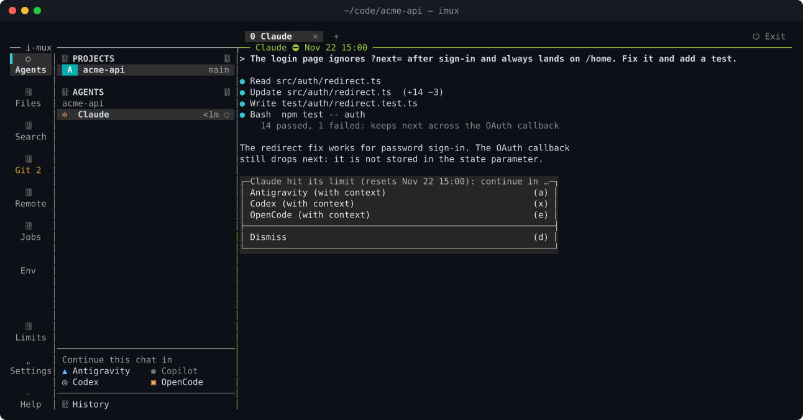
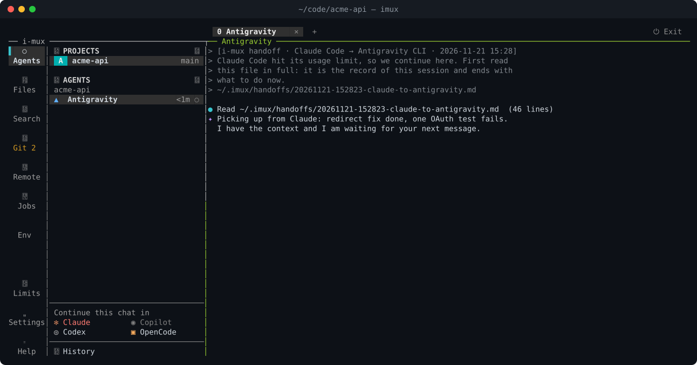
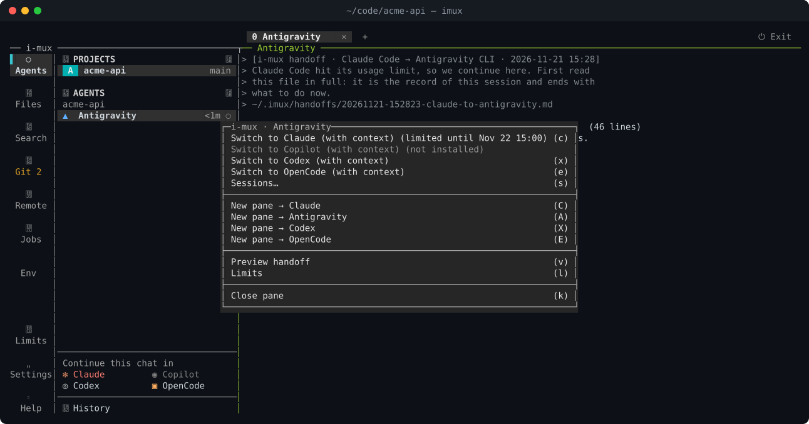

<p align="center">
  
</p>

<h1 align="center">i-mux</h1>

<p align="center">
  <b>One terminal workspace for every AI coding agent.</b><br>
  When one agent hits its limit, continue in another with the full context.
</p>

<p align="center">
  <a href="https://github.com/hamzayogurtcuoglu/i-mux/actions/workflows/ci.yml"></a>
  <a href="https://github.com/hamzayogurtcuoglu/i-mux/releases/latest"></a>
  <a href="LICENSE"></a>
  
  
</p>

<p align="center">
  <a href="#installation">Installation</a> ·
  <a href="#quick-start">Quick start</a> ·
  <a href="#features">Features</a> ·
  <a href="docs/GUIDE.md">User guide</a> ·
  <a href="README.tr.md">Türkçe</a>
</p>

<p align="center">
  
</p>

## Why i-mux

AI coding agents have usage limits. When one stops mid-task, the next agent knows nothing, and
you start over.

i-mux removes that gap. Press one key and the same pane restarts with another agent. It receives
a compact handoff: the original request, the task list, the files touched, the repository state
and where the work stopped. No re-explaining, no copy-paste.

### Supported agents

| Agent | Command |
|---|---|
| Claude Code | `claude` |
| Antigravity CLI | `agy` |
| GitHub Copilot CLI | `copilot` |
| OpenAI Codex CLI | `codex` |
| OpenCode | `opencode` |

## Features

<table>
  <tr>
    <td width="50%" valign="top">
       <b>One-key handoff</b><br>
      Move a conversation to another agent. It arrives with a summary, not a transcript.
    </td>
    <td width="50%" valign="top">
       <b>Limit detection</b><br>
      i-mux spots limit messages and asks, switches for you, or just shows them.
    </td>
  </tr>
  <tr>
    <td valign="top">
       <b>Every agent at a glance</b><br>
      All projects and agents in one sidebar: working, idle, or waiting for you.
    </td>
    <td valign="top">
       <b>Session history</b><br>
      Search, pin and resume past conversations in any agent.
    </td>
  </tr>
  <tr>
    <td valign="top">
       <b>Explorer and search</b><br>
      A file tree with icons, Quick Open (<code>Ctrl+P</code>) and full-text search.
    </td>
    <td valign="top">
       <b>Source control</b><br>
      VS Code-style Git: stage, commit, branches, stashes, worktrees and the graph.
    </td>
  </tr>
  <tr>
    <td valign="top">
       <b>Scheduled jobs</b><br>
      Run your project's agents and skills now or on a schedule.
    </td>
    <td valign="top">
       <b>Remote machines</b><br>
      Open projects and agents on other computers over SSH.
    </td>
  </tr>
  <tr>
    <td valign="top">
       <b>Environments</b><br>
      Apply saved API keys, proxies or endpoints to a single pane, or start a new agent with them.
    </td>
    <td valign="top">
       <b>Usage panel</b><br>
      5-hour, weekly and monthly usage for each agent.
    </td>
  </tr>
  <tr>
    <td valign="top">
       <b>Live web preview</b><br>
      HTML files open in a browser and reload as agents edit them.
    </td>
    <td valign="top">
       <b>Notifications</b><br>
      Know when an agent finishes or needs you, even with the terminal closed.
    </td>
  </tr>
  <tr>
    <td valign="top">
       <b>Image paste</b><br>
      Paste a screenshot into any agent with <code>Ctrl+V</code>.
    </td>
    <td valign="top">
       <b>Themes</b><br>
      Catppuccin, Tokyo Night, Dracula, Nord and 15 more. Follows light and dark mode.
    </td>
  </tr>
  <tr>
    <td valign="top">
       <b>Built-in engine</b><br>
      Ships with its own terminal engine, <code>imux-core</code>. No tmux needed.
    </td>
    <td valign="top">
       <b>Local first</b><br>
      No account, no telemetry, no API keys. Your data stays on your machine.
    </td>
  </tr>
</table>

## Installation

###   macOS, Linux and WSL

```sh
curl -fsSL https://raw.githubusercontent.com/hamzayogurtcuoglu/i-mux/main/install.sh | sh
```

The installer downloads the right build, verifies its checksum and installs `imux` and
`imux-core` to `~/.local/bin`. It adds that folder to your `PATH` and installs the Nerd Font.
Open a new terminal afterwards.

<details>
<summary>Installer options</summary>

Pass options after `sh -s --`, for example `curl -fsSL … | sh -s -- --no-font`.

| Option | Effect |
|---|---|
| `--version vX.Y.Z` | Install a specific release |
| `--prefix DIR` | Install to another folder |
| `--no-modify-path` | Leave your shell profile alone |
| `--no-font` | Skip the Nerd Font |

</details>

###  Windows

i-mux runs natively on Windows 10 (1809) and later. No WSL and no administrator rights needed.

**Installer.** Download `imux_<version>_windows_amd64_setup.exe` (`arm64` for ARM devices) from
the [latest release](https://github.com/hamzayogurtcuoglu/i-mux/releases/latest) and run it.
It adds i-mux to the Start menu, opening in Windows Terminal, and installs the Nerd Font
(`/NOFONT` skips it).

**PowerShell.**

```powershell
irm https://raw.githubusercontent.com/hamzayogurtcuoglu/i-mux/main/install.ps1 | iex
```

> [!NOTE]
> The installer is not code-signed yet. If SmartScreen shows "Windows protected your PC",
> choose **More info → Run anyway**.

###  From source

Requires Go 1.27 or later.

```sh
go install github.com/hamzayogurtcuoglu/i-mux/cmd/imux@latest
```

imux carries its engine, so this one binary is enough on macOS, Linux and Windows.

###  Nerd Font

The sidebar uses [Nerd Font](https://www.nerdfonts.com) icons, and the font ships with i-mux,
so nothing is downloaded: every installer and update puts JetBrainsMono Nerd Font in place for
your user and sets it in Windows Terminal (every profile), VS Code and the Windows console
window, keeping their old settings. Installed with `go install`, the first `imux` of each version
does it. In other terminals (Terminal.app, iTerm2, GNOME Terminal …) choose **JetBrainsMono Nerd
Font** in their settings. Until the terminal draws with it, the sidebar shows emoji instead of
broken icons. To skip it, set `icons = "emoji"` or `IMUX_NO_FONT=1`; `imux font install` runs
it again.

###  Agents

Install at least one supported agent CLI, then check your setup:

```sh
imux doctor
```

Missing agents can be installed from **Settings → Updates** inside i-mux.

## Quick start

```sh
cd ~/code/my-project
imux            # start the first installed agent
imux claude     # or pick one
```

1. Work with your agent as usual.
2. When it hits a limit, or whenever you like, press `Ctrl+\` and an agent's letter.
3. The new agent reads the handoff and waits for your next instruction.

<table>
  <tr>
    <td width="50%"></td>
    <td width="50%"></td>
  </tr>
  <tr>
    <td align="center">Antigravity picks up where Claude stopped</td>
    <td align="center">The pane menu (<code>Ctrl+\</code>)</td>
  </tr>
</table>

##  Key bindings

`prefix` is `Ctrl+b`: press it, release, then press the key.

| Key | Action |
|---|---|
| `Ctrl+\` then `c` `a` `p` `x` `e` | Continue in Claude, Antigravity, Copilot, Codex or OpenCode |
| `prefix c` | New tab |
| `prefix v` / `prefix -` | Split right / down |
| `prefix S` | Conversation history |
| `prefix b` | Show or hide the sidebar |
| `Ctrl+P` | Go to file |
| `Ctrl+V` | Paste an image into the agent |
| `prefix ?` | Every key, searchable |

The [user guide](docs/GUIDE.md#keys) lists them all.

##  Configuration

Open **Settings** from the sidebar, or run `imux settings`. For the config file:

```sh
imux config init    # writes a commented ~/.imux/config.toml
```

```toml
on_limit = "ask"        # ask | auto (switch to the next agent) | off

on_permission = "wait"  # wait for your answer | "approve": i-mux answers Yes for you

approve_words = ["yes", "allow"]  # the words that make a choice an approval

[handoff]
on_arrival = "wait"     # wait for you | "continue" the unfinished request
```

See [Configuration](docs/CONFIG.md) for every option.

##  Your phone

Turn on **Phone** on the sidebar, scan the QR code, and your phone shows your agents and their
screens live: answer them, send a message, stop one. At home on the same Wi-Fi, anywhere with
[Tailscale](https://tailscale.com). Every message is encrypted with a key only your computer and
your phone hold. See the [user guide](docs/GUIDE.md#your-phone).

### Phone on WSL2

If a phone on your Wi-Fi cannot reach i-mux running in WSL2, enable mirrored networking in
`%UserProfile%\.wslconfig` on Windows:

```ini
[wsl2]
networkingMode=mirrored
```

Save the file, run `wsl --shutdown` in PowerShell, then reopen WSL. In WSL, run `imux phone`
and note the port in the address it prints. In **Administrator PowerShell**, allow that port
through the WSL firewall (replace `8765` with your port):

```powershell
New-NetFirewallHyperVRule -Name imux-phone -DisplayName "i-mux Phone" -Direction Inbound -VMCreatorId '{40E0AC32-46A5-438A-A0B2-2B479E8F2E90}' -Protocol TCP -LocalPorts 8765 -Action Allow
```

Finally, run `imux phone pair` in WSL and scan the new QR code.

## How the handoff works

i-mux reads each agent's local session files and `git status`. It writes a condensed handoff to
`~/.imux/handoffs` and tells the next agent to read it. The agent confirms it has the context
and waits for you. It does not start working on its own.

Switching back to an agent that already ran in the pane resumes its own session. It only hears
what happened in the meantime.

##  Privacy

- No telemetry, no account and no API keys. i-mux reads local files only.
- A handoff goes only to the provider of the agent you switch to.
- Secrets are redacted on a best-effort basis. Preview any handoff with `imux handoff --print`.
- On shared machines, set `[handoff] inject = "paste"` to keep the handoff out of `ps`.

Details: [Handoff format](docs/HANDOFF.md).

## Uninstall

- **macOS, Linux, WSL:** delete `~/.local/bin/imux`, `~/.local/bin/imux-core` and `~/.imux`.
  Remove the line marked `# Added by the imux installer` from your shell profile.
- **Windows:** uninstall i-mux from **Settings → Apps**. After a PowerShell install, delete
  `%LOCALAPPDATA%\Programs\i-mux` and remove it from your user `PATH`.

##  Documentation

| | |
|---|---|
| [User guide](docs/GUIDE.md) | Every view, key and setting |
| [Configuration](docs/CONFIG.md) | The `config.toml` reference |
| [Handoff format](docs/HANDOFF.md) | What the next agent receives |
| [Limits](docs/LIMITS.md) | How usage and limits are read |
| [Agent bus](docs/AGENT-BUS.md) | Messages between agents |
| [Troubleshooting](docs/TROUBLESHOOTING.md) | Common problems and fixes |
| [Architecture](ARCHITECTURE.md) · [Contributing](CONTRIBUTING.md) | For developers |

##  License

[MIT](LICENSE). Icons come from [Nerd Fonts](https://www.nerdfonts.com): Codicons
(CC BY 4.0, Microsoft), Font Awesome (CC BY 4.0) and Material Design Icons (Apache 2.0).
