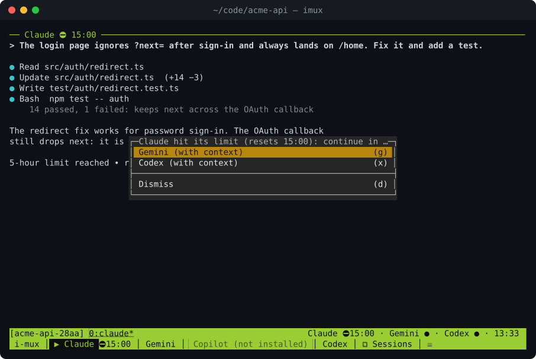
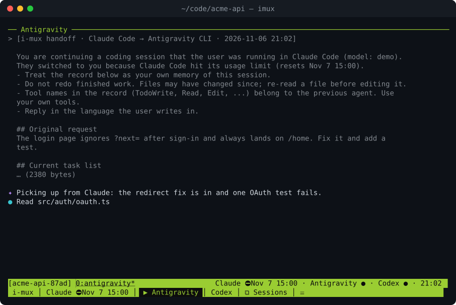
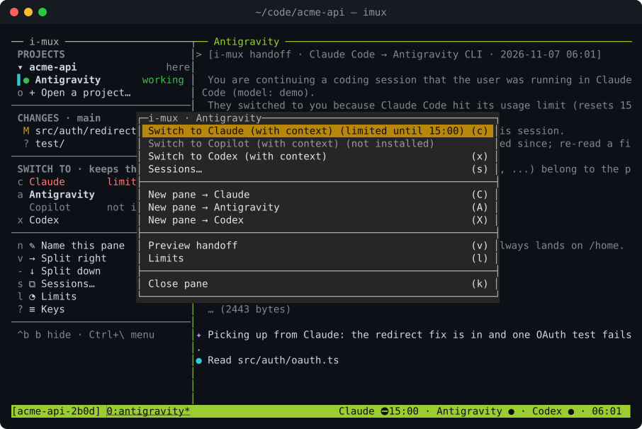

<h1 align="center">i-mux</h1>

<p align="center">
  <b>Hit your usage limit in one AI coding agent? Keep going in another, with the whole conversation.</b><br>
  Claude Code · Antigravity CLI · GitHub Copilot CLI · OpenAI Codex CLI · OpenCode
</p>

<p align="center">
  <a href="https://github.com/hamzayogurtcuoglu/i-mux/actions/workflows/ci.yml"></a>
  <a href="LICENSE"></a>
  
</p>

<p align="center">
  
</p>

i-mux runs your agent CLIs in a terminal workspace. When one hits its limit, or whenever you like,
press one key and the same pane restarts with another agent. The new agent receives a condensed
handoff: the original request, the task list, files touched, repository state and where the work
stopped. No re-explaining, no copy-paste.

It is a single binary, `imux`, built on [tmux](https://github.com/tmux/tmux) (on its own socket, so your
tmux setup is untouched). Everything stays on your machine.

## Install

One line on macOS, Linux, or Windows through WSL (open a WSL terminal):

```sh
curl -fsSL https://raw.githubusercontent.com/hamzayogurtcuoglu/i-mux/main/install.sh | sh
```

It downloads the release for your OS and CPU, verifies its checksum, installs `imux` to
`~/.local/bin`, adds that directory to your shell's PATH (zsh, bash or fish), offers to install
tmux (3.2+; 3.4+ for the clickable agent bar) if it is missing, and offers the Nerd Font the
sidebar's icons need (below). Open a new terminal afterwards. Options go after `sh -s --`, for
example `... | sh -s -- --yes` to install tmux and the font without asking, `--version v0.1.0`,
`--prefix DIR`, `--no-modify-path` or `--no-font`.

With Go 1.27+ you can also build it yourself:

```sh
go install github.com/hamzayogurtcuoglu/i-mux/cmd/imux@latest
```

Then install at least one agent CLI and check the setup. For Google's models, install
[Antigravity CLI](https://antigravity.google/docs/cli/) (`agy`):
`curl -fsSL https://antigravity.google/cli/install.sh | bash`. Google stopped serving personal
accounts in Gemini CLI on 2026-06-18, so i-mux supports Antigravity CLI instead of Gemini CLI.

```sh
imux doctor
```

To uninstall, delete `~/.local/bin/imux` and `~/.imux`, and remove the line the installer added to
your shell profile (marked `# Added by the imux installer`).

## Usage

```sh
cd ~/code/my-project
imux            # start the first installed agent (or: imux claude)
```

The rail shows the editor's icons when your terminal uses a [Nerd Font](https://www.nerdfonts.com),
emoji otherwise. **`imux font install`** (also in Settings, and offered by the installer) downloads
JetBrainsMono Nerd Font, checks it against the release's checksum, installs it for you alone (no
administrator rights) and sets Windows Terminal's and VS Code's terminal font to it, keeping their
old settings in `settings.json.imux-backup`. On WSL it does all this on the Windows side, where
the terminal draws the text. Restart the terminal afterwards; in other terminals (Terminal.app,
iTerm2, GNOME Terminal ...) pick "JetBrainsMono Nerd Font" in their settings. `imux font` shows
what is in place. A click on the open view's icon closes the panel beside the rail, as in the
editor, and gives the agent the room; a click on any view's icon opens it again. Drag the panel's
edge to make it wider or narrower: every tab takes the width, and i-mux remembers it
(`tmux.sidebar_width`).

**🔧 Config** on the rail (or `imux settings`, or `,` in the sidebar) opens Settings: AI completion
in the editor, icons, who writes commit messages, what a new agent does after a handoff, what happens
at a limit, and the config file. **Versions and updates** there (or `imux versions`) lists i-mux, tmux
and every agent CLI with its version and the command that updates it; press its letter to run it
right there. It says what an older tmux lacks and how to get a newer one on your system. **AI completion in the editor** works like Copilot in VS Code: turn it
on there and files you edit open in Neovim with GitHub's Copilot plugin (Tab accepts a suggestion,
Ctrl+S saves, Ctrl+Q quits). It installs what is missing (Neovim with Homebrew, the plugin) and signs you
in to GitHub Copilot once.

**Notifications:** when an agent finishes (after working 10 s or more) or asks you something and you
are not looking at it, a notification comes: macOS's notification center, the Linux desktop's
(`notify-send`), or, over SSH or on a server, your terminal's own (iTerm2, Ghostty, WezTerm, kitty,
GNOME Terminal …). It works with the terminal closed too. Turn it and its sound off in Settings, or set
`[notify] command` to send it anywhere (a push to your phone).

**Pasting images:** copy a screenshot (or image files in Finder / your file manager) and press
**Ctrl+V** in any agent's pane, as many times as you like: i-mux saves the image under
`~/.imux/images/` and gives the agent its path, the way a dropped file arrives (Antigravity gets
`@path`). **Alt+V** and the sidebar's 📎 do the same; use them where the terminal keeps Ctrl+V
for itself (Windows Terminal). With no image on the clipboard Ctrl+V reaches the agent as usual.
It reads the macOS clipboard, Wayland's (`wl-clipboard`), X11's (`xclip`), and from WSL the
Windows clipboard: copy on Windows, paste in WSL. Over SSH the clipboard is on the other machine,
so it cannot work there. `imux doctor` says what it uses; Settings turns it off.

**OpenCode** works with any model endpoint you set up in OpenCode (OpenAI-compatible APIs such as
NVIDIA's or Groq's free tiers, Anthropic, Ollama on your machine ...): a handy place to continue
when the others hit their limits. i-mux needs OpenCode 2: `brew install opencode` gives it. Its
install script and npm still give OpenCode 1; after them, run `opencode upgrade --major`. `imux
doctor` checks that it can run. Add a key inside OpenCode with `/connect` (pick NVIDIA or Groq,
paste the key from build.nvidia.com or console.groq.com; no account needed), then choose a model
with `/models`.

Files open in your editor: `editor` in the config, else micro (the easiest in a terminal: `brew
install micro`), `$VISUAL`, `$EDITOR`, nano, vim. The mouse wheel scrolls everywhere.

Run `imux` in your home folder and it asks which project to open: type a few letters of its name.
**Recent** projects come first and reopen as you left them: the same tabs, names and agents, each
agent back in its own conversation. After a restart, **Restore last session** brings back every
project that was open.

The **sidebar** on the left works like an editor's: a column of icons (with their names under
them) switches its view.

| Icon | View |
|---|---|
| 🤖 | **Agents:** your projects (branch, uncommitted changes) and every agent working in them, with what each one is doing: a spinner while it works, **Needs you** when it asks you something, a green dot when it finished while you were elsewhere, a ring when idle, and how long ago that changed |
| 📁 | **Files:** **Ctrl+P** (or 📄 in its title) finds a file of the project like the editor's Quick Open: type letters of its name (`sbrnd` finds `sidebar/render.go`; `name:42` opens at line 42), Enter opens it. The project's files; click a folder to open it, a file to edit it; changed files are colored. **Right-click** gives the editor's menu: New File / New Folder, Rename, Delete (to the Trash), Cut / Copy / Paste, Copy Path / Copy Relative Path, Reveal in Finder, Open in Terminal, Open to the Side, Find in Folder, Compare, Add to Agent. What the pointer is over lights up; the selected file stays marked |
| 🔍 | **Search:** every file of the project, results as you type, grouped by file (click a file or press Tab to fold); Enter opens the file at the line |
| 🔀 | **Git:** like an editor's source control: staged and unstaged changes (each file's name, then its folder in gray) with stage, unstage and discard (asks first) on each file and for all; **Commit…**, and **✨** next to it: your agent (or `git.commit_agent`, for example OpenCode with a free Groq key) writes the message from the changes, and you commit it, edit it or ask for another; pull / push / sync with ↑↓ counts; the branch menu (switch, new branch); the history. A click on a file shows the whole file with the changes highlighted, side by side when the window is wide |
| 🧩 | **Skills:** the project's `<name>/SKILL.md` skills across every agent CLI, with which of the five agents see each one (`✻▲◉◎▣`) and a `⚠` when its front matter is broken. Skills live in `.agents/skills/` and are linked into `.claude/skills/` automatically so one skill works in all five CLIs. **✨ New skill…** opens a dialog that asks who writes it (an agent in a new pane, the agent of the current pane, or you from a blank `SKILL.md`) and what it should do; the agent starts with i-mux's skill-writing guide, inspects the repo and writes it; clicking **✨** on a skill (or right-clicking it) opens its menu: Open, View, Add to Agent, Improve with Agent, Share with all agents, Delete |
| 📊 · ❓ | usage limits · every key |

| Sidebar / key | What it does |
|---|---|
| click a project · **+** next to **Projects** (or `o`) | switch to it (click the current one, or right-click any, to **close** it) · open another project: type a few letters of its name, Enter |
| right-click an agent (or click the selected one) | its menu: **Rename…** (the name stays when the chat moves to another CLI, and History lists the conversation by it) or **Close agent…** |
| click an agent · **+** next to **Agents** | go to it (in any project) · open a new agent, or a plain **Terminal**, in a pane (`prefix v` / `prefix -` for right / down) |
| click an agent under **Continue this chat in** | the active pane continues in that agent, with the conversation |
| a section title (PROJECTS, AGENTS) | fold or unfold it |
| **⧉ History** (or `prefix S`) · **◔** on the rail | earlier conversations, named ones by their name (a conversation's **Rename…** names it; continuing it gives the agent its name back) (📌 Pin or unpin…, `p`, keeps one at the top) · plan usage per window (Claude and Codex: 5-hour and weekly %; Copilot: monthly) |
| the **tab bar** at the top · its **+** (or `prefix c`) · **×** | one tab per task, with its agents and state; click to switch · a new tab with the agent you pick (`prefix ,` names a tab) · close the tab |
| close a project's last agent | the project stays open and says **No agents**: press an agent's key (or click it) there, or **+** next to AGENTS, to start one |
| `prefix b` | hide or show the sidebar |
| `Ctrl+\` (or `prefix a`), then `c` `a` `p` `x` `e` | the pane menu; continue in Claude / Antigravity / Copilot / Codex / OpenCode |

`prefix` is `Ctrl+b`: press it, release, then press the key.

<table>
  <tr>
    <td width="50%"></td>
    <td width="50%"></td>
  </tr>
  <tr>
    <td align="center">Antigravity picks up where Claude stopped</td>
    <td align="center">The pane menu (<code>Ctrl+\</code>)</td>
  </tr>
</table>

After a switch you see one short message, not the whole conversation: i-mux saves it in
`~/.imux/handoffs` and tells the new agent to read that file. The agent reads it, says in one
sentence that it has the context, and waits for you: it does not start working (or spend tokens) on
its own. Set `[handoff] deliver = "inline"` to send the whole document as the message instead,
and `[handoff] on_arrival = "continue"` to let it carry on with an unfinished request right away.

Switching back to an agent that already ran in the pane resumes its own session and tells it only
what happened in the meantime. Run `imux help` for the command line (`switch`, `split`, `ls`, `versions`,
`limits`, `sessions`, `handoff --print`).

## When an agent hits its limit

A small watcher notices limit messages on agent screens and shows them in the status bar. Choose
what happens next in `~/.imux/config.toml` (`imux config init` writes a commented one):

```toml
on_limit = "ask"   # ask (default) | auto: switch to the next agent in `order` | off: only show it
```

## Privacy

- No network calls, no telemetry, no API keys. i-mux reads the agents' local session files and
  `git status`.
- Switching sends the handoff to the next agent's provider. Secrets are redacted on a best-effort
  basis; check with `imux handoff --print`.
- The handoff is passed as a command-line argument, which other users on the machine can see with
  `ps`. On shared machines set `[handoff] inject = "paste"`.
- Details in [docs/HANDOFF.md](docs/HANDOFF.md) and [docs/AGENT-BUS.md](docs/AGENT-BUS.md).

## Documentation

[Configuration](docs/CONFIG.md) · [Handoff format](docs/HANDOFF.md) · [Limits](docs/LIMITS.md) ·
[Agent bus](docs/AGENT-BUS.md) · [Troubleshooting](docs/TROUBLESHOOTING.md) ·
[Architecture](ARCHITECTURE.md) · [Contributing](CONTRIBUTING.md) · [Türkçe](README.tr.md)

## License

[MIT](LICENSE)
