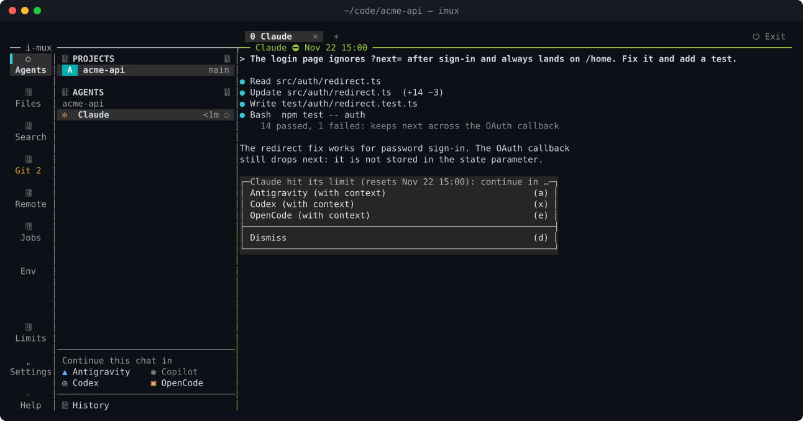
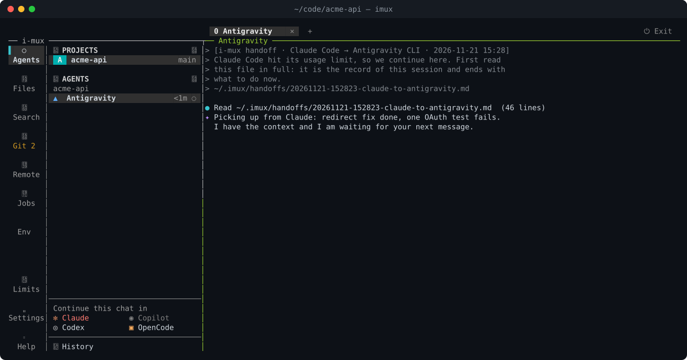
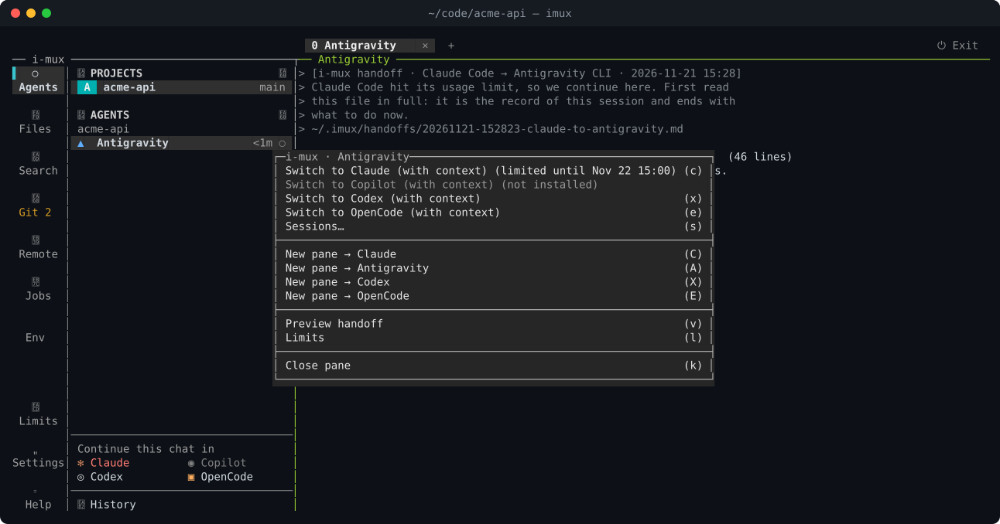

<p align="center">
  
</p>

<h1 align="center">i-mux</h1>

<p align="center">
  <b>Tüm yapay zekâ kodlama agent'ları için tek bir terminal çalışma alanı.</b><br>
  Bir agent limite takıldığında, tüm bağlamıyla başka bir agent'ta devam edin.
</p>

<p align="center">
  <a href="https://github.com/hamzayogurtcuoglu/i-mux/actions/workflows/ci.yml"></a>
  <a href="https://github.com/hamzayogurtcuoglu/i-mux/releases/latest"></a>
  <a href="LICENSE"></a>
  
  
</p>

<p align="center">
  <a href="#kurulum">Kurulum</a> ·
  <a href="#hızlı-başlangıç">Hızlı başlangıç</a> ·
  <a href="#özellikler">Özellikler</a> ·
  <a href="docs/GUIDE.md">Kullanım rehberi (İngilizce)</a> ·
  <a href="README.md">English</a>
</p>

<p align="center">
  
</p>

## Neden i-mux

Yapay zekâ kodlama agent'larının kullanım limitleri var. Biri işin ortasında durduğunda sıradaki
agent hiçbir şey bilmez ve her şeye baştan başlarsınız.

i-mux bu boşluğu kapatır. Tek tuşa basın, aynı bölme başka bir agent ile yeniden başlasın. Yeni
agent kısa bir devir belgesi alır: ilk istek, görev listesi, dokunulan dosyalar, depo durumu ve
işin kaldığı yer. Yeniden anlatmak yok, kopyala-yapıştır yok.

### Desteklenen agent'lar

| Agent | Komut |
|---|---|
| Claude Code | `claude` |
| Antigravity CLI | `agy` |
| GitHub Copilot CLI | `copilot` |
| OpenAI Codex CLI | `codex` |
| OpenCode | `opencode` |

## Özellikler

<table>
  <tr>
    <td width="50%" valign="top">
       <b>Tek tuşla devir</b><br>
      Sohbeti başka bir agent'a taşıyın. Dökümü değil, özeti gider.
    </td>
    <td width="50%" valign="top">
       <b>Limit algılama</b><br>
      i-mux limit mesajlarını yakalar; sorar, sizin yerinize geçer ya da yalnızca gösterir.
    </td>
  </tr>
  <tr>
    <td valign="top">
       <b>Tüm agent'lar tek bakışta</b><br>
      Bütün projeler ve agent'lar tek kenar panelde: çalışıyor, boşta ya da sizi bekliyor.
    </td>
    <td valign="top">
       <b>Sohbet geçmişi</b><br>
      Eski sohbetleri arayın, sabitleyin ve herhangi bir agent'ta sürdürün.
    </td>
  </tr>
  <tr>
    <td valign="top">
       <b>Gezgin ve arama</b><br>
      Simgeli dosya ağacı, Hızlı Aç (<code>Ctrl+P</code>) ve tam metin arama.
    </td>
    <td valign="top">
       <b>Kaynak denetimi</b><br>
      VS Code tarzı Git: stage, commit, dallar, stash, worktree ve grafik.
    </td>
  </tr>
  <tr>
    <td valign="top">
       <b>Zamanlanmış işler</b><br>
      Projenizin agent'larını ve skill'lerini hemen ya da bir takvimle çalıştırın.
    </td>
    <td valign="top">
       <b>Uzak makineler</b><br>
      Başka bilgisayarlardaki projeleri ve agent'ları SSH ile açın.
    </td>
  </tr>
  <tr>
    <td valign="top">
       <b>Ortamlar</b><br>
      Kayıtlı API anahtarlarını, proxy'leri ya da uç noktaları tek bir bölmeye uygulayın.
    </td>
    <td valign="top">
       <b>Kullanım paneli</b><br>
      Her agent için 5 saatlik, haftalık ve aylık kullanım.
    </td>
  </tr>
  <tr>
    <td valign="top">
       <b>Canlı web önizleme</b><br>
      HTML dosyaları tarayıcıda açılır, agent düzenledikçe yenilenir.
    </td>
    <td valign="top">
       <b>Bildirimler</b><br>
      Bir agent bitirdiğinde ya da size ihtiyaç duyduğunda haberiniz olur, terminal kapalıyken bile.
    </td>
  </tr>
  <tr>
    <td valign="top">
       <b>Görsel yapıştırma</b><br>
      Ekran görüntüsünü <code>Ctrl+V</code> ile herhangi bir agent'a yapıştırın.
    </td>
    <td valign="top">
       <b>Temalar</b><br>
      Catppuccin, Tokyo Night, Dracula, Nord ve 15 tema daha. Açık ve koyu moda uyar.
    </td>
  </tr>
  <tr>
    <td valign="top">
       <b>Yerleşik motor</b><br>
      Kendi terminal motoruyla gelir: <code>imux-core</code>. tmux gerekmez.
    </td>
    <td valign="top">
       <b>Önce yerel</b><br>
      Hesap yok, telemetri yok, API anahtarı yok. Verileriniz makinenizde kalır.
    </td>
  </tr>
</table>

## Kurulum

###   macOS, Linux ve WSL

```sh
curl -fsSL https://raw.githubusercontent.com/hamzayogurtcuoglu/i-mux/main/install.sh | sh
```

Kurulum betiği doğru sürümü indirir, sağlama toplamını doğrular ve `imux` ile `imux-core`'u
`~/.local/bin` dizinine kurar. Bu dizini `PATH`'e ekler ve Nerd Font'u kurar. Ardından yeni bir
terminal açın.

<details>
<summary>Kurulum seçenekleri</summary>

Seçenekleri `sh -s --` sonrasına yazın, örneğin `curl -fsSL … | sh -s -- --no-font`.

| Seçenek | Etkisi |
|---|---|
| `--version vX.Y.Z` | Belirli bir sürümü kurar |
| `--prefix DIR` | Başka bir dizine kurar |
| `--no-modify-path` | Kabuk profilinize dokunmaz |
| `--no-font` | Nerd Font'u atlar |

</details>

###  Windows

i-mux, Windows 10 (1809) ve sonrasında doğrudan çalışır. WSL ya da yönetici yetkisi gerekmez.

**Kurulum programı.** [Son sürümden](https://github.com/hamzayogurtcuoglu/i-mux/releases/latest)
`imux_<sürüm>_windows_amd64_setup.exe` dosyasını (ARM cihazlarda `arm64`) indirip çalıştırın.
i-mux'u Başlat menüsüne ekler; Windows Terminal'de açılır. Nerd Font'u da kurar (`/NOFONT`
atlatır).

**PowerShell.**

```powershell
irm https://raw.githubusercontent.com/hamzayogurtcuoglu/i-mux/main/install.ps1 | iex
```

> [!NOTE]
> Kurulum programı henüz kod imzalı değil. SmartScreen "Windows bilgisayarınızı korudu" derse
> **Ek bilgi → Yine de çalıştır**'ı seçin.

###  Kaynaktan

Go 1.27 ya da sonrası gerekir.

```sh
go install github.com/hamzayogurtcuoglu/i-mux/cmd/imux@latest
```

imux motorunu kendi içinde taşır; macOS, Linux ve Windows'ta bu tek dosya yeter.

###  Nerd Font

Kenar panel [Nerd Font](https://www.nerdfonts.com) simgeleri kullanır ve font i-mux'un içinde
gelir, hiçbir şey indirilmez: her kurulum ve güncelleme JetBrainsMono Nerd Font'u yalnızca sizin
kullanıcınıza kurar; Windows Terminal'de (her profilde), VS Code'da ve Windows konsol
penceresinde ayarlar, eski ayarları saklar. `go install` ile kurduysanız her sürümün ilk `imux`'u
bunu yapar. Diğer terminallerde (Terminal.app, iTerm2, GNOME Terminal …) ayarlardan
**JetBrainsMono Nerd Font**'u seçin. Terminal bu fontla çizene kadar kenar panel bozuk simge
yerine emoji gösterir. İstemezseniz `icons = "emoji"` ya da `IMUX_NO_FONT=1`; `imux font install`
yeniden çalıştırır.

###  Agent'lar

Desteklenen agent CLI'larından en az birini kurun, ardından kurulumu kontrol edin:

```sh
imux doctor
```

Eksik agent'ları i-mux içinden **Settings → Updates** ile kurabilirsiniz.

## Hızlı başlangıç

```sh
cd ~/code/projem
imux            # kurulu ilk agent'ı başlatır
imux claude     # ya da birini seçin
```

1. Agent'ınızla her zamanki gibi çalışın.
2. Limite takıldığında ya da istediğiniz an `Ctrl+\` ve bir agent'ın harfine basın.
3. Yeni agent devir belgesini okur ve bir sonraki talimatınızı bekler.

<table>
  <tr>
    <td width="50%"></td>
    <td width="50%"></td>
  </tr>
  <tr>
    <td align="center">Antigravity, Claude'un kaldığı yerden devam ediyor</td>
    <td align="center">Bölme menüsü (<code>Ctrl+\</code>)</td>
  </tr>
</table>

##  Kısayollar

`prefix`, `Ctrl+b`'dir: basın, bırakın, sonra tuşa basın.

| Tuş | İşlev |
|---|---|
| `Ctrl+\` sonra `c` `a` `p` `x` `e` | Claude, Antigravity, Copilot, Codex ya da OpenCode'da sürdür |
| `prefix c` | Yeni sekme |
| `prefix v` / `prefix -` | Sağa / aşağı böl |
| `prefix S` | Sohbet geçmişi |
| `prefix b` | Kenar paneli göster ya da gizle |
| `Ctrl+P` | Dosyaya git |
| `Ctrl+V` | Agent'a görsel yapıştır |
| `prefix ?` | Tüm tuşlar, aranabilir |

Tam liste [kullanım rehberinde](docs/GUIDE.md#keys).

##  Yapılandırma

Kenar panelden **Settings**'i açın ya da `imux settings` çalıştırın. Yapılandırma dosyası için:

```sh
imux config init    # açıklamalı bir ~/.imux/config.toml yazar
```

```toml
on_limit = "ask"        # ask | auto (sıradaki agent'a geç) | off

[handoff]
on_arrival = "wait"     # sizi bekler | "continue": yarım kalan isteğe devam eder
```

Tüm seçenekler için [Configuration](docs/CONFIG.md) belgesine bakın.

## Devir nasıl çalışır

i-mux her agent'ın yerel oturum dosyalarını ve `git status` çıktısını okur. Kısa bir devir
belgesini `~/.imux/handoffs` altına yazar ve yeni agent'a onu okumasını söyler. Agent bağlamı
aldığını söyler ve sizi bekler; kendi başına işe girişmez.

Bölmede daha önce çalışmış bir agent'a geri dönmek onun kendi oturumunu sürdürür. Agent yalnızca
aradan geçen kısmı öğrenir.

##  Gizlilik

- Telemetri, hesap ya da API anahtarı yok. i-mux yalnızca yerel dosyaları okur.
- Devir belgesi yalnızca geçtiğiniz agent'ın sağlayıcısına gider.
- Gizli bilgiler elden geldiğince maskelenir. Her devri `imux handoff --print` ile önizleyin.
- Paylaşılan makinelerde devrin `ps`'te görünmemesi için `[handoff] inject = "paste"` ayarlayın.

Ayrıntılar: [Handoff format](docs/HANDOFF.md).

## Kaldırma

- **macOS, Linux, WSL:** `~/.local/bin/imux`, `~/.local/bin/imux-core` ve `~/.imux`'u silin.
  Kabuk profilinizden `# Added by the imux installer` ile işaretli satırı kaldırın.
- **Windows:** i-mux'u **Ayarlar → Uygulamalar**'dan kaldırın. PowerShell ile kurduysanız
  `%LOCALAPPDATA%\Programs\i-mux` klasörünü silin ve kullanıcı `PATH`'inizden çıkarın.

##  Belgeler (İngilizce)

| | |
|---|---|
| [User guide](docs/GUIDE.md) | Tüm görünümler, tuşlar ve ayarlar |
| [Configuration](docs/CONFIG.md) | `config.toml` başvurusu |
| [Handoff format](docs/HANDOFF.md) | Yeni agent'a ne gider |
| [Limits](docs/LIMITS.md) | Kullanım ve limitler nasıl okunur |
| [Agent bus](docs/AGENT-BUS.md) | Agent'lar arası mesajlar |
| [Troubleshooting](docs/TROUBLESHOOTING.md) | Sık sorunlar ve çözümleri |
| [Architecture](ARCHITECTURE.md) · [Contributing](CONTRIBUTING.md) | Geliştiriciler için |

##  Lisans

[MIT](LICENSE). Simgeler [Nerd Fonts](https://www.nerdfonts.com)'tan alınmıştır: Codicons
(CC BY 4.0, Microsoft), Font Awesome (CC BY 4.0) ve Material Design Icons (Apache 2.0).
