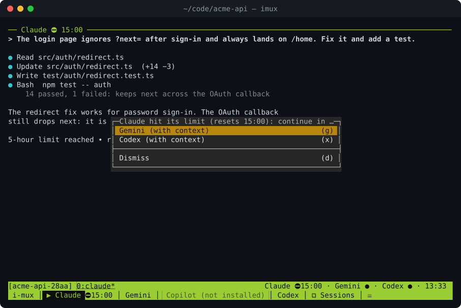
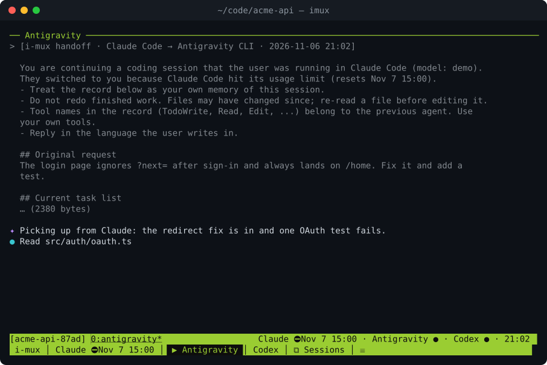
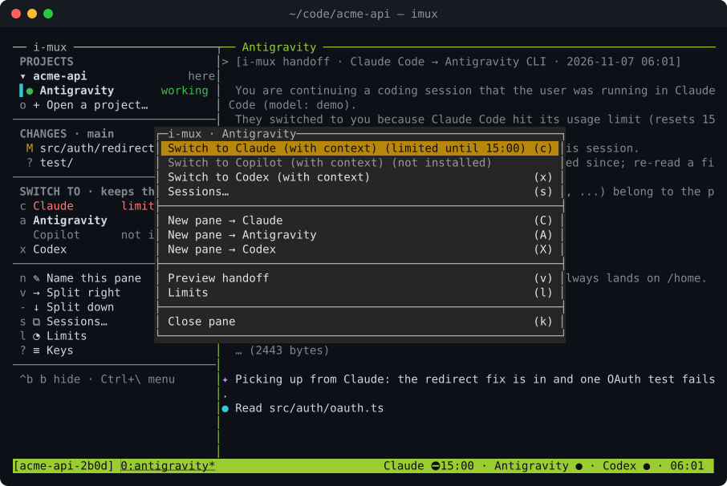

<h1 align="center">ajan</h1>

<p align="center">
  <b>Bir yapay zekâ kodlama ajanında kullanım limitine mi takıldınız? Sohbetin tamamıyla başka bir ajanda devam edin.</b><br>
  Claude Code · Gemini CLI · GitHub Copilot CLI · OpenAI Codex CLI
</p>

<p align="center">
  
</p>

ajan, ajan CLI'larınızı bir terminal çalışma alanında çalıştırır. Biri limite takıldığında ya da
siz istediğinizde tek tuşa basarsınız; aynı bölme başka bir ajanla yeniden başlar. Yeni ajan
özetlenmiş bir devir belgesi alır: ilk istek, görev listesi, dokunulan dosyalar, depo durumu ve
işin kaldığı yer. Yeniden anlatmak ya da kopyalayıp yapıştırmak yok.

[tmux](https://github.com/tmux/tmux) üzerinde çalışan tek bir programdır (kendi soketinde; sizin
tmux ayarlarınıza dokunmaz). Her şey makinenizde kalır.

## Kurulum

macOS, Linux ya da WSL ile Windows. tmux 3.2+ gerekir (tıklanabilir ajan çubuğu için 3.4+).

```sh
brew install hamzayogurtcuoglu/tap/ajan
```

```sh
curl -fsSL https://raw.githubusercontent.com/hamzayogurtcuoglu/i-mux/main/install.sh | sh
```

```sh
go install github.com/hamzayogurtcuoglu/i-mux/cmd/ajan@latest   # Go 1.27+
```

Kurulum betiği sağlama toplamını doğrular, `~/.local/bin` dizinine kurar ve tmux eksikse kurmayı
önerir. Sonra en az bir ajan CLI'ı kurun ve kurulumu denetleyin:

```sh
ajan doctor
```

## Kullanım

```sh
cd ~/code/projem
ajan            # kurulu ilk ajanı başlatır (ya da: ajan claude)
```

| Tuş / eylem | Ne yapar |
|---|---|
| `Ctrl+\` | bölme menüsü: ajan değiştir, oturumlar, yeni bölme, devir belgesi, limitler |
| `Ctrl+\` sonra `c` `g` `p` `x` | Claude / Gemini / Copilot / Codex'te sürdür |
| alttaki çubukta bir ajana tıklamak | o ajanda sürdür |
| `prefix S` | projenin önceki sohbetlerinden birini seç |
| `prefix a` | bölme menüsü (terminal `Ctrl+\` tuşunu kendine ayırıyorsa) |

<table>
  <tr>
    <td width="50%"></td>
    <td width="50%"></td>
  </tr>
  <tr>
    <td align="center">Gemini, Claude'un kaldığı yerden devam ediyor</td>
    <td align="center">Bölme menüsü (<code>Ctrl+\</code>)</td>
  </tr>
</table>

Bölmede daha önce çalışmış bir ajana geri dönmek, o ajanın kendi oturumunu sürdürür ve ona yalnızca
aradaki gelişmeleri anlatır. Komut satırı için `ajan help` (`switch`, `split`, `ls`, `limits`,
`sessions`, `handoff --print`).

Arayüz dili `LANG` / `AJAN_LANG` ya da yapılandırmadaki `locale = "tr"` ile seçilir; ajanlara giden
devir belgesi her zaman İngilizcedir.

## Bir ajan limite takıldığında

Küçük bir izleyici ajan ekranlarındaki limit mesajlarını fark eder ve durum çubuğunda gösterir.
Sonrasında ne olacağını `~/.ajan/config.toml` içinde seçin (`ajan config init` açıklamalı bir dosya
yazar):

```toml
on_limit = "ask"   # ask (varsayılan) | auto: `order` içindeki sıradaki ajana geç | off: yalnızca göster
```

## Gizlilik

- Ağ bağlantısı, telemetri ya da API anahtarı yok. ajan ajanların yerel oturum dosyalarını ve
  `git status` çıktısını okur.
- Geçiş, devir belgesini sonraki ajanın sağlayıcısına gönderir. Gizli bilgiler elden geldiğince
  çıkarılır; `ajan handoff --print` ile kontrol edin.
- Devir belgesi komut satırı argümanı olarak verilir; makinedeki diğer kullanıcılar onu `ps` ile
  görebilir. Paylaşılan makinelerde `[handoff] inject = "paste"` ayarlayın.
- Ayrıntılar: [docs/HANDOFF.md](docs/HANDOFF.md) ve [docs/AGENT-BUS.md](docs/AGENT-BUS.md).

## Belgeler (İngilizce)

[Yapılandırma](docs/CONFIG.md) · [Devir belgesi](docs/HANDOFF.md) · [Limitler](docs/LIMITS.md) ·
[Ajan veri yolu](docs/AGENT-BUS.md) · [Sorun giderme](docs/TROUBLESHOOTING.md) ·
[Mimari](ARCHITECTURE.md) · [Katkı](CONTRIBUTING.md) · [English](README.md)

## Lisans

[MIT](LICENSE)
